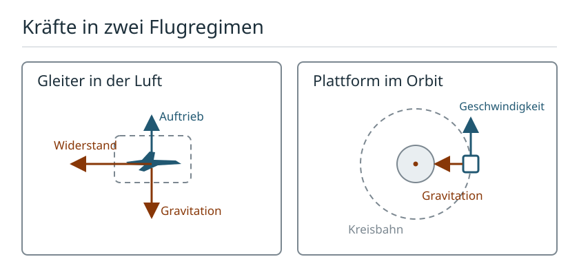

# M1-L1 – Systemgrenzen und Flugregime {#L1}

**Kursbereich:** M1 – Gemeinsame Methoden und Modelle

**Studienrolle** · Kern/Grundlagen

**Vorwissen** · Schulphysik und elementare Mathematik

**Lernziel** · Geeignete Systemgrenzen und Referenzsysteme für Atmosphärenflug und Raumflug bestimmen

## Zwei Beobachtungen, zwei Modelle {#S1}

Ein Gleiter sinkt nach dem Ausklinken langsam zur Landefläche. Eine zivile Beobachtungsplattform bleibt in großer Höhe viele Stunden unterwegs, obwohl ihr Antrieb im betrachteten Abschnitt ruht. Beide ändern ihre Bewegung unter äußeren Kräften. Die richtige Erklärung beginnt mit der Wahl des Systems, der Umgebung und eines Bezugssystems, in dem Position und Geschwindigkeit eindeutig beschrieben sind.

## Systemgrenze und Referenzsystem {#S2}

Die **Systemgrenze** umschließt das Objekt, dessen Bewegung wir vorhersagen wollen. Schließen wir den Gleiter einschließlich seiner Insassen ein, gehört die Luft zur Umgebung. Druck und Reibung an der Oberfläche ergeben zusammen die aerodynamische Kraft. Auftrieb steht senkrecht zur ungestörten Relativströmung, Widerstand liegt parallel zur Strömungsrichtung um das Fahrzeug. Gravitation zieht das System annähernd zur Erdmitte. Luftgeschwindigkeit und Geschwindigkeit über Grund können sich durch den Wind unterscheiden. Für den Schwerpunkt kann der Boden bei einer kurzen, örtlich begrenzten Betrachtung als annähernd inertiales Referenzsystem dienen.

Für die Plattform betrachten wir den Schwerpunkt im erdzentrierten, annähernd nicht mitrotierenden Bezugssystem. Auf einer idealisierten Umlaufbahn fällt sie fortwährend, da die Gravitation ihre Geschwindigkeit umlenkt. Die tangentiale Bewegungsrichtung und die nach innen gerichtete Beschleunigung sind im Kreisbahnmodell senkrecht zueinander. Kräfte im Vakuum sind möglich. Eine hinreichend dünne Atmosphäre erlaubt in einer ersten Rechnung häufig, Widerstand zu vernachlässigen.

Eine Systemgrenze ist eine Rechenentscheidung. Eine andere Grenze, etwa nur um eine einzelne Steuerfläche, führt zu anderen äußeren Wechselwirkungen. Die dazu passenden Gleichungen, Kräfte und Messgrößen müssen gemeinsam neu festgelegt werden.

{alt="Beim Gleiter stehen Auftrieb und Widerstand quer beziehungsweise parallel zur Relativströmung. In der Kreisbahn steht die Geschwindigkeit senkrecht zur Gravitation."}

## Zwei Messprotokolle lesen {#S3}

Für den Gleiter seien die lokale Ost-Richtung und die Summe zweier Geschwindigkeiten gegeben. Bezüglich der Luft bewegt sich der Gleiter mit $20\,\mathrm{m/s}$ ostwärts. Die Luftmasse bewegt sich gegenüber dem Boden mit $5\,\mathrm{m/s}$ westwärts. In Ost-Richtung gilt daher $v_\mathrm{Gleiter/Boden}=20-5=15\,\mathrm{m/s}$. In einer Aero-Kraftgleichung wäre die Fluggeschwindigkeit relativ zur Luft von $20\,\mathrm{m/s}$ maßgeblich. Der Geländeüberflug folgt aus $15\,\mathrm{m/s}$ über Grund.

Beim Bahnpunkt der Plattform ist die Geschwindigkeit tangential und die Erdbeschleunigung radial nach innen. Das Skalarprodukt von Geschwindigkeit und Beschleunigung ist in diesem Augenblick null. Das bedeutet eine lokale Richtungsänderung bei unverändertem Geschwindigkeitsbetrag. Erst die zusätzlichen Annahmen über Gravitation, Anfangszustand und ausbleibende Störkräfte begründen eine dauerhaft idealisierte Kreisbahn.

## Selbstkontrolle {#S4}

1. Ein Gleiter hat $18\,\mathrm{m/s}$ ostwärts relativ zur Luft. Die Luft strömt gegenüber dem Boden mit $4\,\mathrm{m/s}$ ostwärts. Welche Geschwindigkeit benutzt du für den Geländeüberflug und welche für die aerodynamische Kraft?
2. Eine Bahnzeichnung zeigt Geschwindigkeit und Beschleunigung senkrecht zueinander. Welche Aussage folgt unmittelbar und welche zusätzliche Information brauchst du für die Behauptung einer Kreisbahn?

::: {.lc-solutions data-lc-section="S4"}
1. Über Grund sind es $18+4=22\,\mathrm{m/s}$ ostwärts. Für die aerodynamische Rechnung sind die $18\,\mathrm{m/s}$ relativ zur Luft relevant.
2. Der Geschwindigkeitsbetrag ändert sich in diesem Augenblick nicht. Für eine Kreisbahn muss die Beschleunigung auch über den weiteren Bewegungsverlauf radial zur selben Mitte zeigen und den Betrag $v^2/r$ haben, während $r$ konstant bleibt. Eine isolierte Momentaufnahme genügt dafür nicht.
:::

## Annahmen und Grenzen {#S5}

Beim Gleiter behandeln wir den Wind als gleichförmig und die lokale Erdoberfläche als eben. Böen, seitlicher Wind und vertikale Strömung brauchen die vollständige Vektorrechnung. Beim Raumfahrtmodell können Restatmosphäre, nicht kugelsymmetrische Gravitation oder weitere Körper die Bewegung ändern. Die Systembeschreibungen reichen für den Vergleich der Modellpfade und lassen reale Flugbetriebsdaten offen.

## Zusammenfassung {#S6}

Systemgrenze, Bezugssystem und relative Messgröße bestimmen, wie Kräfte und Bewegung in einer Bilanz zusammengehören. Die Wahl dieser Größen steht vor dem Rechnen mit Kraft, Impuls und Energie.

**Weiterlesen** · [M1-L2 – Kräfte-, Impuls- und Energiebilanzen](M1-L2.md)

## Quellen (extern) {#S7}

- [NASA Glenn – Airplane Cruise – Balanced Forces](https://www1.grc.nasa.gov/beginners-guide-to-aeronautics/airplane-cruise-balanced-forces/) · Four Forces; Relative Velocity · Fachgrundlage · Zuletzt abgerufen: 2026-11-23
- [NASA Science – Basics of Space Flight – Chapter 3](https://science.nasa.gov/learn/basics-of-space-flight/chapter3-3/) · Acceleration in Orbit; Kepler’s Laws · Fachgrundlage · Zuletzt abgerufen: 2026-11-23
