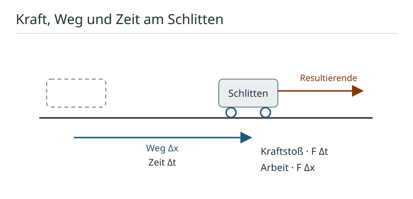

# M1-L2 – Kräfte-, Impuls- und Energiebilanzen {#L2}

**Kursbereich:** M1 – Gemeinsame Methoden und Modelle

**Studienrolle** · Kern/Grundlagen

**Vorwissen** · [M1-L1 – Systemgrenzen und Flugregime](M1-L1.md)

**Lernziel** · Kraftresultierende, Impulsänderung, Arbeit und Leistung mit SI-Einheiten berechnen

## Dieselbe Bewegung aus zwei Blickwinkeln {#S1}

Auf einer ebenen Schiene wird ein Wagen aus fast reibungsarmen Rollen durch einen Kraftsensor gezogen. Die Messwerte geben Kraft und Weg an. Ein anderes Protokoll misst Kraft und Zeit. Wie lässt sich prüfen, ob beide Beschreibungen der geänderten Bewegung zusammenpassen?

## Kraft, Impuls, Arbeit und Leistung {#S2}

Für ein System mit konstanter Masse im Inertialsystem gilt $\sum F_x=\mathrm{d}p_x/\mathrm{d}t$ mit $p_x=mv_x$. Positive Kräfte zeigen in die definierte $+x$-Richtung. Der Kraftstoß ist das Zeitintegral der resultierenden Kraft. Für eine konstante Resultierende ist $\Delta p_x=F_\mathrm{res}\Delta t$. Die Einheit $\mathrm{N\,s}$ ist dieselbe wie $\mathrm{kg\,m/s}$.

Arbeit berücksichtigt Kraft **entlang des Wegs**. Bei konstanter Kraft in Bewegungsrichtung gilt $W=F_\mathrm{res}\Delta x$. Die Summe der Arbeiten ergibt im Punktmassenmodell die Änderung von $E_\mathrm{kin}=mv^2/2$. Leistung ist Arbeit pro Zeit, im betrachteten Fall momentan $P=F_\mathrm{res}v$ und im Mittel $\overline P=W/\Delta t$. Newtonsekunde, Joule und Watt zählen physikalisch verschiedene Größen. Ein Joule ist eine Newtonmeter Arbeit, ein Watt ein Joule je Sekunde.

{alt="Ein Schlitten fährt bei konstanter Resultierenden entlang einer Schiene. Der Kraftstoß verwendet die Dauer, die Arbeit die Strecke."}

## Ein Laborschlitten beschleunigt {#S3}

Ein Schlitten der Masse $3\,\mathrm{kg}$ startet aus der Ruhe. Auf ihn wirkt $2\,\mathrm{s}$ lang eine resultierende Kraft von $6\,\mathrm{N}$ entlang der Schiene. Die positive $x$-Richtung zeigt mit der Kraft. Aus dem Kraftstoß folgt $\Delta p_x=6\cdot 2=12\,\mathrm{kg\,m/s}$ und damit $v_x=12/3=4\,\mathrm{m/s}$.

Die Beschleunigung ist $a_x=6/3=2\,\mathrm{m/s^2}$. Aus konstanter Beschleunigung folgt $\Delta x=a_x(\Delta t)^2/2=4\,\mathrm{m}$. Die entlang der Strecke verrichtete Arbeit beträgt $6\cdot4=24\,\mathrm J$. Die Gegenprobe liefert $\Delta E_\mathrm{kin}=3\cdot 4^2/2=24\,\mathrm J$. Die mittlere Leistung ist $12\,\mathrm W$. Die momentane Leistung am Ende ist $24\,\mathrm W$, weil die Kraft konstant und die Geschwindigkeit von null auf $4\,\mathrm{m/s}$ gestiegen ist.

## Selbstkontrolle {#S4}

1. Ein Schlitten mit $3\,\mathrm{kg}$ fährt mit $4\,\mathrm{m/s}$ in positiver Richtung. Eine resultierende Kraft von $-3\,\mathrm N$ wirkt $2\,\mathrm s$ lang. Bestimme Endgeschwindigkeit und Änderung der kinetischen Energie.
2. Ein Wagen mit $2\,\mathrm{kg}$ startet aus der Ruhe und erfährt $4\,\mathrm N$ Resultierende über $1\,\mathrm s$. Bestimme zurückgelegten Weg und mittlere Leistung.

::: {.lc-solutions data-lc-section="S4"}
1. $\Delta p_x=-6\,\mathrm{kg\,m/s}$, also $\Delta v_x=-2\,\mathrm{m/s}$ und $v_x=2\,\mathrm{m/s}$. Die kinetische Energie ändert sich um $3(2^2-4^2)/2=-18\,\mathrm J$. Direkte Gegenprobe mit $\Delta x=6\,\mathrm m$ und $W=-3\cdot6=-18\,\mathrm J$.
2. $a_x=2\,\mathrm{m/s^2}$ und $\Delta x=1\,\mathrm m$. $W=4\,\mathrm J$ über eine Sekunde ergibt $\overline P=4\,\mathrm W$.
:::

## Annahmen und Grenzen {#S5}

Die Strecke ist eben und geradlinig. Der Wagen wird als Punktmasse modelliert. Bei berücksichtigter Radrotation oder verformbaren Verbindungen muss die Energiebilanz um weitere Anteile erweitert werden. Für eine veränderliche Kraft sind die Integrale über Zeit oder Weg zu verwenden. Bei Massenstrom durch eine Systemgrenze, etwa im Antriebskontext, sind Impuls- und Energieflüsse zusätzlich zu berücksichtigen.

## Zusammenfassung {#S6}

Kraftstoß und Arbeit liefern zwei unabhängige Prüfwege für dieselbe Bewegung. Saubere Einheiten und Vorzeichen machen Widersprüche sichtbar.

**Weiterlesen** · [M1-L3 – Ähnlichkeit, Messfehler und Modellgrenzen](M1-L3.md)

## Quellen (extern) {#S7}

- [OpenStax – University Physics Volume 1 – Impulse and Collisions](https://openstax.org/books/university-physics-volume-1/pages/9-2-impulse-and-collisions) · § 9.2, Impulse-Momentum Theorem · Fachgrundlage · Zuletzt abgerufen: 2026-11-23
- [OpenStax – University Physics Volume 1 – Work-Energy Theorem](https://openstax.org/books/university-physics-volume-1/pages/7-3-work-energy-theorem) · § 7.3, Work-Energy Theorem · Fachgrundlage · Zuletzt abgerufen: 2026-11-23
