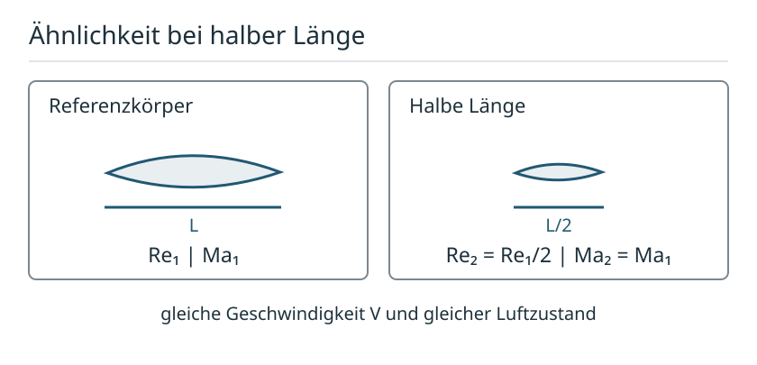

# M1-L3 – Ähnlichkeit, Messfehler und Modellgrenzen {#L3}

**Kursbereich:** M1 – Gemeinsame Methoden und Modelle

**Studienrolle** · Kern/Grundlagen

**Vorwissen** · [M1-L2 – Kräfte-, Impuls- und Energiebilanzen](M1-L2.md)

**Lernziel** · Reynolds- und Mach-Zahl sowie Unsicherheiten für ein Lehrmodell einordnen

## Ein kleineres Modell im Windkanal {#S1}

In einem Lehrversuch wird ein Probekörper mit halber Referenzlänge untersucht. Luft und Geschwindigkeit bleiben gleich. Reicht es, die Kräfte mit der kleineren Fläche zu skalieren? Manche Kraftbeiwerte bleiben zwischen den Modellen erst vergleichbar, wenn die für die Strömung entscheidenden dimensionslosen Kennzahlen hinreichend übereinstimmen.

## Zwei Kennzahlen, zwei Fragen {#S2}

Für die Reynolds-Zahl gilt $\mathrm{Re}=\rho VL/\mu$. Sie vergleicht Trägheit und Viskosität. $\rho$ ist die Dichte in $\mathrm{kg/m^3}$, $V$ der Betrag der Relativgeschwindigkeit in $\mathrm{m/s}$, $L$ eine ausdrücklich festgelegte Referenzlänge in $\mathrm m$ und $\mu$ die dynamische Viskosität in $\mathrm{Pa\,s}$. Der Zähler hat dieselbe Einheit wie $\mu$, also ist $\mathrm{Re}$ dimensionslos.

Die Mach-Zahl $\mathrm{Ma}=V/a$ vergleicht die Geschwindigkeit mit der lokalen Schallgeschwindigkeit $a$. Auch dieses Verhältnis ist dimensionslos. Das Re-Verhältnis ändert sich bei gleicher Geschwindigkeit mit der Länge. Das Ma-Verhältnis ändert sich bei gleicher Luft und Geschwindigkeit durch die Länge allein nicht. Beide Kennzahlen beantworten damit unterschiedliche Fragen.

Messwerte werden mit der Messmethode und ihrer Auflösung bzw. Unsicherheit berichtet. Eine absolute Unsicherheit hat dieselbe Einheit wie der Messwert. Die relative Unsicherheit ergibt sich durch Division durch den jeweiligen Bezugswert. Ein Wert mit Messunsicherheit sagt noch nichts über den deterministischen Modellfehler beim Wechsel des Strömungsregimes aus.

{alt="Zwei Probekörper mit Längen L und L/2 haben bei gleicher Strömung dieselbe Mach-Zahl. Der kleinere hat die halbe Reynolds-Zahl."}

## Modellmaßstab und Messunsicherheit {#S3}

Im frei gewählten Lehrzustand seien $\rho=1{,}20\,\mathrm{kg/m^3}$, $\mu=1{,}80\times10^{-5}\,\mathrm{Pa\,s}$, $a=340\,\mathrm{m/s}$ und $V=20\,\mathrm{m/s}$. Für $L=0{,}60\,\mathrm m$ folgt $\mathrm{Re}=8{,}0\times10^5$ und $\mathrm{Ma}\approx0{,}059$. Das halb so lange Modell hat bei gleichen übrigen Werten $\mathrm{Re}=4{,}0\times10^5$ und dieselbe Mach-Zahl. Der Vergleich von Kraftbeiwerten muss also die Abweichung der Reynolds-Zahl berücksichtigen.

Liegt bei $V=20\,\mathrm{m/s}$ eine absolute Unsicherheit von $0{,}20\,\mathrm{m/s}$ vor, beträgt ihr relativer Anteil $1\,\%$. Bei festgehaltenen anderen Größen übernimmt $\mathrm{Re}$ diesen relativen Beitrag. Der Unterschied um den Faktor zwei zwischen großem und kleinem Modell ist weit größer als dieser Einzelbeitrag.

## Selbstkontrolle {#S4}

1. Auf welchen Wert steigt die Mach-Zahl, wenn das halb so lange Modell zur Wiederherstellung von $\mathrm{Re}$ mit $40\,\mathrm{m/s}$ bei derselben Luft untersucht wird?
2. Bei $V=25\,\mathrm{m/s}$ beträgt die absolute Geschwindigkeitsunsicherheit $0{,}5\,\mathrm{m/s}$. Wie groß ist der relative Beitrag zu $\mathrm{Ma}$, wenn $a$ festgehalten wird?

::: {.lc-solutions data-lc-section="S4"}
1. $\mathrm{Ma}=40/340\approx0{,}118$. Die Reynolds-Zahl steigt wieder auf $8{,}0\times10^5$, während die Mach-Zahl gegenüber dem ursprünglichen Lehrzustand verdoppelt ist.
2. Der Beitrag beträgt $0{,}5/25=0{,}02$, also $2\,\%$. Wegen der linearen Abhängigkeit übernimmt $\mathrm{Ma}$ bei festem $a$ denselben relativen Beitrag.
:::

## Annahmen und Grenzen {#S5}

Die Lehrrechnung hält Luftzustand und Geometrie bis auf den Maßstab konstant. Rauheit, Turbulenzgrad, Wandnähe, Anstellwinkel und Messketteneffekte können den Vergleich ebenfalls beeinflussen. Der gerechnete Einzelbeitrag ist kein vollständiges Unsicherheitsbudget. Für weitere unabhängige oder korrelierte Beiträge ist ihre Herkunft und statistische Behandlung zu prüfen.

## Zusammenfassung {#S6}

Eine Maßstabsrechnung braucht zur Modellübertragung die relevanten Kennzahlen, dokumentierte Messbedingungen und eine klar benannte Unsicherheit.

**Weiterlesen** · [M2-L1 – Atmosphäre und dynamischer Druck](M2-L1.md)

## Quellen (extern) {#S7}

- [NASA Glenn – Similarity Parameters](https://www1.grc.nasa.gov/beginners-guide-to-aeronautics/similarity-parameters/) · Reynolds Number; Mach Number · Fachgrundlage · Zuletzt abgerufen: 2026-11-23
- [NIST – NIST Technical Note 1297 – 7. Reporting Uncertainty](https://www.nist.gov/pml/nist-technical-note-1297/nist-tn-1297-7-reporting-uncertainty) · §§ 7.1–7.2 · Fachgrundlage · Zuletzt abgerufen: 2026-11-23
