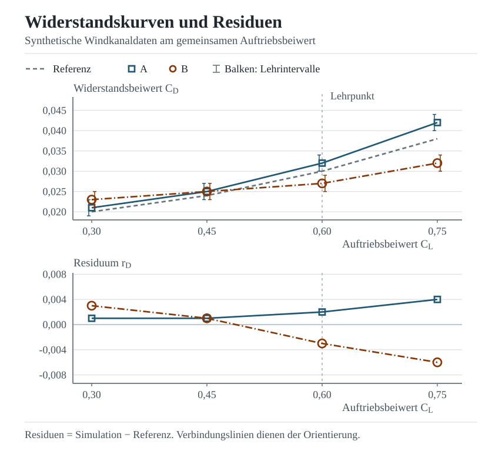

# M10-L1 – Luftfahrtprofil – Messdaten und Modellvergleich {#L1}

**Kursbereich:** M10 – Wahlprofile Luftfahrt und Raumfahrt

**Studienrolle** · Bachelor-Wahlprofil

**Vorwissen** · [M2-L4 – Kompressibilität und Windkanalübertragung](M2-L4.md); [M3-L4 – Flugleistung und Energiehöhe](M3-L4.md); [M5-L3 – Ermüdung, Inspektion und Evidenz](M5-L3.md); [M9-L1 – Verifikation, Validierung und Qualifikation](M9-L1.md)

**Lernziel** · Zivile Windkanal- und Flugleistungsbelege für eine Vorentscheidung zusammenführen

## Welche Variante kommt in die nächste Prüfung? {#S1}

Eine Arbeitsgruppe vergleicht zwei Konzepte für ein ziviles Forschungsflugzeug. Für beide liegen simulierte Windkanaldaten vor. Variante A erzeugt bei kleinem Auftrieb den geringeren Widerstand. Die Vorentscheidung fällt jedoch bei dem Auftriebsbeiwert, den beide Konzepte für dieselbe Lehrmission erreichen müssen. Gesucht ist die Variante, für die sich eine vertiefte Modellprüfung zuerst lohnt.

## Widerstandskurven und Residuen {#S2}

Beide Datensätze verwenden dieselbe Bezugsfläche $S$, denselben dynamischen Druck $q$ und die gleiche Definition von $C_L$ und $C_D$. Wir vergleichen bei festem $C_L$, um ein gleiches Auftriebsziel zu untersuchen. Die gemeinsame Modellkurve ist eine synthetische Referenz für den Vergleich. Das Residuum $r_D=C_{D,\mathrm{sim}}-C_{D,\mathrm{ref}}$ gibt an, wie weit der jeweilige simulierte Wert über oder unter der Referenz liegt. Ein positives Residuum bedeutet, dass die Referenz den simulierten Widerstand unterschätzt.

| $C_L$ | $C_{D,\mathrm{ref}}$ | $C_{D,A}$ | $C_{D,B}$ |
|---|---:|---:|---:|
| $0{,}30$ | $0{,}020$ | $0{,}021$ | $0{,}023$ |
| $0{,}45$ | $0{,}024$ | $0{,}025$ | $0{,}025$ |
| $0{,}60$ | $0{,}030$ | $0{,}032$ | $0{,}027$ |
| $0{,}75$ | $0{,}038$ | $0{,}042$ | $0{,}032$ |

Für A und B verwenden wir je Punkt ein vorgegebenes Lehrintervall von $\pm 0{,}002$. Es veranschaulicht Streuung. Eine reale Unsicherheitsangabe erfordert zusätzlich die Angabe des Ermittlungsverfahrens und bei erweiterter Unsicherheit den Deckungsfaktor.

{alt="Oben Widerstandsbeiwerte von A, B und Referenz mit Lehrintervallen. Unten Residuen. Bei Auftriebsbeiwert 0,60 hat B den kleineren Widerstandsbeiwert."}

## Entscheidung am Lehrpunkt {#S3}

Bei $C_L=0{,}60$ lautet das Residuum für A $+0{,}002$ und für B $-0{,}003$. Das Intervall für A reicht von $0{,}030$ bis $0{,}034$, das für B von $0{,}025$ bis $0{,}029$. Die Intervalle überlappen sich an diesem Lehrpunkt nicht.

Mit $q=500\,\mathrm{Pa}$ und $S=10\,\mathrm{m^2}$ gilt $L=qSC_L=3\,000\,\mathrm{N}$ für beide. Für den Widerstand $D=qSC_D$ folgen $160\,\mathrm{N}$ bei A und $135\,\mathrm{N}$ bei B. Bei gleicher Relativgeschwindigkeit $V=30\,\mathrm{m/s}$ beträgt die zum Ausgleich dieses Widerstands nötige Vortriebsleistung $P_D=DV$. Sie liegt für A bei $4{,}80\,\mathrm{kW}$ und für B bei $4{,}05\,\mathrm{kW}$. B hat am Lehrpunkt einen rechnerischen Vorteil von $0{,}75\,\mathrm{kW}$. Die Arbeitsgruppe prüft B vertieft und erhebt einen zusätzlichen Datensatz mit dokumentierter Wiederholbarkeit am relevanten Auftriebspunkt.

## Selbstkontrolle {#S4}

1. Berechne die beiden Residuen bei $C_L=0{,}75$. Welche Tendenz zeigt die Referenz für jede Variante an diesem Punkt?
2. Prüfe bei $C_L=0{,}30$, ob sich anhand der Lehrintervalle eine ebenso klare Entscheidung wie bei $C_L=0{,}60$ treffen lässt.

::: {.lc-solutions data-lc-section="S4"}
1. Für A gilt $0{,}042-0{,}038=+0{,}004$. Die Referenz unterschätzt A. Für B gilt $0{,}032-0{,}038=-0{,}006$. Die Referenz überschätzt B.
2. Für A beträgt das Intervall $[0{,}019;0{,}023]$, für B $[0{,}021;0{,}025]$. Sie überlappen sich. A hat den kleineren Zentralwert, die Daten trennen die Varianten hier weniger klar.
:::

## Welche Änderungen können die Rangfolge verschieben? {#S5}

Die Zahlen sind synthetisch und gelten für die gezeigten Punkte. Beim Übertragen eines Windkanalvergleichs können Unterschiede in Reynolds- und Mach-Zahl, Übergang der Grenzschicht und Versuchsaufbau die Widerstandskurve verschieben. Die Rechnung $DV$ erfasst die Widerstandsleistung des Lehrmodells. Die für ein reales Flugzeug nötige Antriebsleistung hängt unter anderem von zusätzlichen Widerstandsbeiträgen und Wirkungsgraden ab. Eine Leistungsangabe für eine vollständige Mission braucht außerdem mehrere Zustände.

## Zusammenfassung {#S6}

Der Vergleich hat einen festgelegten Betriebspunkt, ein gemeinsames Bezugsmodell und ausgewiesene Streuung. Der Leistungsvorteil begründet eine nächste Prüfung. Welche Daten dafür neu zu erheben sind, ergibt sich aus der größten verbleibenden Unsicherheit.

**Weiterlesen** · [M10-L2 – Raumfahrtprofil – Missionsvergleich und Nachweisplan](M10-L2.md)

## Quellen (extern) {#S7}

- [NASA Glenn – Lift Equation](https://www1.grc.nasa.gov/beginners-guide-to-aeronautics/lift-equation/) · Lift Coefficient; Flow Conditions; Density · Fachgrundlage · Zuletzt abgerufen: 2026-11-23
- [NASA Glenn – Drag Equation](https://www1.grc.nasa.gov/beginners-guide-to-aeronautics/drag-equation/) · Drag Coefficient; Reference Area · Fachgrundlage · Zuletzt abgerufen: 2026-11-23
- [NASA Glenn – Similarity Parameters](https://www1.grc.nasa.gov/beginners-guide-to-aeronautics/similarity-parameters/) · Reynolds Number; Mach Number · Fachgrundlage · Zuletzt abgerufen: 2026-11-23
- [NIST – NIST Technical Note 1297 – 7. Reporting Uncertainty](https://www.nist.gov/pml/nist-technical-note-1297/nist-tn-1297-7-reporting-uncertainty) · §§ 7.1–7.2 · Fachgrundlage · Zuletzt abgerufen: 2026-11-23
