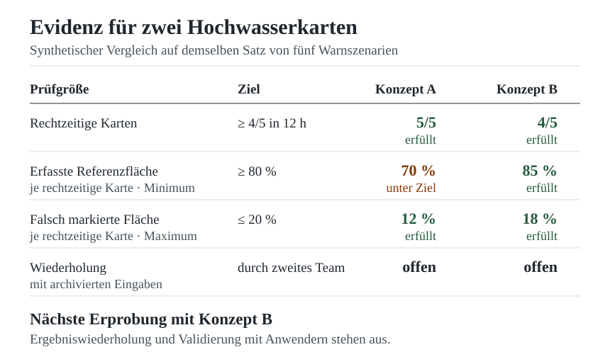

# M10-L2 – Raumfahrtprofil – Missionsvergleich und Nachweisplan {#L2}

**Kursbereich:** M10 – Wahlprofile Luftfahrt und Raumfahrt

**Studienrolle** · Bachelor-Wahlprofil

**Vorwissen** · [M6-L4 – Missionsziele, Bahnwahl und Modellabweichungen](M6-L4.md); [M7-L3 – Lage, Bahn und Umwelteinflüsse](M7-L3.md); [M8-L4 – Anforderungen, Schnittstellen und Rückverfolgbarkeit](M8-L4.md); [M9-L1 – Verifikation, Validierung und Qualifikation](M9-L1.md)

**Lernziel** · Zwei zivile Missionskonzepte nach qualitativen Annahmen vergleichen und einen Nachweisplan formulieren

## Zwei Konzepte für eine Hochwasserkarte {#S1}

Ein ziviler Hochwasserdienst möchte bei einer Warnung eine Karte neu überfluteter Flächen erhalten. Konzept A nutzt häufiger verfügbare, räumlich gröbere Beobachtungen. Konzept B setzt auf seltener verfügbare, räumlich feinere Beobachtungen. Welche Variante soll in eine erweiterte Erprobung mit unabhängigen Lehrdaten gehen?

## Anforderungen in beobachtbare Kriterien übersetzen {#S2}

Die Gruppe vergleicht beide Konzepte anhand derselben fünf synthetischen Warnszenarien. Die Uhr beginnt mit dem protokollierten Warnzeitpunkt. Als rechtzeitig gilt eine Karte, die innerhalb von $12\,\mathrm{h}$ mit Zeitstempel bereitsteht. Die Gruppe legt drei Anforderungen fest:

1. In mindestens vier der fünf Szenarien geht eine Karte rechtzeitig ein.
2. Jede rechtzeitige Karte erfasst mindestens $80\,\%$ der unabhängig markierten Überflutungsfläche. Höchstens $20\,\%$ der in der Karte als überflutet ausgewiesenen Fläche dürfen außerhalb der Referenz liegen.
3. Ein zweites Team kann das Ergebnis anhand festgehaltener Eingaben, Versionen und Auswertungsschritte wiederholen.

Für Kriterium 2 bezeichnet $I$ die Schnittfläche von Kartenmarkierung und Referenz, $R$ die Referenzfläche und $K$ die in der Karte markierte Fläche, jeweils in $\mathrm{km^2}$. Die erfasste Referenzfläche als Anteil ist $I/R$. Der Anteil falscher Markierungen an der Kartenmarkierung ist $(K-I)/K$. Beide Größen sind dimensionslos und werden für denselben Auswertebereich bestimmt. Die Szenarien setzen $R>0$ voraus. Liefert ein Konzept eine leere Karte, ist die Abdeckung null und das Kriterium verfehlt. Eine vom Modell wegen Wolken ausgelassene, in der Referenz überflutete Fläche senkt die Abdeckung.

{alt="Die Nachweismatrix vergleicht rechtzeitige Karten, Mindestabdeckung, falsche Markierungen und Wiederholbarkeit. B besteht die ersten beiden Anforderungen, die Wiederholung steht aus."}

## Begründete Vorentscheidung und Nachweisplan {#S3}

| Beobachtung im Lehrdatensatz | Konzept A | Konzept B |
|---|---:|---:|
| Rechtzeitige Karten | $5/5$ | $4/5$ |
| Kleinster Anteil erfasster Referenzfläche | $70\,\%$ | $85\,\%$ |
| Größter Anteil falscher Markierungen | $12\,\%$ | $18\,\%$ |
| Wiederholung durch zweites Team | offen | offen |

Die beiden Extremwerte können aus unterschiedlichen Karten stammen. A liefert öfter rechtzeitig, unterschreitet aber die Mindestabdeckung. B erfüllt in diesem Datensatz die ersten beiden Anforderungen. Wir wählen B für die nächste Erprobung und lassen die Wiederholbarkeit ausdrücklich offen.

Zur Verifikation sichert das Team für jedes Szenario Zeitprotokoll, Referenzmaske, Ergebnisdatei und Versionsstand. Ein zweites Team wertet die gespeicherten Eingaben erneut aus. Die Gruppe erweitert den Datensatz danach um andere Bewölkung und Flächenformen. In einem getrennten Validierungsschritt prüfen Mitarbeitende des Hochwasserdienstes anhand eines fiktiven Einsatzablaufs, ob die Darstellung dringende Nachfragen und unkartierte Gebiete erkennen lässt.

## Selbstkontrolle {#S4}

1. Eine rechtzeitige Karte hat $R=50\,\mathrm{km^2}$, $K=45\,\mathrm{km^2}$ und $I=42\,\mathrm{km^2}$. Erfüllt sie die beiden Flächenkriterien?
2. In einer Wiederholung ist B nur in drei von fünf Szenarien rechtzeitig. Die rechtzeitigen Karten erfüllen weiterhin die Flächenkriterien. Welche Folgerung ergibt sich für die Vorentscheidung?

::: {.lc-solutions data-lc-section="S4"}
1. $42/50=0{,}84$, also $84\,\%$ Abdeckung. $(45-42)/45\approx 0{,}067$, also ungefähr $6{,}7\,\%$ falsche Markierungen. Beide Grenzen sind erfüllt.
2. Die neue Stichprobe erfüllt die Zeitgrenze nicht. B bleibt eine offene Variante. Das Team untersucht den verspäteten Datenzugang und wiederholt den Vergleich mit besser abgedeckten Szenarien. Höhere Flächengüte gleicht die Zeitverletzung nicht aus.
:::

## Annahmen und Grenzen {#S5}

Fünf synthetische Fälle erlauben einen Verfahrensvergleich und liefern keine Einsatzstatistik. Fehler in der Referenzmaske, geänderte Bewölkung oder verspätete Eingaben können die Bewertung verschieben. Die Fallstudie betrachtet die Datenleistung auf Produktebene. Konkrete Bahnen, Instrumente und Betriebsabläufe werden für diese Entscheidung nicht vorausgesetzt.

## Zusammenfassung {#S6}

Eine zivile Missionswahl braucht prüfbare Kriterien, nachvollziehbare Evidenz und einen Plan für offene Nachweise. Ein Vorteil bei einem Kriterium reicht nur dann für die Vorentscheidung, wenn die übrigen Mindestanforderungen im betrachteten Datensatz erfüllt sind oder die Prüfung ausdrücklich offen bleibt.

**Weiterlesen** · [Studienweg](pages/studienweg.md)

## Quellen (extern) {#S7}

- [NASA Science – Basics of Space Flight – Chapter 7](https://science.nasa.gov/learn/basics-of-space-flight/chapter7-1/) · Chapter Objectives; Conceptual Study · Fachgrundlage · Zuletzt abgerufen: 2026-11-23
- [NASA – NASA Systems Engineering Handbook – 5.3 Product Verification](https://www.nasa.gov/reference/5-3-product-verification/) · § 5.3, Process Description · Fachgrundlage · Zuletzt abgerufen: 2026-11-23
- [NASA – NASA Systems Engineering Handbook – 5.4 Product Validation](https://www.nasa.gov/reference/5-4-product-validation/) · § 5.4, Process Description · Fachgrundlage · Zuletzt abgerufen: 2026-11-23
