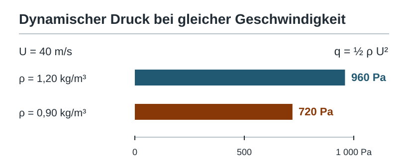

# M2-L1 – Atmosphäre und dynamischer Druck {#L1}

**Kursbereich:** M2 – Atmosphäre und Aerodynamik

**Studienrolle** · Kern/Grundlagen

**Vorwissen** · [M1-L2 – Kräfte-, Impuls- und Energiebilanzen](M1-L2.md); [M1-L3 – Ähnlichkeit, Messfehler und Modellgrenzen](M1-L3.md)

**Lernziel** · Dichte und Relativgeschwindigkeit im dynamischen Druck richtig verwenden

## Einstieg {#S1}

Ein ziviles Forschungsflugzeug erfasst über einer Küstenregion Messdaten. Ein Team vergleicht zwei Datenausschnitte mit derselben Geschwindigkeit relativ zur Luft. Obwohl beide Ausschnitte gleich schnell erscheinen, wirkt auf eine gleich ausgerichtete Messfläche eine unterschiedliche aerodynamische Kraft. Wie viel davon lässt sich bereits durch die unterschiedliche Luftdichte erklären?

## Begriffe und Modell {#S2}

Die Dichte $\rho=m/V$ gibt die Masse $m$ pro Volumen $V$ an. Im SI-System hat sie die Einheit $\mathrm{kg/m^3}$. Sie beschreibt eine lokale Eigenschaft der Luft. Bei gleichem statischem Druck hat wärmere trockene Luft eine geringere Dichte. In der Atmosphäre ändern sich Druck und Temperatur häufig zugleich, weshalb man die Dichte für den betrachteten Zustand ansetzt.

Die Geschwindigkeit über Grund $\mathbf v_\mathrm{G}$, die Windgeschwindigkeit relativ zum Boden $\mathbf v_\mathrm{Wind}$ und die Fluggeschwindigkeit relativ zur Luft sind Vektoren. Ihre Beziehung ist $\mathbf v_\mathrm{rel}=\mathbf v_\mathrm{G}-\mathbf v_\mathrm{Wind}$. In den dynamischen Druck geht der Betrag $U=|\mathbf v_\mathrm{rel}|$ ein:

$$
q=\tfrac12 \rho U^2.
$$

Die Einheit $\mathrm{kg/(m\,s^2)}$ entspricht $\mathrm{N/m^2}$ und damit Pascal. $q$ entspricht der kinetischen Energie pro Volumen im Bezugssystem des Fahrzeugs. Der statische Druck $p$ ist eine Zustandsgröße der Luft. Entlang einer Stromlinie in stationärer, inkompressibler, reibungsarmer Strömung und bei vernachlässigbarem Höhenunterschied gilt $p+q=\text{konstant}$. Am zugehörigen Staupunkt ist $U=0$. Unter diesen Annahmen beträgt der Unterschied zwischen Stau- und statischem Druck der ungestörten Strömung gerade $q$.

{alt="Zwei Balken zeigen 960 und 720 Pascal bei gleicher Geschwindigkeit und unterschiedlicher Luftdichte."}

## Durchgerechnetes Beispiel {#S3}

Für zwei synthetische Messzustände sei $U=40\,\mathrm{m/s}$. Mit $\rho_A=1{,}20\,\mathrm{kg/m^3}$ ergibt sich $q_A=\tfrac12\cdot 1{,}20\cdot40^2\,\mathrm{Pa}=960\,\mathrm{Pa}$. Bei $\rho_B=0{,}90\,\mathrm{kg/m^3}$ erhält man $q_B=720\,\mathrm{Pa}$. Der Quotient ist $q_B/q_A=0{,}75$, weil $U$ konstant bleibt. Sind Bezugsfläche und Beiwert unverändert, sinkt die dazu proportionale Kraft ebenfalls um 25 Prozent. Ob der Beiwert bei veränderter Dichte tatsächlich gleich bleibt, muss separat geprüft werden.

## Selbstkontrolle {#S4}

### Aufgaben

1. Berechne $q$ bei einer Dichte von $1{,}20\,\mathrm{kg/m^3}$ für $U=30\,\mathrm{m/s}$ und $U=60\,\mathrm{m/s}$. Wie verändert sich $q$?
2. Ein Flugzeug bewegt sich mit $50\,\mathrm{m/s}$ nach Osten über Grund. Wind der Stärke $10\,\mathrm{m/s}$ weht einmal nach Westen und einmal nach Osten. Welches $U$ setzt du jeweils ein?

::: {.lc-solutions data-lc-section="S4"}

### Lösungen

1. $q(30)=540\,\mathrm{Pa}$ und $q(60)=2\,160\,\mathrm{Pa}$. Die Verdopplung der Geschwindigkeit vervierfacht $q$.
2. Osten sei positiv. Bei Westbewegung der Luft ist $v_\mathrm{Wind}=-10\,\mathrm{m/s}$ und $U=60\,\mathrm{m/s}$. Bei Ostbewegung der Luft ist $v_\mathrm{Wind}=+10\,\mathrm{m/s}$ und $U=40\,\mathrm{m/s}$.

:::

## Annahmen und Grenzen {#S5}

Die Beispiele setzen je Zustand eine gleichförmige ungestörte Anströmung voraus. Bei räumlich veränderlichem Wind kann ein einzelner Geschwindigkeitswert die Anströmung einer ganzen Fläche schlecht beschreiben. In kompressibler Strömung lässt sich $q=\rho U^2/2$ weiterhin als Bezugsgröße definieren. Die einfache Gleichsetzung mit einer gemessenen Stau-Statik-Druckdifferenz benötigt dagegen die zuvor genannten Modellannahmen.

## Zusammenfassung {#S6}

Die Dichte geht linear und die Luftrelativgeschwindigkeit quadratisch in $q$ ein. Mit Bezugsfläche und dimensionslosem Beiwert wird daraus eine aerodynamische Kraft.

**Weiterlesen** · [M2-L2 – Auftrieb, Widerstand und Beiwerte](M2-L2.md)

## Quellen (extern) {#S7}

- [NASA Glenn – Lift Equation](https://www1.grc.nasa.gov/beginners-guide-to-aeronautics/lift-equation/) · Lift Coefficient; Flow Conditions; Density · Fachgrundlage · Zuletzt abgerufen: 2026-11-23
- [NASA Glenn – Bernoulli’s Equation](https://www1.grc.nasa.gov/beginners-guide-to-aeronautics/bernoullis-equation-1/) · Introductory equation; Derivation of General Equations · Fachgrundlage · Zuletzt abgerufen: 2026-11-23
- [NASA Glenn – Airplane Cruise – Balanced Forces](https://www1.grc.nasa.gov/beginners-guide-to-aeronautics/airplane-cruise-balanced-forces/) · Four Forces; Relative Velocity · Fachgrundlage · Zuletzt abgerufen: 2026-11-23
