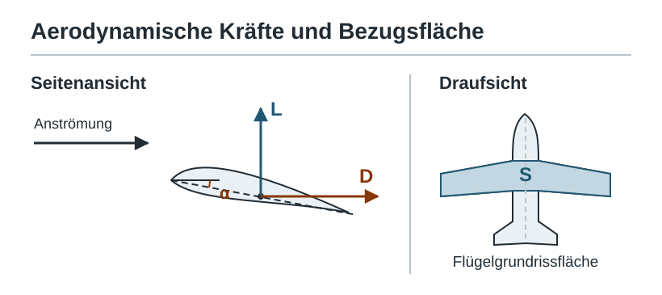

# M2-L2 – Auftrieb, Widerstand und Beiwerte {#L2}

**Kursbereich:** M2 – Atmosphäre und Aerodynamik

**Studienrolle** · Kern/Grundlagen

**Vorwissen** · [M2-L1 – Atmosphäre und dynamischer Druck](M2-L1.md)

**Lernziel** · Aerodynamische Kräfte aus konsistenten Bezugsgrößen und gegebenen Beiwerten bestimmen

## Einstieg {#S1}

Ein ziviles Windkanallabor erhält zwei Sätze von Kraftbeiwerten für dasselbe Versuchsmodell. Im ersten Datensatz bezieht sich der Widerstandsbeiwert auf die Flügelgrundrissfläche, im zweiten auf die Stirnfläche des Modells. Die Zahlen unterscheiden sich stark. Welche Angaben braucht das Labor, um zu entscheiden, ob sich auch die wirkenden Kräfte unterscheiden?

## Begriffe und Modell {#S2}

Die Windachsen beziehen sich auf die Fluggeschwindigkeit relativ zur ungestörten Luft, $\mathbf v_\mathrm{rel}$. Der positive Widerstand $D$ wirkt gegen diese Geschwindigkeit. Der Auftrieb $L$ liegt senkrecht dazu in der vertikalen Längsebene, die im hier betrachteten aufrechten und symmetrischen Fall zugleich die Symmetrieebene des Flugzeugs ist. In der Grafik zeigt der Pfeil für die Anströmung in die Gegenrichtung zu $\mathbf v_\mathrm{rel}$. Der Widerstand zeigt in diese Anströmrichtung, der Auftrieb senkrecht dazu. Bei seitlicher Anströmung kommt eine Seitenkraftkomponente hinzu.

Die Größen $L$ und $D$ sind Anteile derselben aerodynamischen Kraft. Mithilfe des dynamischen Drucks $q$ in Pascal und einer festgelegten Referenzfläche $S$ in Quadratmetern lassen sich beide darstellen:

$$
L=qSC_L,\qquad D=qSC_D.
$$

$C_L$ und $C_D$ sind dimensionslos, weil $qS$ bereits in Newton gemessen wird. Im Flugzeugkontext dient als gemeinsame Referenz oft die Flügelgrundrissfläche. Bei anderen Körpern kann eine Stirnfläche verwendet werden. Jeder Beiwert wird mit der Fläche seines Datensatzes multipliziert. Die Beiwerte hängen unter anderem vom Anstellwinkel $\alpha$, von der Geometrie und vom Strömungszustand ab. Die Profiltiefe und die Spannweite bestimmen die Flügelgrundrissfläche mit. Der Anstellwinkel wird in der Skizze zwischen der Profilsehne und der Linie der ungestörten Anströmung eingezeichnet.

{alt="Auftrieb senkrecht und Widerstand parallel zur Anströmung, daneben die markierte Flügelgrundrissfläche."}

## Durchgerechnetes Beispiel {#S3}

Setze $q=750\,\mathrm{Pa}$, $S=16\,\mathrm{m^2}$, $C_L=0{,}60$ und $C_D=0{,}050$. Das ergibt $qS=12\,000\,\mathrm N$ und damit $L=7\,200\,\mathrm N$ und $D=600\,\mathrm N$. Das Verhältnis $L/D=12$ ergibt sich hier auch aus $C_L/C_D$, weil beide Beiwerte dieselbe Fläche benutzen.

Ein anderer Bericht benutzt für denselben Widerstand die Stirnfläche $S_\mathrm f=2\,\mathrm{m^2}$. Der entsprechende Beiwert ist $600/(750\cdot 2)=0{,}40$. Die Beiwertzahl ist achtmal so groß, die gemessene Kraft beträgt weiterhin $600\,\mathrm N$.

## Selbstkontrolle {#S4}

### Aufgaben

1. Berechne $L$ und $D$ für $q=500\,\mathrm{Pa}$, $S=4\,\mathrm{m^2}$, $C_L=0{,}50$ und $C_D=0{,}080$.
2. Ein Widerstandsbeiwert $0{,}10$ bezieht sich auf $3\,\mathrm{m^2}$. Welcher Beiwert liefert mit der doppelten Bezugsfläche dieselbe Kraft bei gleichem $q$?

::: {.lc-solutions data-lc-section="S4"}

### Lösungen

1. $qS=2\,000\,\mathrm N$, also $L=1\,000\,\mathrm N$ und $D=160\,\mathrm N$.
2. Die Erhaltung des Produkts $SC_D$ verlangt $C_{D,\mathrm{neu}}=0{,}050$. Die Bezugsfläche ist $6\,\mathrm{m^2}$.

:::

## Annahmen und Grenzen {#S5}

Ein Tabellenwert gilt für die dokumentierte Modellform, den Anstellwinkel und die jeweiligen Strömungsbedingungen. Schon eine Änderung von Oberflächenrauheit oder Mach- und Reynolds-Zahl kann die Übertragung einschränken. $L/D$ beschreibt hier nur das Verhältnis der aerodynamischen Kraftkomponenten unter den gewählten Bedingungen. Aussagen über Reichweite oder Steigleistung erfordern weitere Größen, etwa Masse und Antriebsleistung.

## Zusammenfassung {#S6}

Druck- und Flächenskala lassen sich von den dimensionslosen Beiwerten trennen. Wie sich die Beiwerte bei veränderter Anströmung verhalten, wird anhand der Grenzschicht und möglicher Ablösung genauer untersucht.

**Weiterlesen** · [M2-L3 – Grenzschicht, Ablösung und Strömungsabriss](M2-L3.md)

## Quellen (extern) {#S7}

- [NASA Glenn – Lift Equation](https://www1.grc.nasa.gov/beginners-guide-to-aeronautics/lift-equation/) · Lift Coefficient; Flow Conditions; Density · Fachgrundlage · Zuletzt abgerufen: 2026-11-23
- [NASA Glenn – Drag Equation](https://www1.grc.nasa.gov/beginners-guide-to-aeronautics/drag-equation/) · Drag Coefficient; Reference Area · Fachgrundlage · Zuletzt abgerufen: 2026-11-23
- [FH Aachen – Tragflügelaerodynamik und Flugleistungen](https://www.campus.fh-aachen.de/campus/all/module.asp?fmodulecode=65101) · Detailinformationen > Lernziele/Inhalt/Voraussetzungen · Curricularer Bezug · Zuletzt abgerufen: 2026-11-23
