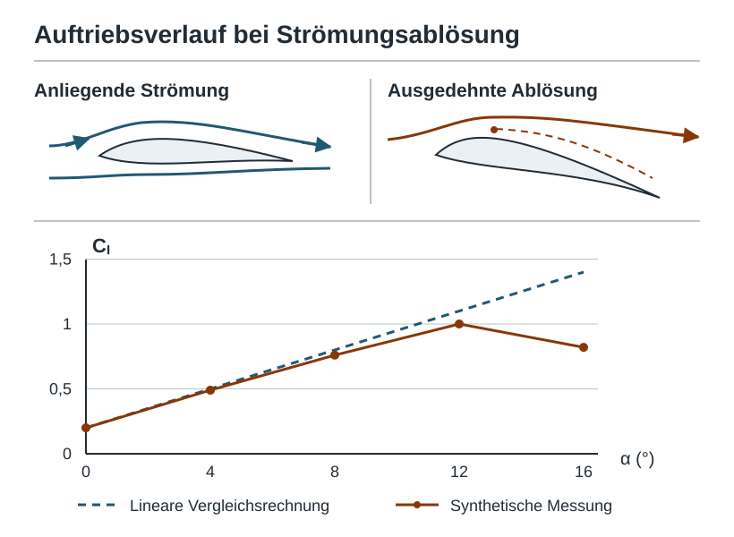

# M2-L3 – Grenzschicht, Ablösung und Strömungsabriss {#L3}

**Kursbereich:** M2 – Atmosphäre und Aerodynamik

**Studienrolle** · Kern/Grundlagen

**Vorwissen** · [M1-L3 – Ähnlichkeit, Messfehler und Modellgrenzen](M1-L3.md); [M2-L2 – Auftrieb, Widerstand und Beiwerte](M2-L2.md)

**Lernziel** · Ablösung und Strömungsabriss anhand einer Messreihe qualitativ und quantitativ deuten

## Einstieg {#S1}

Ein Hochschullabor prüft ein Flügelmodell für ein ziviles Umweltmessprojekt. Die Forschenden vergrößern im Windkanal schrittweise den Anstellwinkel. Zunächst nimmt der gemessene Auftrieb fast gleichmäßig zu. Beim letzten Messpunkt fällt er deutlich. Was zeigt der Kraftverlauf über die Strömung, und welche zusätzliche Beobachtung wäre nötig, um den Ort der Ablösung zu bestimmen?

## Begriffe und Modell {#S2}

An einer ruhenden Profiloberfläche besitzt die Luft im Modell wegen der Haftbedingung dieselbe Geschwindigkeit wie die Oberfläche, also null im Modellbezugssystem. In der Grenzschicht ändert sich die wandparallele Geschwindigkeit über einen vergleichsweise kleinen Wandabstand stark. Jenseits davon nähert sie sich der lokalen Außenströmung an. Die Grenzschicht kann laminar oder turbulent sein. Beides ist mit anliegender Strömung vereinbar.

Ein Druckanstieg in Strömungsrichtung bremst die wandnahe Luft. Bei hinreichend starkem Druckanstieg kann sich die Strömung von der Oberfläche ablösen. Ein großflächiger Verlust der anliegenden Strömung am Flügel kann den Auftriebsanstieg beenden und den Auftriebsbeiwert $C_L$ bei weiter wachsendem Anstellwinkel $\alpha$ verringern. Dieser Zustand ist mit einem Strömungsabriss vereinbar. Eine kleine örtliche Ablösezone kann schon unterhalb des Auftriebsmaximums auftreten. Die Zuordnung von Ablösegebiet und Gesamtauftrieb erfordert daher sowohl lokale Strömungsbeobachtung als auch Kraftmessung.

{alt="Skizzen zeigen anliegende und abgelöste Strömung. Unter ihnen erreicht der gemessene Auftriebsbeiwert bei zwölf Grad sein diskretes Maximum."}

## Durchgerechnetes Beispiel {#S3}

Die Versuchsdaten sind synthetisch. Referenzfläche und dynamischer Druck bleiben bei $S=0{,}50\,\mathrm{m^2}$ und $q=500\,\mathrm{Pa}$.

| $\alpha$ in Grad | 0 | 4 | 8 | 12 | 16 |
|---|---:|---:|---:|---:|---:|
| Lineare Vergleichsrechnung für anliegende Strömung | 0,20 | 0,50 | 0,80 | 1,10 | 1,40 |
| $C_L$ der synthetischen Kraftmessung | 0,20 | 0,49 | 0,76 | 1,00 | 0,82 |

Die lineare Vergleichsrechnung extrapoliert $C_L=0{,}20+0{,}075\,\alpha$ mit $\alpha$ als Zahlenwert in Grad. Die Messreihe bleibt nach dem ersten Punkt darunter und erreicht bei $12^\circ$ den größten erfassten Wert. Von $12^\circ$ auf $16^\circ$ fällt die Kraft von $250\,\mathrm N$ auf $205\,\mathrm N$, da $L=qSC_L$. Der Rückgang um $45\,\mathrm N$ stützt hier die Hypothese ausgedehnter Ablösung. Eine zeitgleich aufgezeichnete Strömungsvisualisierung könnte sie prüfen.

## Selbstkontrolle {#S4}

### Aufgaben

1. Berechne die mittlere Steigung $\Delta C_L/\Delta\alpha$ in den Intervallen $4^\circ$ bis $8^\circ$ und $8^\circ$ bis $12^\circ$.
2. Reichen die Punkte bei $12^\circ$ und $16^\circ$, um den genauen Anstellwinkel des größten Auftriebs und den Ort der Ablösung anzugeben?

::: {.lc-solutions data-lc-section="S4"}

### Lösungen

1. Die Steigungen betragen $0{,}0675$ pro Grad und $0{,}060$ pro Grad. Der Zuwachs je Grad wird kleiner.
2. $12^\circ$ liefert das diskrete Messmaximum. Für das kontinuierliche Maximum sind engere Winkelschritte oder ein überprüftes Modell nötig. Der Ort der Ablösung verlangt lokale Beobachtungen, etwa im Windkanal mittels geeigneter Strömungsvisualisierung.

:::

## Annahmen und Grenzen {#S5}

Geometrie, Oberflächenzustand und Anströmbedingungen sind für den Vergleich festgelegt. In einem beschleunigten oder rasch gedrehten Modell kann der Verlauf vom quasistationären Experiment abweichen. Wandnähe im Windkanal, Oberflächenrauheit und Versuchsskalierung können das beobachtete Maximum verschieben. Die Zahlen beschreiben nur das vorliegende Lehrbeispiel.

## Zusammenfassung {#S6}

Ablösung verändert die aerodynamischen Kräfte. Eine Auftriebskurve zeigt den integrierten Effekt, lokale Beobachtungen ordnen ihn der Strömung am Flügel zu. Für die Übertragung zwischen Modellen ist der Strömungszustand getrennt abzugleichen.

**Weiterlesen** · [M2-L4 – Kompressibilität und Windkanalübertragung](M2-L4.md)

## Quellen (extern) {#S7}

- [NASA Glenn – Boundary Layer](https://www1.grc.nasa.gov/beginners-guide-to-aeronautics/boundary-layer/) · Velocity Boundary Layer; flow separation discussion · Fachgrundlage · Zuletzt abgerufen: 2026-11-23
- [NASA Glenn – Lift Equation](https://www1.grc.nasa.gov/beginners-guide-to-aeronautics/lift-equation/) · Lift Coefficient; Flow Conditions; Density · Fachgrundlage · Zuletzt abgerufen: 2026-11-23
- [FH Aachen – Tragflügelaerodynamik und Flugleistungen](https://www.campus.fh-aachen.de/campus/all/module.asp?fmodulecode=65101) · Detailinformationen > Lernziele/Inhalt/Voraussetzungen · Curricularer Bezug · Zuletzt abgerufen: 2026-11-23
