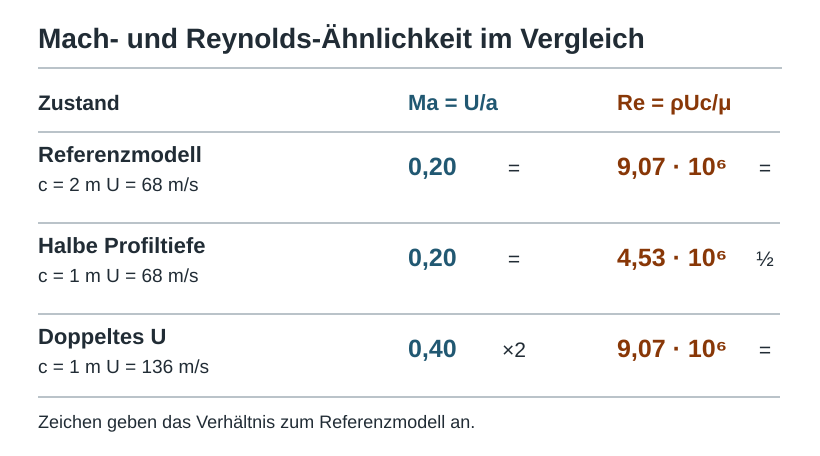

# M2-L4 – Kompressibilität und Windkanalübertragung {#L4}

**Kursbereich:** M2 – Atmosphäre und Aerodynamik

**Studienrolle** · Kern/Grundlagen

**Vorwissen** · [M1-L3 – Ähnlichkeit, Messfehler und Modellgrenzen](M1-L3.md); [M2-L3 – Grenzschicht, Ablösung und Strömungsabriss](M2-L3.md)

**Lernziel** · Mach- und Reynolds-Ähnlichkeit als getrennte Bedingungen anwenden

## Einstieg {#S1}

Ein Windkanalteam verwendet ein Modell mit halber Profiltiefe für ein ziviles Forschungsflugzeug. Die Lufttemperatur und die Anströmgeschwindigkeit sollen den Bedingungen des größeren Modells entsprechen. Damit bleibt eine Ähnlichkeitskennzahl gleich, während sich eine andere ändert. Welche Folgen hat das für die Übertragung von Beiwerten?

## Begriffe und Modell {#S2}

Die Mach-Zahl $\mathrm{Ma}=U/a$ vergleicht die Fluggeschwindigkeit relativ zur Luft $U$ mit der lokalen Schallgeschwindigkeit $a$. Beide haben die Einheit $\mathrm{m/s}$. $\mathrm{Ma}$ beschreibt, wie bedeutsam Kompressibilität sein kann und wie schnell sich kleine Druckstörungen im Verhältnis zur Strömung ausbreiten. Lokale Strömungsgeschwindigkeiten an einem Profil können höher liegen als die ungestörte Geschwindigkeit.

Die Reynolds-Zahl $\mathrm{Re}=\rho Uc/\mu$ vergleicht Trägheits- und Zähigkeitseffekte. $c$ bezeichnet hier die Profiltiefe in Metern, $\rho$ die Dichte und $\mu$ die dynamische Viskosität in $\mathrm{Pa\,s}$. Beide Kennzahlen sind dimensionslos. Für den Vergleich zweier Modelle muss dieselbe Art von Bezugslänge eingesetzt werden. Reynolds-Ähnlichkeit ist etwa für Grenzschicht und Ablösung relevant. Mach-Ähnlichkeit behandelt andere Mechanismen. Die Übereinstimmung einer Kennzahl stellt deshalb nur eine der Bedingungen dar.

{alt="Bei halber Profiltiefe halbiert sich bei gleichem Tempo Reynolds. Bei doppeltem Tempo wird Mach doppelt so groß wie beim Referenzmodell."}

## Durchgerechnetes Beispiel {#S3}

Setze für beide Modelle $a=340\,\mathrm{m/s}$, $\rho=1{,}20\,\mathrm{kg/m^3}$ und $\mu=1{,}80\times10^{-5}\,\mathrm{Pa\,s}$. Das größere Modell hat $c=2{,}00\,\mathrm m$ bei $U=68\,\mathrm{m/s}$. Es folgen $\mathrm{Ma}=0{,}20$ und

$$
\mathrm{Re}=\frac{1{,}20\cdot68\cdot2{,}00}{1{,}80\times10^{-5}}
\approx9{,}07\times10^6.
$$

Beim kleinen Modell mit $c=1{,}00\,\mathrm m$ und unverändertem $U$ bleiben $\mathrm{Ma}=0{,}20$, aber $\mathrm{Re}\approx4{,}53\times10^6$. Eine Verdopplung auf $136\,\mathrm{m/s}$ würde die Reynolds-Zahl rechnerisch angleichen, erhöht jedoch $\mathrm{Ma}$ auf $0{,}40$. Mit denselben Lufteigenschaften und $U$ als einziger veränderbarer Größe kann man beide Werte für dieses Modellpaar nicht zugleich treffen.

## Selbstkontrolle {#S4}

### Aufgaben

1. Ein Modell hat ein Viertel der Bezugsprofiltiefe. Wie ändern sich bei gleicher Luft und gleichem $U$ die beiden Kennzahlen?
2. Welches Verhältnis $\rho/\mu$ würde bei unverändertem $U$ und unverändertem $a$ die Halbierung von $c$ in der Reynolds-Zahl ausgleichen? Ist das schon eine Anleitung zum Betrieb des Windkanals?

::: {.lc-solutions data-lc-section="S4"}

### Lösungen

1. $\mathrm{Ma}$ bleibt gleich und $\mathrm{Re}$ sinkt auf ein Viertel.
2. $\rho/\mu$ müsste doppelt so groß sein. Das ist eine rechnerische Bedingung. Ob dieser Zustand unter den übrigen Versuchsanforderungen erreichbar ist, hängt von der Anlage und dem verwendeten Gas ab.

:::

## Annahmen und Grenzen {#S5}

Die Rechnung nimmt geometrische Ähnlichkeit und bekannte Lufteigenschaften an. Selbst bei gleichen Kennzahlen können Modellaufhängung, Tunnelwände, freier Turbulenzgrad oder Rauheit die Resultate verändern. Ein Bereich kleiner Mach-Zahlen kann eine inkompressible Näherung stützen. Entscheidend bleiben der lokale Strömungszustand und die für die Fragestellung tolerierbare Abweichung.

## Zusammenfassung {#S6}

Mach- und Reynolds-Zahl müssen getrennt abgeglichen werden. Die Resultate aus einer Windkanalmessung liefern Kräfte und Momente für dokumentierte Versuchsbedingungen, aus denen sich im nächsten Schritt Flugbewegungen modellieren lassen.

**Weiterlesen** · [M3-L1 – Flugachsen, Kräfte und Momente](M3-L1.md)

## Quellen (extern) {#S7}

- [NASA Glenn – Similarity Parameters](https://www1.grc.nasa.gov/beginners-guide-to-aeronautics/similarity-parameters/) · Reynolds Number; Mach Number · Fachgrundlage · Zuletzt abgerufen: 2026-11-23
- [HAW Hamburg – Modulhandbuch Flugzeugtechnik](https://www.haw-hamburg.de/index.php?download=&eID=dumpFile&f=69780&t=f&token=b5aa5118df55167276ae8b4217791b5cea2fdc11) · M22 S. 58–60; M23 S. 61–62; M27 S. 70–72; M31 S. 80–81; M41 S. 101–102; M43 S. 106–107 · Curricularer Bezug · Zuletzt abgerufen: 2026-11-23
