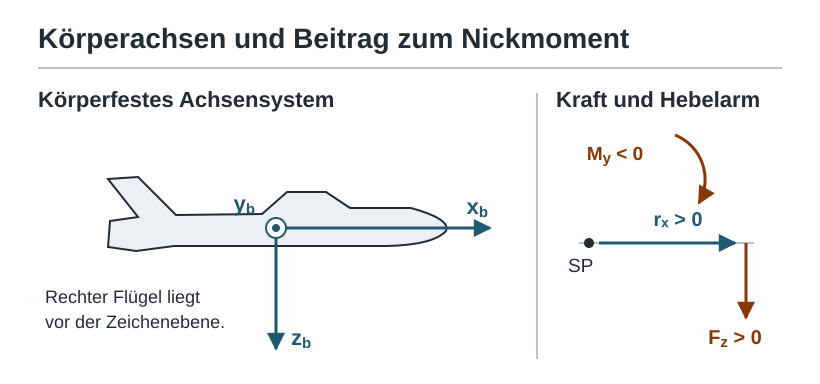

# M3-L1 – Flugachsen, Kräfte und Momente {#L1}

**Kursbereich:** M3 – Flugmechanik und Flugleistung

**Studienrolle** · Kern/Grundlagen

**Vorwissen** · [M1-L2 – Kräfte-, Impuls- und Energiebilanzen](M1-L2.md); [M2-L2 – Auftrieb, Widerstand und Beiwerte](M2-L2.md)

**Lernziel** · Wind- und Körperachsen sowie translatorische und rotatorische Bilanzen auseinanderhalten

## Einstieg {#S1}

Bei einem zivilen Forschungsflugzeug wird die Kraft einer kleinen Messvorrichtung im Lehrmodell als einzelner Pfeil dargestellt. Je nachdem, ob dieser Pfeil vor oder hinter dem Schwerpunkt ansetzt, kann dasselbe Bauteil einen anderen Drehsinn erzeugen. Wie kann man die Kraftwirkung eindeutig von der Drehwirkung unterscheiden?

## Begriffe und Modell {#S2}

Im verwendeten körperfesten, rechtshändigen System zeigt $x_b$ zur Nase, $y_b$ zum rechten Flügel und $z_b$ nach unten. Momente um diese Achsen heißen Roll-, Nick- und Giermoment. Positive Drehrichtung folgt der Rechte-Hand-Regel: Positives Rollen senkt den rechten Flügel, positives Nicken hebt die Nase, positives Gieren dreht sie nach rechts. Die Achsen bewegen sich mit dem Körper. Windachsen folgen dagegen der Fluggeschwindigkeit relativ zur Luft. Bei positivem Anstellwinkel stimmen beide Achsensysteme im Allgemeinen nicht überein. Auftrieb und Widerstand werden zunächst in Windachsen beschrieben.

Die Resultierende aller äußeren Kräfte bestimmt die Schwerpunktbeschleunigung im als inertial angenäherten Bezugssystem, $\sum\mathbf F=m\mathbf a$. Für das Moment einer Kraft um den Schwerpunkt gilt $\boldsymbol M=\mathbf r\times\mathbf F$. Dabei führt der Ortsvektor $\mathbf r$ in Metern vom Schwerpunkt zum Angriffspunkt und $\mathbf F$ ist die Kraft in Newton. Ein Moment wird in Newtonmetern angegeben. Ein starrer Körper kann eine resultierende Kraft ohne Nickmoment erfahren oder ein Nickmoment bei verschwindender resultierender Kraft. Die volle räumliche Drehbilanz berücksichtigt auch die Verteilung der Trägheit auf die Achsen. Bei reiner Nickbewegung um eine Hauptträgheitsachse vereinfacht sie sich zu $\sum M_y=I_y\dot{\omega}_y$, mit $I_y$ in $\mathrm{kg\,m^2}$ und Winkelbeschleunigung $\dot{\omega}_y$ in $\mathrm{rad/s^2}$.

{alt="Die körperfeste Längsachse zeigt zur Nase, die Hochachse nach unten. Eine nach unten wirkende Kraft vor dem Schwerpunkt erzeugt ein negatives Nickmoment."}

## Durchgerechnetes Beispiel {#S3}

Eine Zusatzkraft $F_z=+120\,\mathrm N$ zeigt körperfest nach unten und greift $0{,}80\,\mathrm m$ vor dem Schwerpunkt an. Alle übrigen Zusatzkraftkomponenten und Hebelarme sind in diesem Beispiel null.

$$
M_y=r_z F_x-r_xF_z=-(0{,}80\,\mathrm m)(120\,\mathrm N)=-96\,\mathrm{N\,m}.
$$

Das isolierte Zusatzmoment wirkt naseabwärts. Die Zusatzkraft in $z_b$ wirkt zugleich auf die Kraftbilanz. Beide Rechnungen sind Teilbilanzen, denn das Fahrzeug erfährt weitere Kräfte und Momente.

## Selbstkontrolle {#S4}

### Aufgaben

1. Berechne dasselbe Zusatzmoment für den Angriffspunkt $0{,}80\,\mathrm m$ hinter dem Schwerpunkt.
2. Eine Kraft von $60\,\mathrm N$ wirkt $0{,}50\,\mathrm m$ vor dem Schwerpunkt nach unten. Eine gleich große Kraft wirkt $0{,}50\,\mathrm m$ dahinter nach oben. Welche resultierende Zusatzkraft und welches Nickmoment entstehen?

::: {.lc-solutions data-lc-section="S4"}

### Lösungen

1. Mit $r_x=-0{,}80\,\mathrm m$ wird $M_y=+96\,\mathrm{N\,m}$. Der Drehsinn hebt die Nase.
2. Die Kräfte heben sich auf. Jedes Moment beträgt $-30\,\mathrm{N\,m}$. Das Kräftepaar ergibt $-60\,\mathrm{N\,m}$.

:::

## Annahmen und Grenzen {#S5}

Die Geometrie ist starr und der Schwerpunkt fest. Eine Kraftverteilung darf für die Drehbilanz durch eine Einzellast ersetzt werden, wenn die Ersatzlast dieselbe Resultierende und dasselbe Moment hat. Änderungen der Massenverteilung oder Bewegung um mehrere Achsen verlangen ein umfassenderes Modell. Das Beispiel ermittelt nur den Momentenbeitrag der Zusatzlast.

## Zusammenfassung {#S6}

Die resultierende Kraft bestimmt die Translation des Schwerpunkts und das resultierende Moment beeinflusst die Drehbewegung. Für einen getrimmten Zustand müssen die zugehörigen Bilanzen separat geprüft werden.

**Weiterlesen** · [M3-L2 – Trimmung und statische Stabilität](M3-L2.md)

## Quellen (extern) {#S7}

- [NASA Glenn – Airplane Cruise – Balanced Forces](https://www1.grc.nasa.gov/beginners-guide-to-aeronautics/airplane-cruise-balanced-forces/) · Four Forces; Relative Velocity · Fachgrundlage · Zuletzt abgerufen: 2026-11-23
- [FH Aachen – Flugdynamik](https://www.campus.fh-aachen.de/campus/all/module.asp?fmodulecode=66102) · Detailinformationen > Lernziele/Inhalt/Voraussetzungen · Curricularer Bezug · Zuletzt abgerufen: 2026-11-23
