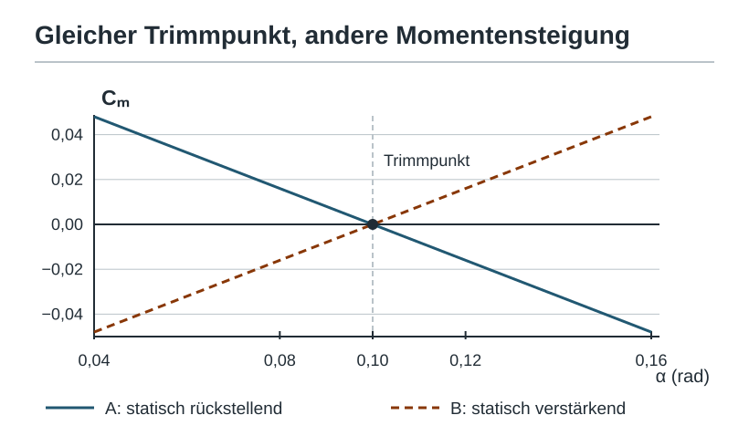

# M3-L2 – Trimmung und statische Stabilität {#L2}

**Kursbereich:** M3 – Flugmechanik und Flugleistung

**Studienrolle** · Kern/Grundlagen

**Vorwissen** · [M3-L1 – Flugachsen, Kräfte und Momente](M3-L1.md)

**Lernziel** · Trimmpunkt und lokales statisches Rückstellverhalten aus einer Momentenkurve bestimmen

## Einstieg {#S1}

Für ein ziviles Segelflugmodell ermittelt ein Hochschulteam, wie das Nickmoment mit dem Anstellwinkel variiert. Zwei Kurven gehen am selben Winkel durch null. Eine Konfiguration reagiert auf eine kleine Erhöhung des Winkels mit einem Moment in Richtung des Ausgangswerts, die andere mit einem Moment vom Ausgangswert weg. Wie erkennt man diesen Unterschied im Diagramm?

## Begriffe und Modell {#S2}

Ein Trimmpunkt der Nickmomentenbilanz liegt bei $M_y=0$. Für vollständig stationären Flug müssen zu dem vorgesehenen Flugzustand auch die erforderlichen Kraft- und übrigen Momentenbilanzen passen. Der dimensionslose Nickmomentenbeiwert ist hier $C_m=M_y/(qSc)$, bezogen auf den Schwerpunkt. $q$ ist der dynamische Druck, $S$ die Bezugsfläche und $c$ die Bezugstiefe. Positives $M_y$ hebt im verwendeten Achsensystem die Nase.

Bei festen Steuereingaben und unveränderter Konfiguration beschreiben wir $C_m$ in einer kleinen Umgebung von $\alpha_0$ durch

$$
C_m(\alpha)=k_\alpha(\alpha-\alpha_0).
$$

$\alpha$ und $\alpha_0$ werden in Radiant eingesetzt. Die lokale Steigung $k_\alpha$ wird pro Radiant angegeben. Ist $k_\alpha<0$, erzeugt eine kleine Zunahme von $\alpha$ ein negatives Nickmoment. Eine kleine Abnahme erzeugt ein positives Moment. Das ist die statische Rückstelltendenz in Längsrichtung für das gewählte Modell. Ist die Steigung positiv, verstärkt das Moment die anfängliche Störung in dieser lokalen Betrachtung. Aus dem Steigungszeichen folgt noch kein Zeitverlauf.

{alt="Zwei Momentengeraden schneiden die Nullachse bei 0,10 Radiant. Die Gerade A fällt und die Gerade B steigt."}

## Durchgerechnetes Beispiel {#S3}

Zwei Konfigurationen haben $\alpha_0=0{,}10\,\mathrm{rad}$. Bei A sei $k_\alpha=-0{,}80\,\mathrm{rad^{-1}}$, bei B $k_\alpha=+0{,}80\,\mathrm{rad^{-1}}$. Beide erreichen bei $\alpha_0$ dieselbe Nullstelle. Bei $\alpha=0{,}12\,\mathrm{rad}$ ergibt das für A $C_m=-0{,}016$ und für B $C_m=+0{,}016$.

Mit $q=500\,\mathrm{Pa}$, $S=10\,\mathrm{m^2}$ und $c=1{,}20\,\mathrm m$ beträgt $qSc=6\,000\,\mathrm{N\,m}$. Das Moment ist somit bei A $-96\,\mathrm{N\,m}$ und bei B $+96\,\mathrm{N\,m}$. Der Winkel hat um $0{,}02\,\mathrm{rad}$ zugenommen. Das negative Moment von A wirkt zum Ausgangszustand zurück.

## Selbstkontrolle {#S4}

### Aufgaben

1. Bestimme für beide Konfigurationen das Vorzeichen von $C_m$ bei $\alpha=0{,}08\,\mathrm{rad}$.
2. Eine andere lineare Näherung lautet $C_m=0{,}128-(0{,}80\,\mathrm{rad^{-1}})\alpha$. Bestimme rechnerische Nullstelle und lokale Rückstelltendenz, sofern die Näherung dort gültig ist.

::: {.lc-solutions data-lc-section="S4"}

### Lösungen

1. Die Störung beträgt $-0{,}02\,\mathrm{rad}$. Damit gilt $C_{m,A}=+0{,}016$ und $C_{m,B}=-0{,}016$. A liefert die Rückstelltendenz.
2. $C_m=0$ ergibt $\alpha_0=0{,}160\,\mathrm{rad}$. Die negative Steigung weist auf lokale statische Längsstabilität hin. Die übrigen Bilanzbedingungen sind gesondert zu prüfen.

:::

## Annahmen und Grenzen {#S5}

Die Gerade gilt nur nahe der betrachteten Nullstelle. Schwerpunktlage, Steuereingabe und aerodynamischer Zustand sind festgelegt. Starke Ablösung kann das lineare Verhalten aufheben. Ob die Bewegung nach einer Störung abklingt, hängt zusätzlich von Trägheit, Dämpfung und Kopplung zwischen Bewegungsgrößen ab.

## Zusammenfassung {#S6}

Die Nullstelle bestimmt den Trimmpunkt der Nickmomentenbilanz. Die lokale Steigung entscheidet über die statische Rückstelltendenz. Die zeitliche Antwort braucht ein eigenes dynamisches Modell.

**Weiterlesen** · [M3-L3 – Dynamische Antwort und Steuerwirkung](M3-L3.md)

## Quellen (extern) {#S7}

- [MIT OpenCourseWare – Aircraft Stability and Control, Lecture 2](https://live.ocw.mit.edu/courses/16-333-aircraft-stability-and-control-fall-2004/99dac83da0ad7eb8906ebac40e9e6ae1_lecture_2.pdf) · S. 2–1, Longitudinal Static Stability · Fachgrundlage · Zuletzt abgerufen: 2026-11-23
- [FH Aachen – Flugdynamik](https://www.campus.fh-aachen.de/campus/all/module.asp?fmodulecode=66102) · Detailinformationen > Lernziele/Inhalt/Voraussetzungen · Curricularer Bezug · Zuletzt abgerufen: 2026-11-23
