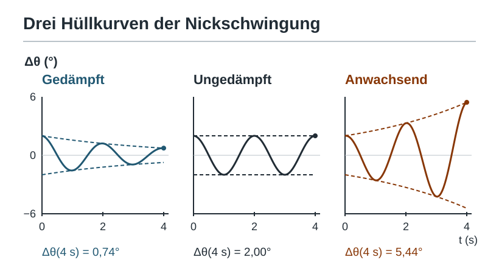

# M3-L3 – Dynamische Antwort und Steuerwirkung {#L3}

**Kursbereich:** M3 – Flugmechanik und Flugleistung

**Studienrolle** · Kern/Grundlagen

**Vorwissen** · [M3-L2 – Trimmung und statische Stabilität](M3-L2.md)

**Lernziel** · Eigenbewegung, Piloteneingabe und Rückkopplung anhand vereinfachter Antwortkurven erkennen

## Einstieg {#S1}

Ein Hochschulteam zeichnet in einer zivilen Flugsimulation die Nickbewegung nach einer kurzen Störung auf. Drei simulierte Verläufe beginnen bei derselben kleinen Nickwinkelauslenkung. Anschließend klingen die Ausschläge ab, bleiben gleich groß oder wachsen. Wie lassen sich die Verläufe systematisch unterscheiden? Was ändert eine zusätzliche Steuereingabe?

## Begriffe und Modell {#S2}

Der Nickwinkel $\theta$ beschreibt die Orientierung der Flugzeuglängsachse relativ zum betrachteten Horizont. Der Anstellwinkel dagegen bezieht sich auf die Luftrelativgeschwindigkeit. Ein reines Nickmodell kann eine kleine Abweichung $\Delta\theta$ von einem Ausgangszustand darstellen. Ein ausgewählter schwingender Eigenanteil ohne weitere Eingabe hat die Form

$$
\Delta\theta(t)=A\,e^{-\sigma t}\cos(\omega_d t).
$$

$t$ ist die Zeit in Sekunden, $A$ die Anfangsauslenkung, $\sigma$ die Abklingrate in $\mathrm{s^{-1}}$ und $\omega_d$ die Kreisfrequenz der Schwingung in $\mathrm{rad/s}$. Ihre Periodendauer ist $2\pi/\omega_d$. Die positive Hüllkurve $|A|e^{-\sigma t}$ sinkt für $\sigma>0$, bleibt für $\sigma=0$ konstant und wächst für $\sigma<0$. Der betrachtete Eigenanteil hängt von den Modellparametern und den Anfangsbedingungen ab. Mehrere Eigenanteile können sich in einer echten Bewegung überlagern.

Eine offene Eingabe kann beispielsweise in der Nickbilanz ein zusätzliches Moment erzeugen. Die Steuerwirksamkeit beschreibt, wie stark sich im betrachteten Zustand das Nickmoment bei einem kleinen Eingabeschritt ändert. Die verfügbare Steuerautorität hängt zusätzlich vom zulässigen Stellbereich ab. Bei Rückkopplung beeinflusst der gemessene Bewegungszustand die weitere Eingabe. Damit kann sich die beobachtete Antwort ändern. Beschränkte Stellwege, Verzögerung und Messfehler beeinflussen diese Wirkung.

{alt="Drei Nickschwingungen beginnen bei zwei Grad. Ihre Hüllkurven werden über vier Sekunden kleiner, bleiben konstant oder wachsen."}

## Durchgerechnetes Beispiel {#S3}

Setze $A=2^\circ$, $\omega_d=\pi\,\mathrm{rad/s}$ und $\sigma=+0{,}25$, $0$ beziehungsweise $-0{,}25\,\mathrm{s^{-1}}$. Die Zeitverläufe haben dieselbe Anfangsauslenkung. Die Anfangsraten können verschieden sein, weil $\sigma$ in die zeitliche Ableitung eingeht. Nach $t=4\,\mathrm s$ sind zwei Perioden vergangen und der Kosinus ist wieder eins. Damit ergibt sich für die drei Kurven:

- Gedämpft: $(2^\circ)e^{-1}\approx0{,}74^\circ$.
- Ungedämpft: $2^\circ$.
- Anwachsende Schwingung: $(2^\circ)e^{1}\approx5{,}44^\circ$.

Die Gleichung beschreibt Modellbewegungen. Für den wachsenden Fall gehört zur Interpretation immer der betrachtete Zeitbereich.

## Selbstkontrolle {#S4}

### Aufgaben

1. Gib für das gedämpfte Beispiel den Betrag nach einer Periode an. Wie groß ist er gegenüber dem Anfangsbetrag?
2. In einem Modell folgt eine zusätzliche Eingabe ausschließlich einem Zeitprogramm. In einem zweiten wird sie von der gemessenen Winkelabweichung bestimmt. Welches Modell enthält Rückkopplung?

::: {.lc-solutions data-lc-section="S4"}

### Lösungen

1. Nach $2\,\mathrm s$ ergibt die Hüllkurve $(2^\circ)e^{-0{,}5}\approx1{,}21^\circ$, rund 61 Prozent des Anfangsbetrags.
2. Nur im zweiten Modell beeinflusst die Messung erneut die Eingabe. Im ersten Modell bleibt der Zusatz eine offene Anregung.

:::

## Annahmen und Grenzen {#S5}

Die kleine Bewegung um einen festen Arbeitspunkt erlaubt eine lineare Näherung. In einer räumlichen Flugbewegung können Nickwinkel, Geschwindigkeit und weitere Größen miteinander gekoppelt sein. Große Auslenkungen, zeitveränderliche Parameter und Sättigung können die Modellantwort verändern. Aus einer einzelnen Kurve lässt sich die Eignung einer Steuerung nicht ableiten.

## Zusammenfassung {#S6}

Die Hüllkurve zeigt Abklingen, konstante Amplitude oder Wachstum eines Eigenanteils. Eine Eingabe ändert die Momentenbilanz. Mit Rückkopplung hängt die Eingabe zusätzlich von der gemessenen Bewegung ab.

**Weiterlesen** · [M3-L4 – Flugleistung und Energiehöhe](M3-L4.md)

## Quellen (extern) {#S7}

- [FH Aachen – Flugdynamik](https://www.campus.fh-aachen.de/campus/all/module.asp?fmodulecode=66102) · Detailinformationen > Lernziele/Inhalt/Voraussetzungen · Curricularer Bezug · Zuletzt abgerufen: 2026-11-23
- [TUM School of Engineering and Design – Modulhandbuch Aerospace [202501]](https://www.ed.tum.de/fileadmin/w00byg/ed/03_Studium/Aerospace_B._Sc/Modulhandbuch/WiSe25/Modulhandbuch_BScAerospace_SPO-202501_DE_2025-12-15.pdf) · ED110124 S. 79–81; LRG0090 S. 94–95; ED110104 S. 510–512; ED110106 S. 536–538; MW0832 S. 560–561; MW0837 S. 562–563; MW2282 S. 579–580 · Curricularer Bezug · Zuletzt abgerufen: 2026-11-23
- [Massachusetts Institute of Technology – Aerospace Engineering (Course 16)](https://catalog.mit.edu/degree-charts/aerospace-engineering-course-16/aerospace-engineering-course-16.pdf) · Departmental Program > Departmental Core und Professional Area Subjects; S. 1 · Curricularer Bezug · Zuletzt abgerufen: 2026-11-23
