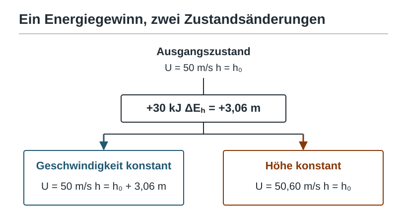

# M3-L4 – Flugleistung und Energiehöhe {#L4}

**Kursbereich:** M3 – Flugmechanik und Flugleistung

**Studienrolle** · Kern/Grundlagen

**Vorwissen** · [M1-L2 – Kräfte-, Impuls- und Energiebilanzen](M1-L2.md); [M3-L1 – Flugachsen, Kräfte und Momente](M3-L1.md)

**Lernziel** · Leistungsbedarf, Steigrate und spezifische Energiehöhe eines Lehrmodells bilanzieren

## Einstieg {#S1}

Für einen zivilen Flugversuch sollen zwei simulierte Zustandsänderungen verglichen werden. In einer Rechnung gewinnt das Flugzeug bei gleicher Geschwindigkeit an Höhe. In der anderen bleibt die Höhe gleich und das Flugzeug wird schneller. Welches Maß macht die beiden Änderungen vergleichbar?

## Begriffe und Modell {#S2}

Verwende ein Punktmassenmodell mit konstanter Masse $m$ und Schwerebeschleunigung $g$. Die Luft ruht gegenüber dem erdfesten Bezugssystem. Damit ist $U$ zugleich der Betrag der Luftrelativgeschwindigkeit und der Geschwindigkeit im Modellbezugssystem. Der Schub $T$ zeigt entlang der Flugbahn, der Widerstand $D$ entgegen der Bewegung, der Auftrieb senkrecht zur Bewegung. Die Leistung des Schubs ist $P_T=TU$, der Leistungsbedarf für den Widerstand ist $P_D=DU$. Beide werden in Watt gemessen. Antriebsleistung am Propeller oder elektrische Eingangsleistung kann wegen Verlusten größer sein als $P_T$.

Mit Höhe $h$ über einem festen lokalen Bezugsniveau und nach oben positiver Höhenänderung schreiben wir die mechanische Energie pro Gewichtskraft als Energiehöhe

$$
E_h=\frac{mgh+\tfrac12mU^2}{mg}=h+\frac{U^2}{2g},
\qquad
mg\dot E_h=P_T-P_D.
$$

$E_h$ hat die Einheit Meter. Der Term $U^2/(2g)$ ist der Geschwindigkeitsanteil der Energie, ausgedrückt als Höhe. Die Schwerkraft steckt bereits im Term $mgh$. Der Auftrieb verrichtet im gewählten Modell keine Arbeit, weil sein Kraftvektor senkrecht zur Geschwindigkeit steht. Bei konstantem $U$ ist $\dot E_h=\dot h$. Bei konstanter Höhe ändert sich allein der Geschwindigkeitsterm.

{alt="Nach einer Energiezunahme von 30 Kilojoule steigt entweder die Höhe um 3,06 Meter oder die Geschwindigkeit bei gleicher Höhe auf 50,60 Meter pro Sekunde."}

## Durchgerechnetes Beispiel {#S3}

Ein synthetischer Ausgangszustand habe $m=1\,000\,\mathrm{kg}$, $g=9{,}81\,\mathrm{m/s^2}$, $U=50\,\mathrm{m/s}$, $D=400\,\mathrm N$ und $T=600\,\mathrm N$. Der Widerstand erfordert $20\,\mathrm{kW}$, der Schub liefert $30\,\mathrm{kW}$ und der Überschuss beträgt $10\,\mathrm{kW}$.

Setze über drei Sekunden in zwei getrennten Varianten denselben konstanten Überschuss an. Die Energie steigt um $30\,\mathrm{kJ}$ und $\Delta E_h=(30\,000\,\mathrm J)/(9\,810\,\mathrm N)\approx3{,}06\,\mathrm m$.

- Bei festem $U$ steigt $h$ um ungefähr $3{,}06\,\mathrm m$. Die Steigrate beträgt ungefähr $1{,}02\,\mathrm{m/s}$.
- Bei fester Höhe gilt $U_\mathrm{Ende}=\sqrt{U_\mathrm{Start}^2+2g\Delta E_h}\approx50{,}60\,\mathrm{m/s}$. In dieser Variante ist der Leistungsüberschuss vorgegeben. Schub und Widerstand müssen während der Beschleunigung keine konstanten Einzelwerte behalten.

## Selbstkontrolle {#S4}

### Aufgaben

1. Die Masse bleibt gleich. Bestimme $\Delta h$ bei unveränderter Geschwindigkeit und einem Gewinn mechanischer Energie von $49{,}05\,\mathrm{kJ}$.
2. Die Höhe sinkt im Modell, während der Leistungsüberschuss null und $E_h$ folglich konstant bleibt. Wie ändert sich $U$?

::: {.lc-solutions data-lc-section="S4"}

### Lösungen

1. $\Delta h=(49\,050\,\mathrm J)/(9\,810\,\mathrm N)=5{,}00\,\mathrm m$.
2. Mit fallendem $h$ steigt $U^2/(2g)$ um den gleichen Höhenbetrag. Der Betrag $U$ nimmt zu.

:::

## Annahmen und Grenzen {#S5}

Diese Bilanz setzt ruhende Luft, einen zur Bahn ausgerichteten Schub, konstante Masse und lokale konstante Schwerebeschleunigung voraus. Widerstand und Antriebsleistung hängen real vom Zustand und von der Konfiguration ab. Die Gleichung prüft die Energiebilanz, während die vollständigen Kraft- und Momentenbilanzen separat sicherstellen müssen, dass ein Zustand überhaupt erreichbar ist.

## Zusammenfassung {#S6}

Die Energiehöhe ordnet Lage- und Bewegungsenergie derselben Höhenskala zu. Leistungsüberschuss erhöht die Summe beider Anteile. Wie viel Leistung ein Antrieb liefert und wie viel Energie er dabei aufnimmt, sind unterschiedliche Fragen.

**Weiterlesen** · [M4-L1 – Energiebilanz strömender Systeme](M4-L1.md)

## Quellen (extern) {#S7}

- [FAA – Airplane Flying Handbook (FAA-H-8083-3C), Chapter 4](https://www.faa.gov/sites/faa.gov/files/regulations_policies/handbooks_manuals/aviation/airplane_handbook/05_afh_ch4.pdf) · S. 4–1, 4–3 und 4–7; Mechanical Energy und Energy Height · Fachgrundlage · Zuletzt abgerufen: 2026-11-23
- [HAW Hamburg – Modulhandbuch Flugzeugtechnik](https://www.haw-hamburg.de/index.php?download=&eID=dumpFile&f=69780&t=f&token=b5aa5118df55167276ae8b4217791b5cea2fdc11) · M22 S. 58–60; M23 S. 61–62; M27 S. 70–72; M31 S. 80–81; M41 S. 101–102; M43 S. 106–107 · Curricularer Bezug · Zuletzt abgerufen: 2026-11-23
- [TUM School of Engineering and Design – Modulhandbuch Aerospace [202501]](https://www.ed.tum.de/fileadmin/w00byg/ed/03_Studium/Aerospace_B._Sc/Modulhandbuch/WiSe25/Modulhandbuch_BScAerospace_SPO-202501_DE_2025-12-15.pdf) · ED110124 S. 79–81; LRG0090 S. 94–95; ED110104 S. 510–512; ED110106 S. 536–538; MW0832 S. 560–561; MW0837 S. 562–563; MW2282 S. 579–580 · Curricularer Bezug · Zuletzt abgerufen: 2026-11-23
