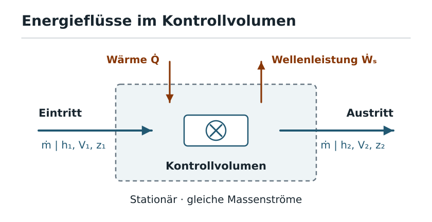

# M4-L1 – Energiebilanz strömender Systeme {#L1}

**Kursbereich:** M4 – Thermofluiddynamik und Antriebsprinzipien

**Studienrolle** · Kern/Grundlagen

**Vorwissen** · [M1-L2 – Kräfte-, Impuls- und Energiebilanzen](M1-L2.md)

**Lernziel** · Enthalpie, kinetische Energie, Wärme und Arbeit mit konsistentem Vorzeichen bilanzieren

## Ein Prüfkanal nimmt Energie auf und gibt Arbeit ab {#S1}

In einem Lehrprüfstand für Kabinenlüftung strömt Luft durch einen beheizten Kanal. Ein kleines Demonstrationsrad gibt über eine Welle Leistung ab. Die Luft ist am Austritt wärmer und schneller als am Eintritt. Wie viel Wärme muss die Heizung zuführen, wenn bekannt ist, was sich in der Strömung ändert und welche Leistung an der Welle austritt?

## Energieflüsse am Kontrollvolumen {#S2}

Die Kontrollfläche umschließt Kanal und Rad und schneidet je einen Ein- und Austrittsquerschnitt. Im stationären Betrieb speichern die eingeschlossene Materie und die Bauteile im Mittel keine zusätzliche Energie. Die Massenströme an beiden Schnitten sind gleich. Für die strömende Masse fasst die **spezifische Enthalpie** $h=u+pv$ die innere Energie $u$ und die zum Verdrängen des Fluids an einem Querschnitt nötige Strömungsarbeit $pv$ zusammen. Dabei sind $p$ der Druck und $v=1/\rho$ das spezifische Volumen. Die Geschwindigkeit heißt hier $V$.

$$
\dot Q-\dot W_\mathrm{s}
=\dot m\left[(h_2-h_1)+\frac{V_2^2-V_1^2}{2}+g(z_2-z_1)\right].
$$

Index $1$ bezeichnet den Eintritt und $2$ den Austritt. $\dot Q$ ist positiv bei **Wärmezufuhr**. $\dot W_\mathrm{s}$ ist positiv bei **Wellenleistung nach außen**. An beiden Schnitten zählen Enthalpie, Bewegungsenergie und Lageenergie je Kilogramm. Die Multiplikation mit $\dot m$ in $\mathrm{kg/s}$ macht daraus einen Energiestrom. Damit ergeben $\mathrm{kJ/kg}$ im Klammerausdruck unmittelbar $\mathrm{kW}$ auf der linken Seite. $z$ wird vertikal nach oben gemessen.

{alt="Links fließt Masse ein, rechts aus. Ein Wärmepfeil zeigt hinein, ein Wellenleistungspfeil hinaus."}

## Wie groß ist die Heizleistung? {#S3}

Der synthetische Datensatz setzt $\dot m=0{,}25\,\mathrm{kg/s}$, $h_2-h_1=12\,\mathrm{kJ/kg}$, $V_1=10\,\mathrm{m/s}$, $V_2=30\,\mathrm{m/s}$ und $z_2=z_1$. Das Rad gibt $0{,}6\,\mathrm{kW}$ ab. Der Geschwindigkeitsbeitrag beträgt $(30^2-10^2)/2=400\,\mathrm{J/kg}=0{,}4\,\mathrm{kJ/kg}$. Die Luft führt am Austritt also $0{,}25(12+0{,}4)\,\mathrm{kW}=3{,}1\,\mathrm{kW}$ mehr Energie mit als am Eintritt. Die Heizung muss zusätzlich die abgegebene Leistung decken. Das ergibt $\dot Q=3{,}1\,\mathrm{kW}+0{,}6\,\mathrm{kW}=3{,}7\,\mathrm{kW}$.

## Selbstkontrolle {#S4}

1. Im selben Rechenmodell nimmt die Welle $0{,}8\,\mathrm{kW}$ von außen auf. Die Zustandsdaten an beiden Schnitten bleiben gleich. Wie groß ist $\dot Q$?
2. Der Kanal sei wärmeisoliert. Geschwindigkeit und Höhe ändern sich jetzt nicht. Bei $\dot m=0{,}25\,\mathrm{kg/s}$ fällt die spezifische Enthalpie um $8\,\mathrm{kJ/kg}$. Welche Leistung gibt die Welle ab?

::: {.lc-solutions data-lc-section="S4"}
1. Die angetriebene Welle hat $\dot W_\mathrm{s}=-0{,}8\,\mathrm{kW}$. Damit ergibt sich $\dot Q=3{,}1\,\mathrm{kW}-0{,}8\,\mathrm{kW}=2{,}3\,\mathrm{kW}$.
2. Mit $\dot Q=0$ gilt $-\dot W_\mathrm{s}=0{,}25(-8)\,\mathrm{kW}=-2{,}0\,\mathrm{kW}$. Die Welle gibt $2{,}0\,\mathrm{kW}$ ab.
:::

## Wann die Bilanz ergänzt werden muss {#S5}

Beim Anfahren können sich Wandtemperatur und Fluidmasse im Kontrollvolumen ändern. Dann muss die Bilanz die zeitliche Speicherung enthalten. Bei ungleichförmigen Strömungsprofilen braucht man geeignete Mittelwerte der Energieflüsse. Oberflächen, die Wärme an den Raum verlieren, vermindern die Netto-Wärmezufuhr. Die elektrische Aufnahme eines Heizgeräts und der bilanzierte Wärmestrom sind deshalb gesondert zu erfassen.

## Drei Arten der Energieübertragung {#S6}

Wärme und Wellenleistung überqueren die Kontrollfläche, während die Masse Enthalpie, Bewegungsenergie und Lageenergie transportiert. Diese Trennung lässt sich auf einzelne Stufen eines thermodynamischen Kreisprozesses anwenden.

**Weiterlesen** · [M4-L2 – Idealisiertes Gasturbinenmodell](M4-L2.md)

## Quellen (extern) {#S7}

- [Massachusetts Institute of Technology – Steady Flow Energy Equation](https://web.mit.edu/16.unified/www/FALL/thermodynamics/chapter_6.htm) · First Law of Thermodynamics for a Control Volume; Enthalpy · Fachgrundlage · Zuletzt abgerufen: 2026-11-23
