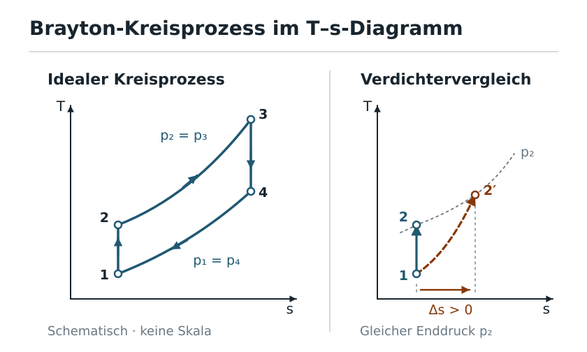

# M4-L2 – Idealisiertes Gasturbinenmodell {#L2}

**Kursbereich:** M4 – Thermofluiddynamik und Antriebsprinzipien

**Studienrolle** · Kern/Grundlagen

**Vorwissen** · [M4-L1 – Energiebilanz strömender Systeme](M4-L1.md)

**Lernziel** · Verlauf eines idealen Brayton-Kreisprozesses und reale Verlustpfade erläutern

## Warum der Verdichter einen Teil der Arbeit braucht {#S1}

In einem Lehrmodell für eine zivile Gasturbine treiben die expandierenden Gase eine Turbine an. Ein Teil ihrer Leistung wird wieder benötigt, um die einströmende Luft zu verdichten. Woran lässt sich erkennen, wie viel Arbeit im Idealfall übrig bleibt und wie ein Verlust im Verdichter diese Bilanz verschiebt?

## Vier Zustandsänderungen im T-s-Diagramm {#S2}

Der **ideale Brayton-Kreisprozess** schließt den Gasweg gedanklich. Die Wärmeabgabe an die Umgebung ersetzt Ausstoß und Ersatz der Luft in der offenen Maschine. Es gelten ideales Gas, konstante spezifische Wärmekapazität $c_p$, konstantes Verhältnis $\gamma=c_p/c_v$ und vernachlässigbare Änderungen von Geschwindigkeit und Höhe.

1. $1\rightarrow2$: isentrope Verdichtung, Druck und Temperatur steigen. „Isentrop“ bedeutet hier adiabatisch und intern reversibel.
2. $2\rightarrow3$: Wärmezufuhr bei konstantem hohem Druck, Temperatur und spezifische Entropie steigen.
3. $3\rightarrow4$: isentrope Entspannung in der Turbine, Druck und Temperatur sinken.
4. $4\rightarrow1$: Wärmeabgabe bei konstantem niedrigem Druck, Temperatur und spezifische Entropie sinken.

Im Diagramm wächst die Temperatur $T$ nach oben und die spezifische Entropie $s$ nach rechts. Isentrope Schritte verlaufen senkrecht. Für die beiden Druckniveaus ist das Druckverhältnis $r_p=p_2/p_1=p_3/p_4$. Die ideale Gasbeziehung liefert $\theta=r_p^{(\gamma-1)/\gamma}$, $T_2=\theta T_1$ und $T_4=T_3/\theta$. Die zugeführte Wärme je Kilogramm ist $q_\mathrm{in}=c_p(T_3-T_2)$. Für den Betrag der abgeführten Wärme gilt $q_\mathrm{out}=c_p(T_4-T_1)$.

{alt="Zwei senkrechte Isentropen verbinden die Druckniveaus. Bei gleichem Enddruck liegt der reale Verdichterendpunkt oberhalb und rechts des Idealpunkts."}

## Rechenbeispiel mit einem vereinfachten Kreisprozess {#S3}

Für synthetische Zustände seien $T_1=300\,\mathrm{K}$, $T_3=900\,\mathrm{K}$, $r_p=4$, $\gamma=1{,}4$ und $c_p=1{,}00\,\mathrm{kJ/(kg\,K)}$. Daraus folgt $\theta\approx1{,}486$, also $T_2\approx446\,\mathrm{K}$ und $T_4\approx606\,\mathrm{K}$. Mit den gerundeten Zuständen erhält man:

- Wärmezufuhr $q_\mathrm{in}\approx454\,\mathrm{kJ/kg}$, Wärmeabgabe $q_\mathrm{out}\approx306\,\mathrm{kJ/kg}$.
- Nettoarbeit $w_\mathrm{net}=q_\mathrm{in}-q_\mathrm{out}\approx148\,\mathrm{kJ/kg}$.
- Idealer thermischer Wirkungsgrad $\eta=w_\mathrm{net}/q_\mathrm{in}\approx0{,}33$.

Bei der adiabatischen **realen Verdichtung** steigt $s$, weil der Vorgang irreversibel ist. Der Endpunkt liegt bei demselben Enddruck weiter rechts und höher. Die Welle muss mehr Verdichtungsarbeit pro Kilogramm liefern.

## Selbstkontrolle {#S4}

1. Gegeben sind $\theta=1{,}25$, $T_1=320\,\mathrm{K}$, $T_3=800\,\mathrm{K}$ und dasselbe $c_p$ wie im Beispiel. Berechne $T_2$, $T_4$ und den Wirkungsgrad.
2. Ein adiabatischer Verdichter erreicht bei gleichem Enddruck $470\,\mathrm{K}$ statt der idealen $446\,\mathrm{K}$. Wie viel zusätzliche spezifische Arbeit benötigt er im Modell?

::: {.lc-solutions data-lc-section="S4"}
1. $T_2=400\,\mathrm{K}$ und $T_4=640\,\mathrm{K}$. Es folgen $q_\mathrm{in}=400\,\mathrm{kJ/kg}$, $q_\mathrm{out}=320\,\mathrm{kJ/kg}$ und $\eta=0{,}20$.
2. Die Differenz ist $c_p(470-446)\,\mathrm{K}=24\,\mathrm{kJ/kg}$. Der Energiebedarf steigt bei demselben Enddruck aufgrund von Irreversibilität.
:::

## Das Modell deckt einen Teil der realen Verluste ab {#S5}

Bei realen Gasturbinen ändern sich Stoffeigenschaften mit der Temperatur. Druckverluste, Kühl- oder Nebenströme und mechanische Verluste verändern die Komponentenbilanz. Die vier Idealzustände liefern eine Referenz für die Richtung und Größenordnung von Energietransfers. Der berechnete thermische Wirkungsgrad bezieht sich auf die Nettoarbeit im Kreisprozess. Für die tatsächlich am Flugzeug nutzbare Vortriebsleistung ist ein weiterer Modellschritt nötig.

## Der Vergleich braucht gleiche Zustandsvorgaben {#S6}

Vergleiche eine ideale und eine reale Teilstufe bei gleichen Eintrittsbedingungen und gleichem Enddruck. Erst dann lassen sich zusätzliche Verdichtungsarbeit und Entropiezunahme sinnvoll zusammen beurteilen.

**Weiterlesen** · [M4-L3 – Schub, Leistung und Antriebskonzepte](M4-L3.md)

## Quellen (extern) {#S7}

- [NASA Glenn – Turbine Engine Thermodynamic Cycle – Brayton Cycle](https://www.grc.nasa.gov/www/k-12/BGP/brayton.html) · Beschreibung zum T-s-Diagramm · Fachgrundlage · Zuletzt abgerufen: 2026-11-23
- [Massachusetts Institute of Technology – Steady Flow Energy Equation](https://web.mit.edu/16.unified/www/FALL/thermodynamics/chapter_6.htm) · First Law of Thermodynamics for a Control Volume; Enthalpy · Fachgrundlage · Zuletzt abgerufen: 2026-11-23
