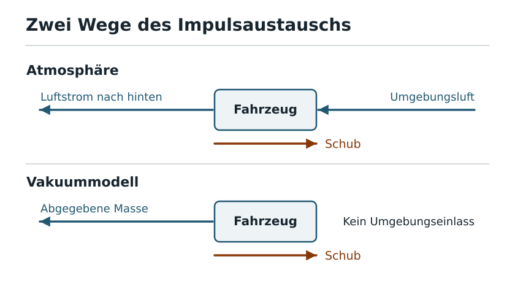

# M4-L3 – Schub, Leistung und Antriebskonzepte {#L3}

**Kursbereich:** M4 – Thermofluiddynamik und Antriebsprinzipien

**Studienrolle** · Kern/Grundlagen

**Vorwissen** · [M4-L1 – Energiebilanz strömender Systeme](M4-L1.md); [M2-L2 – Auftrieb, Widerstand und Beiwerte](M2-L2.md)

**Lernziel** · Impuls- und Leistungsargumente bei zivilen Luftantrieben und für abstrakte Raumfahrtsysteme unterscheiden

## Gleicher Schub bei zwei Geschwindigkeiten {#S1}

Zwei synthetische Messpunkte eines kleinen zivilen Elektroflug-Demonstrators weisen dieselbe Vortriebskraft aus. Der erste wurde rechnerisch bei niedrigerer Fahrt angesetzt als der zweite. Die Leistungsanzeige muss trotz gleicher Kraft unterschiedlich ausfallen, wenn sie die mechanische Leistung am Fahrzeug wiedergibt. An welchen Größen erkennt man den Unterschied?

## Impulsaustausch und nutzbare Vortriebsleistung {#S2}

Ein Antrieb, der Umgebungsluft als Arbeitsmedium nutzt, tauscht Impuls mit der einströmenden Luft aus. Ein Propeller beschleunigt beispielsweise einen Luftstrom relativ zur Umgebung nach hinten. Der Vortrieb des Fahrzeugs und die Impulsänderung des Fluids sind entgegengesetzt. Eine vollständige Impulsbilanz berücksichtigt alle Massenströme und äußeren Kräfte an der gewählten Systemgrenze. Je nach Lage der Kontrollfläche gehören auch Druckkräfte dazu.

Bei einem Raumfahrzeug im Vakuummodell fehlt ein kontinuierlicher Einlassstrom der Umgebung. Ein System mit mitgeführtem Reaktionsmedium kann Impuls übertragen, indem es Masse abgibt. Auf die Gesamtbilanz bezogen ergänzen sich die Impulsänderungen von Fahrzeug und abgegebener Masse, sofern äußere Kräfte vernachlässigbar sind. Die Grafik gibt die Herkunft der am Austausch beteiligten Masse an.

Für die translatorische Leistung der Schubkraft gilt $P_\mathrm{V}=\boldsymbol F_\mathrm{T}\cdot\boldsymbol V$. $\boldsymbol V$ ist die Fahrzeuggeschwindigkeit im betrachteten Bezugssystem, $\boldsymbol F_\mathrm{T}$ die auf das Fahrzeug wirkende Schubkraft. Im Luftfahrtbeispiel verwenden wir das Ruhesystem der Luft und nehmen parallele Richtung an. Dann ist $P_\mathrm{V}=F_\mathrm{T}V$. Ein Newtonmeter pro Sekunde entspricht einem Watt. Der Wert beschreibt die mechanische Leistungsübertragung dieser Kraft auf die Fahrzeugbewegung.

{alt="Im oberen Schema strömt Umgebungsluft ein und wird nach hinten beschleunigt. Unten tritt mitgeführte Masse ohne Umgebungseinlass aus. Der Schub weist jeweils nach vorn."}

## Leistung zweier synthetischer Messpunkte {#S3}

Beide Messpunkte haben $F_\mathrm{T}=60\,\mathrm{N}$. Im ersten Punkt ergibt sich bei $V_A=20\,\mathrm{m/s}$ eine Vortriebsleistung von $60\cdot20\,\mathrm{W}=1{,}20\,\mathrm{kW}$. Im zweiten Punkt sind es bei $V_B=35\,\mathrm{m/s}$ dagegen $60\cdot35\,\mathrm{W}=2{,}10\,\mathrm{kW}$. Der zweite Wert übersteigt den ersten um $0{,}90\,\mathrm{kW}$. Beide Punkte sind im selben Luftbezugssystem angegeben. Für die Änderung der Bewegungsenergie des gesamten Fahrzeugs müssten auch die Leistungen der übrigen Kräfte bilanziert werden.

## Selbstkontrolle {#S4}

1. In einem gedachten Prüfpunkt liegt der Schubvektor um $60^\circ$ gegen die Fahrzeuggeschwindigkeit geneigt. Es gelten $F_\mathrm{T}=60\,\mathrm{N}$ und $V=30\,\mathrm{m/s}$. Wie groß ist die translatorische Leistung?
2. Ein festgehaltener Demonstrator entwickelt $60\,\mathrm{N}$ Schub. Welche translatorische Vortriebsleistung hat er in ruhender Umgebungsluft? Fließt weiterhin Energie in den Luftstrom?

::: {.lc-solutions data-lc-section="S4"}
1. Nur die Komponente entlang der Geschwindigkeit trägt bei. $P_\mathrm{V}=60\cdot30\cdot\cos 60^\circ\,\mathrm{W}=900\,\mathrm{W}$.
2. Mit $V=0$ gilt $P_\mathrm{V}=0\,\mathrm{W}$. Der Luftstrom erhält weiterhin Energie, weil der Antrieb Luft beschleunigt.
:::

## Welche Leistungszahl hier gemeint ist {#S5}

Die Vortriebsleistung hängt vom gewählten Bezugssystem ab. Bei Wind können Flug- und Bodengeschwindigkeit verschieden sein. Die Leistungsaufnahme der Energiequelle muss separat bestimmt werden. Bei einem Kraftangriff außerhalb des betrachteten Bezugspunkts kann zusätzlich Drehleistung auftreten. Das Raumfahrzeugbeispiel erklärt allein den Impulsaustausch und setzt keine Bau- oder Betriebsparameter an.

## Kraft und Leistung beantworten verschiedene Fragen {#S6}

Der Impulsaustausch erklärt, wie eine Kraft zustande kommt. Wie viel translatorische Arbeit diese Kraft pro Zeit überträgt, hängt zusätzlich von Richtung und Geschwindigkeit ab. Dieselben Kräfte können als Lasten in Bauteile eingeleitet werden.

**Weiterlesen** · [M5-L1 – Lastpfade und einfache Spannungsmodelle](M5-L1.md)

## Quellen (extern) {#S7}

- [Massachusetts Institute of Technology – Thermodynamics and Propulsion – 11.1 Overall Efficiency](https://web.mit.edu/16.unified/www/FALL/thermodynamics/notes/node80.html) · § 11.1, thrust power · Fachgrundlage · Zuletzt abgerufen: 2026-11-23
- [NASA Glenn – Airplane Cruise – Balanced Forces](https://www1.grc.nasa.gov/beginners-guide-to-aeronautics/airplane-cruise-balanced-forces/) · Four Forces; Relative Velocity · Fachgrundlage · Zuletzt abgerufen: 2026-11-23
