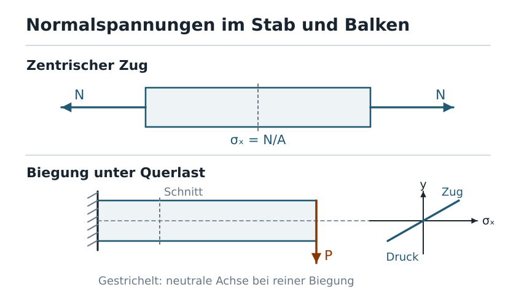

# M5-L1 – Lastpfade und einfache Spannungsmodelle {#L1}

**Kursbereich:** M5 – Werkstoffe und Leichtbau

**Studienrolle** · Kern/Grundlagen

**Vorwissen** · [M1-L2 – Kräfte-, Impuls- und Energiebilanzen](M1-L2.md)

**Lernziel** · Lastpfade sichtbar machen und einfache Normal- und Biegespannungen unterscheiden

## Wie eine Last vom Modellflügel zur Einspannung gelangt {#S1}

Eine isolierte Modelltragfläche trägt am Ende einen Sensorhalter. Die nach unten gerichtete Kraft am Halter wirkt über die tragende Struktur bis zur Einspannung. Eine gleich große Kraft in Längsrichtung würde denselben Querschnitt anders beanspruchen. Welche Spannungen kann man aus beiden Belastungen getrennt und gemeinsam bestimmen?

## Normalkraft und Biegemoment im Schnittbild {#S2}

Ein **Lastpfad** verfolgt die Wirkung einer Kraft über tragende Abschnitte und Verbindungen bis zu ihren Reaktionen. Schneidet man einen Balken gedanklich, ersetzen Schnittgrößen die Wirkung des entfernten Teils. Die Normalkraft $N$ wirkt längs der Balkenachse $x$. Für zentrischen Zug ist $N>0$ und die mittlere axiale Normalspannung $\sigma_N=N/A$. $A$ ist die Querschnittsfläche.

Eine Querlast erzeugt ein Biegemoment $M$. In der linearen Balkentheorie bleiben die Querschnitte bei der Biegung eben. Für einen homogenen Balken mit einem um die Bezugsachse symmetrischen Querschnitt gilt

$$
\sigma_\mathrm{B}=-\frac{My}{I},\qquad
I=\int_A y^2\,\mathrm{d}A.
$$

Die Koordinate $y$ ist oberhalb des Flächenschwerpunkts positiv. Die Vorzeichenkonvention setzt $M>0$, wenn die Oberseite auf Druck beansprucht wird. $I$ ist das Flächenträgheitsmoment um die waagerechte Schwerpunktachse. Es hat die Einheit Länge hoch vier. Eine feste Einspannung mit nach unten gerichteter Endlast ergibt auf der betrachteten Seite $M<0$, also Biegezug oben und Biegedruck unten. Bei reiner Biegung ist die Normalspannung bei $y=0$ null. Für eine gleichzeitig wirkende Normalkraft gilt innerhalb dieses linearen Modells $\sigma_x=N/A-My/I$.

{alt="Zentrische Zugpfeile am Stab mit konstanter Spannung. Der Balken darunter trägt eine nach unten gerichtete Endlast und zeigt auf der Oberseite Zug und auf der Unterseite Druck."}

## Zug und Biegung mit denselben Bezugsflächen {#S3}

Der Lehrbalken ist $100\,\mathrm{mm}$ lang. Sein Rechteckquerschnitt ist $20\,\mathrm{mm}$ breit und $10\,\mathrm{mm}$ hoch. Die nach unten gerichtete Endkraft beträgt $30\,\mathrm{N}$, der zentrische Zug $120\,\mathrm{N}$. Am eingespannten Schnitt ergeben sich $A=200\,\mathrm{mm^2}$, $I=20\cdot10^3/12\,\mathrm{mm^4}\approx1667\,\mathrm{mm^4}$ und $M=-30\cdot100\,\mathrm{N\,mm}$. Damit gilt:

- Der Zug allein liefert über den Querschnitt $\sigma_N=0{,}60\,\mathrm{MPa}$.
- Biegung allein liefert bei $y=+5\,\mathrm{mm}$ etwa $+9{,}0\,\mathrm{MPa}$ und unten bei $y=-5\,\mathrm{mm}$ etwa $-9{,}0\,\mathrm{MPa}$.
- Zusammen ergeben sich oben etwa $+9{,}6\,\mathrm{MPa}$ und unten etwa $-8{,}4\,\mathrm{MPa}$. Dabei ist $1\,\mathrm{N/mm^2}=1\,\mathrm{MPa}$.

## Selbstkontrolle {#S4}

1. Der gedachte Schnitt wandert auf halbe Balkenlänge. Welche Biegespannung liegt am oberen Rand an, wenn die Endlast gleich bleibt?
2. Ist die Normalspannung bei $y=0$ null, wenn Zug und Biegung gleichzeitig auftreten?

::: {.lc-solutions data-lc-section="S4"}
1. Der Hebelarm halbiert sich auf $50\,\mathrm{mm}$. Damit halbieren sich auch das Moment und die Biegespannung. Oben verbleiben $+4{,}5\,\mathrm{MPa}$ aus Biegung.
2. Der Biegeanteil ist null, der gleichförmige Zuganteil bleibt. Die Normalspannung beträgt dort $+0{,}60\,\mathrm{MPa}$.
:::

## Wo eine Balkenspannung nur eine Näherung ist {#S5}

Das Modell setzt kleine Verformungen, linear-elastisches Material, einfache Querschnitte und eine ideale Krafteinleitung voraus. Nahe einer realen Einspannung, einer Bohrung oder einem konzentrierten Krafteinleitungspunkt können erhebliche lokale Abweichungen auftreten. Schubspannungen, Knicken und Kerbwirkungen benötigen eigene Modelle. Die Ergebnisse sind nominale Lehrspannungen.

## Der Lastpfad führt zur passenden Schnittgröße {#S6}

Axialer Zug beansprucht den Querschnitt im Modell gleichförmig. Biegung verteilt die Normalspannung nach Abstand und Seite zur Schwerpunktachse. Diese Unterscheidung hilft, Werkstoff und Verbindung nach dem dominierenden Lastfall zu beurteilen.

**Weiterlesen** · [M5-L2 – Leichtbau, Werkstoffauswahl und Verbindungen](M5-L2.md)

## Quellen (extern) {#S7}

- [OpenStax – University Physics Volume 1 – Stress, Strain, and Elastic Modulus](https://openstax.org/books/university-physics-volume-1/pages/12-3-stress-strain-and-elastic-modulus) · § 12.3, Gl. 12.34–12.36 · Fachgrundlage · Zuletzt abgerufen: 2026-11-23
- [MIT OpenCourseWare – Unified Engineering: Materials and Structures – Lecture Notes](https://ocw.mit.edu/courses/16-001-unified-engineering-materials-and-structures-fall-2021/pages/lecture-notes/) · Fall 2021, Lehrfolienliste zu stress, strain, constitutive laws und beams · Fachgrundlage · Zuletzt abgerufen: 2026-11-23
