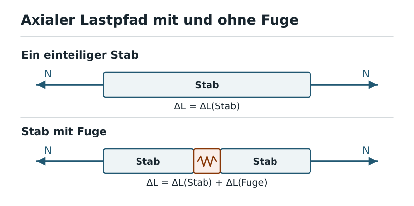

# M5-L2 – Leichtbau, Werkstoffauswahl und Verbindungen {#L2}

**Kursbereich:** M5 – Werkstoffe und Leichtbau

**Studienrolle** · Kern/Grundlagen

**Vorwissen** · [M5-L1 – Lastpfade und einfache Spannungsmodelle](M5-L1.md)

**Lernziel** · Spezifische Kennwerte und Verbindungseigenschaften bei einer Variantenwahl abwägen

## Die leichtere Strebe braucht eine Verbindung {#S1}

In einem zivilen Flugzeugmodell gibt es zwei Konzepte für eine axial belastete Messgerätehalterung. Variante A hat einen einteiligen Stab. Variante B verwendet einen leichteren Werkstoff, benötigt aber eine zusätzliche Verbindung in der Mitte. Welche Variante bietet mehr axiale Steifigkeit pro Gesamtmasse, wenn diese Verbindung berücksichtigt wird?

## Vom spezifischen Werkstoffkennwert zum Lastpfad {#S2}

Der Elastizitätsmodul $E$ beschreibt die Steigung im linear-elastischen Spannungs-Dehnungs-Bereich. Die Dichte $\rho$ setzt Masse und Volumen ins Verhältnis. Der spezifische Modul $E/\rho$ vergleicht Werkstoffe nach elastischer Steifigkeit bei gegebener Dichte. Er hat die Einheit $\mathrm{m^2/s^2}$ und sagt für sich nur etwas über den gewählten Verformungsmechanismus aus. Im axialen Stab mit konstantem Querschnitt $A$ und Länge $L$ gilt:

$$
k_\mathrm{Stab}=\frac{EA}{L},\qquad
m_\mathrm{Stab}=\rho AL,\qquad
\frac{k_\mathrm{Stab}}{m_\mathrm{Stab}}=\frac{E}{\rho L^2}.
$$

$k$ ist die axiale Kraft pro Verlängerung in $\mathrm{N/m}$. Bei gleicher Länge entscheidet $E/\rho$ im isolierten Stab über das Verhältnis $k/m$. Bei Biegung beeinflusst die Querschnittsgeometrie den Vergleich über das Flächenträgheitsmoment.

Im Modell durchläuft dieselbe Axialkraft nacheinander Stab und Verbindung. Die Verlängerungen addieren sich in diesem seriellen Lastpfad. Bei einer idealisierten Fugensteifigkeit $k_\mathrm{F}$ gilt $1/k_\mathrm{ges}=1/k_\mathrm{Stab}+1/k_\mathrm{F}$. Stab- und Fugenmasse werden für den Systemvergleich addiert.

{alt="Ein durchgehender Stab und zwei Stabteile mit einer dazwischenliegenden Fuge tragen die gleiche Axialkraft."}

## Wann die Rangfolge der Varianten wechselt {#S3}

Beide Modellstäbe haben $L=0{,}50\,\mathrm{m}$ und $A=1{,}0\cdot10^{-4}\,\mathrm{m^2}$. Für die fiktiven Werkstoffe seien $E_A=72\,\mathrm{GPa}$ und $\rho_A=2700\,\mathrm{kg/m^3}$ sowie $E_B=60\,\mathrm{GPa}$ und $\rho_B=1500\,\mathrm{kg/m^3}$ angesetzt. Die gemeinsamen Endanschlüsse bleiben in beiden Rechnungen außerhalb der Vergleichsgrenze.

- A hat $k_A=14{,}4\,\mathrm{MN/m}$ und $m_A=0{,}135\,\mathrm{kg}$, also $k_A/m_A\approx106{,}7\,\mathrm{MN/(m\,kg)}$.
- B hat als Stab $k_B=12\,\mathrm{MN/m}$ und $m_B=0{,}075\,\mathrm{kg}$. Sein Verhältnis ohne Fuge wäre $160\,\mathrm{MN/(m\,kg)}$.
- Die Fuge von B bringt $0{,}025\,\mathrm{kg}$ mit und hat $k_\mathrm{F}=6\,\mathrm{MN/m}$. Die Reihenschaltung ergibt $k_\mathrm{ges}=4\,\mathrm{MN/m}$. Bei $m_\mathrm{ges}=0{,}100\,\mathrm{kg}$ sinkt das Verhältnis auf $40\,\mathrm{MN/(m\,kg)}$.

B ist auch als Gesamtsystem leichter. A hat unter diesen Annahmen die größere absolute und massenbezogene Steifigkeit.

## Selbstkontrolle {#S4}

1. Verdopple die Fugensteifigkeit von B bei gleicher Masse. Berechne die Gesamtsteifigkeit und den Wert pro Masse.
2. Ein Lehrversuch verlangt mindestens $8\,\mathrm{MN/m}$ axiale Steifigkeit. Welche der beiden ursprünglichen Varianten erfüllt dieses einzelne Kriterium?

::: {.lc-solutions data-lc-section="S4"}
1. Bei $k_\mathrm{F}=12\,\mathrm{MN/m}$ ergeben zwei gleiche serielle Nachgiebigkeiten $k_\mathrm{ges}=6\,\mathrm{MN/m}$. Bezogen auf die Masse ergibt das $60\,\mathrm{MN/(m\,kg)}$.
2. A erfüllt das Kriterium mit $14{,}4\,\mathrm{MN/m}$. B erreicht im ursprünglichen Fugenmodell $4\,\mathrm{MN/m}$.
:::

## Welche Eigenschaften bei einem Bauteilvergleich hinzukommen {#S5}

Die Rechnung gilt für kleine axiale Verformungen und eine linear modellierte Verbindung ohne Spiel oder Schlupf. Bei Biegung, anisotropen Werkstoffen oder wechselnden Lasten sind andere Kennwerte erforderlich. Die lokale Spannungsverteilung, Festigkeit, Inspektionszugänglichkeit und Alterung lassen sich aus der axialen Gesamtsteifigkeit allein nicht ableiten.

## Die Vergleichsgrenze entscheidet über die Kennzahl {#S6}

Werkstoffkennwerte beschreiben das Material. Wenn eine Fuge zur Lastübertragung gehört, muss ihre Nachgiebigkeit und Masse in die Systemkennzahl eingehen. Wiederholte Beanspruchung kann zusätzliche Anforderungen an Material und Verbindung stellen.

**Weiterlesen** · [M5-L3 – Ermüdung, Inspektion und Evidenz](M5-L3.md)

## Quellen (extern) {#S7}

- [OpenStax – University Physics Volume 1 – Stress, Strain, and Elastic Modulus](https://openstax.org/books/university-physics-volume-1/pages/12-3-stress-strain-and-elastic-modulus) · § 12.3, Gl. 12.34–12.36 · Fachgrundlage · Zuletzt abgerufen: 2026-11-23
- [MIT OpenCourseWare – Unified Engineering: Materials and Structures – Lecture Notes](https://ocw.mit.edu/courses/16-001-unified-engineering-materials-and-structures-fall-2021/pages/lecture-notes/) · Fall 2021, Lehrfolienliste zu stress, strain, constitutive laws und beams · Fachgrundlage · Zuletzt abgerufen: 2026-11-23
