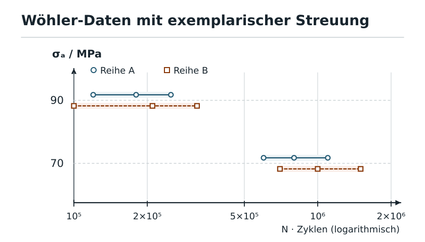

# M5-L3 – Ermüdung, Inspektion und Evidenz {#L3}

**Kursbereich:** M5 – Werkstoffe und Leichtbau

**Studienrolle** · Kern/Grundlagen

**Vorwissen** · [M5-L1 – Lastpfade und einfache Spannungsmodelle](M5-L1.md); [M5-L2 – Leichtbau, Werkstoffauswahl und Verbindungen](M5-L2.md)

**Lernziel** · Zyklische Belastung, statische Festigkeit und Aussagegrenzen von Ermüdungsdaten trennen

## Ein unauffälliger Einzeltest sagt wenig über wiederholte Lasten {#S1}

Zwei Modellproben für einen zivilen Strukturträger überstehen denselben einmaligen Laborlastfall. Im Versuch mit wiederholter Belastung fallen einzelne Proben jedoch nach unterschiedlichen Zykluszahlen aus. Warum kann eine statische Beobachtung eine Ermüdungsbewertung nicht ersetzen, und was lässt sich aus wenigen Laborpunkten tatsächlich ableiten?

## Spannungsamplitude, Mittelspannung und Wöhler-Daten {#S2}

Ermüdung ist eine fortschreitende Schädigung unter wechselnder Beanspruchung. Ein vereinfachter Zyklus wird hier durch die größten und kleinsten Normalspannungen $\sigma_\mathrm{max}$ und $\sigma_\mathrm{min}$ beschrieben. Die Spannungsamplitude $\sigma_a$ ist der halbe Spannungsbereich. Die Mittelspannung $\sigma_m$ beschreibt die Lage des Zyklus:

$$
\sigma_a=\frac{\sigma_\mathrm{max}-\sigma_\mathrm{min}}{2},\qquad
\sigma_m=\frac{\sigma_\mathrm{max}+\sigma_\mathrm{min}}{2}.
$$

Eine Wöhlerdarstellung verknüpft bei festgelegten Versuchsbedingungen $\sigma_a$ mit der Zahl $N$ der Zyklen bis zum definierten Ausfall. Die horizontale Achse ist häufig logarithmisch. Ein gleicher Abstand steht dort für einen gleichen Faktor in $N$. Einzelne Punkte stehen für Versuchsergebnisse. Bei gleicher Amplitude können sie streuen. Die gezeichneten Streubänder zeigen ausschließlich den kleinsten und größten Messwert der Beispielreihe. Als Ausfallkriterium gilt hier für alle Versuche der Bruch einer glatten Laborprobe.

{alt="Zwölf synthetische Bruchdatenpunkte für zwei Amplituden und zwei Reihen. Horizontal markierte Spannen überlappen sich pro Amplitude."}

## Synthetische Versuchsreihen richtig vergleichen {#S3}

Alle Proben werden bei $\sigma_m=20\,\mathrm{MPa}$ geprüft. Für $90\,\mathrm{MPa}$ Amplitude läuft der Zyklus daher von $-70$ bis $110\,\mathrm{MPa}$. Die Daten sind synthetisch. Gezählt werden Zyklen bis zum Bruch.

| Amplitude | Reihe A, Zyklen | Reihe B, Zyklen |
|---|---|---|
| $90\,\mathrm{MPa}$ | $120000$, $180000$, $250000$ | $100000$, $210000$, $320000$ |
| $70\,\mathrm{MPa}$ | $600000$, $800000$, $1100000$ | $700000$, $1000000$, $1500000$ |

Bei $90\,\mathrm{MPa}$ reicht A von $120000$ bis $250000$ Zyklen und B von $100000$ bis $320000$. B hat sowohl den niedrigsten als auch den höchsten Einzelwert. Bei $70\,\mathrm{MPa}$ liegen die Ergebnisse beider Stichproben höher, aber ihre Spannweiten überlappen sich innerhalb dieser Amplitude ebenfalls. Die Reihen illustrieren Streuung und den Einfluss der Amplitude. Eine verlässliche Rangfolge oder ein Grenzwert erfordert zusätzliche Evidenz.

## Selbstkontrolle {#S4}

1. Eine weitere glatte Probe wird zwischen $-30$ und $120\,\mathrm{MPa}$ belastet. Berechne Amplitude und Mittelspannung. Darfst du diesen Versuch ohne Weiteres mit derselben Versuchsreihe zusammenfassen?
2. Bei der Sichtprüfung eines beanspruchten Bauteils ist kein Riss erkennbar. Welche zusätzliche Information ist für die Bewertung dieses Befunds nötig?

::: {.lc-solutions data-lc-section="S4"}
1. Die Amplitude beträgt $75\,\mathrm{MPa}$ und die Mittelspannung $45\,\mathrm{MPa}$. Die Mittelspannung weicht von den $20\,\mathrm{MPa}$ der Reihe ab. Für einen gemeinsamen Vergleich wäre eine kontrollierte Behandlung dieses Unterschieds nötig.
2. Erforderlich sind Angaben zur Nachweisgrenze und zur geprüften Oberfläche oder Zone. Ein fehlender sichtbarer Befund schließt kleinere oder verdeckte Risse nicht aus. Das geeignete Prüfverfahren hängt vom Bauteil und der Fragestellung ab.
:::

## Was sich aus der Stichprobe nicht ableiten lässt {#S5}

Die zwei Amplituden gelten für glatte Proben und gleichförmig wiederholte Zyklen. Kerben, Verbindungen, korrosive Umgebung und gemischte Lastkollektive können das Verhalten ändern. Die Versuchsstichprobe enthält keinen statistisch abgesicherten unteren Lebensdauerwert. Sie eignet sich weder zur Festlegung eines Inspektionsintervalls noch zur Freigabe eines Bauteils.

## Messdaten brauchen ihre Versuchsgrenzen {#S6}

Ermüdungsdaten werden erst durch Lastbereich, Mittelspannung, Ausfallkriterium und Streuung interpretierbar. Prüfverfahren ergänzen diese Evidenz durch Beobachtungen mit begrenzter Nachweisfähigkeit.

**Weiterlesen** · [M6-L1 – Gravitation und Kreisbahn](M6-L1.md)

## Quellen (extern) {#S7}

- [NASA Technical Reports Server – Advances in Fatigue and Fracture Mechanics Analyses for Aircraft Structures](https://ntrs.nasa.gov/citations/20040086677) · Abstract · Fachgrundlage · Zuletzt abgerufen: 2026-11-23
- [TUM School of Engineering and Design – Modulhandbuch Aerospace [202501]](https://www.ed.tum.de/fileadmin/w00byg/ed/03_Studium/Aerospace_B._Sc/Modulhandbuch/WiSe25/Modulhandbuch_BScAerospace_SPO-202501_DE_2025-12-15.pdf) · ED110124 S. 79–81; LRG0090 S. 94–95; ED110104 S. 510–512; ED110106 S. 536–538; MW0832 S. 560–561; MW0837 S. 562–563; MW2282 S. 579–580 · Curricularer Bezug · Zuletzt abgerufen: 2026-11-23
