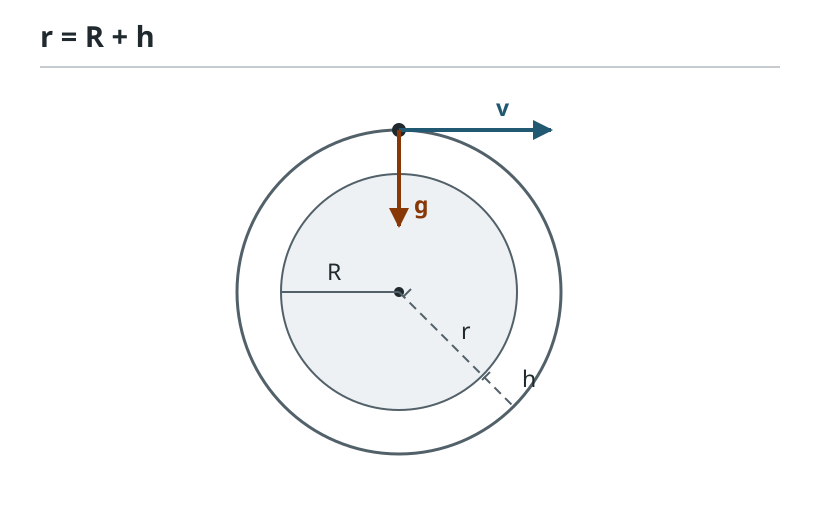

# M6-L1 – Gravitation und Kreisbahn {#L1}

**Kursbereich:** M6 – Raumflugmechanik und Missionsanalyse

**Studienrolle** · Kern/Grundlagen

**Vorwissen** · [M1-L2 – Kräfte-, Impuls- und Energiebilanzen](M1-L2.md)

**Lernziel** · Kreisbahngeschwindigkeit und -periode im idealen Zweikörpermodell herleiten

## Einstieg {#S1}

Ein fiktiver Erdbeobachtungssatellit umrundet einen Modellplaneten. Im Unterricht soll aus seiner Bahnhöhe die Zeit für einen Umlauf abgeleitet werden. Dazu muss zuerst klar sein, welche Strecke als Radius in die Rechnung eingeht und weshalb ein Körper mit konstanter Geschwindigkeit im Sinn eines konstanten *Betrags* trotzdem beschleunigt wird.

## Begriffe und Modell {#S2}

Im ebenen Kreisbahnmodell liegt der Mittelpunkt eines kugelsymmetrischen Zentralkörpers im Ursprung eines näherungsweise inertialen Bezugssystems. $\vec r$ zeigt vom Zentrum zum Raumfahrzeug, $r=|\vec r|$ ist der Bahnradius in Metern. Die Höhe $h$ über der Modelloberfläche und der Radius $R$ des Zentralkörpers ergeben zusammen $r=R+h$. Die Geschwindigkeit ist tangential, die Gravitationsbeschleunigung radial nach innen gerichtet. Ihr Betrag ist $\mu/r^2$, wobei $\mu=GM$ der Gravitationsparameter des Zentralkörpers in $\mathrm{m^3/s^2}$ ist. Dabei ist $G$ die Gravitationskonstante und $M$ die Masse des Zentralkörpers.

Bei einer Kreisbahn liefert die Gravitation die gesamte Zentripetalbeschleunigung $v^2/r$. Das ist dieselbe Beschleunigung aus zwei Perspektiven, einmal als Folge einer Kraft und einmal als Folge der Bahngeometrie. Gleichsetzen, nach $v$ auflösen und die Kreisstrecke $2\pi r$ durch $v$ teilen ergibt

$$
v=\sqrt{\frac{\mu}{r}}, \qquad T=\frac{2\pi r}{v}=2\pi\sqrt{\frac{r^3}{\mu}}.
$$

Der Ausdruck unter der ersten Wurzel hat die Einheit $\mathrm{m^2/s^2}$, jener unter der zweiten die Einheit $\mathrm{s^2}$. Die Masse des Raumfahrzeugs kürzt sich in der Bewegungsgleichung heraus. Der Zentralkörper wird als sehr viel schwerer angenommen.

{alt="Kreisbahn mit tangentialer Geschwindigkeit und nach innen gerichteter Gravitationsbeschleunigung."}

## Durchgerechnetes Beispiel {#S3}

Für den Modellplaneten gelten $R=3\,000\,\mathrm{km}$, $h=1\,000\,\mathrm{km}$ und $\mu=6{,}4\cdot10^{13}\,\mathrm{m^3/s^2}$.

1. Der Abstand vom Zentrum beträgt $r=4\,000\,\mathrm{km}=4{,}0\cdot10^6\,\mathrm{m}$.
2. Aus $\mu/r=1{,}6\cdot10^7\,\mathrm{m^2/s^2}$ folgt $v=4{,}0\cdot10^3\,\mathrm{m/s}$.
3. Die Umlaufperiode ist $T=2\,000\pi\,\mathrm{s}\approx6\,283\,\mathrm{s}\approx104{,}7\,\mathrm{min}$.

Als Kontrolle ergeben sowohl $\mu/r^2$ als auch $v^2/r$ genau $4{,}0\,\mathrm{m/s^2}$. Die örtliche Beschleunigung ändert laufend die Bewegungsrichtung. Der Betrag der Geschwindigkeit bleibt über den ganzen Kreis gleich.

## Selbstkontrolle {#S4}

1. Wie ändern sich Bahngeschwindigkeit und Periode, wenn der Bahnradius beim selben Zentralkörper verdoppelt wird?
2. Welche beiden Richtungen haben Geschwindigkeit und Beschleunigung an einem Bahnpunkt? Welche Größe bleibt dabei konstant?

::: {.lc-solutions data-lc-section="S4"}

1. $v$ sinkt auf den Faktor $1/\sqrt{2}$, $T$ wächst um den Faktor $2^{3/2}$. Beide Beziehungen verwenden den Bahnradius.
2. Die Geschwindigkeit weist tangential und die Beschleunigung zum Zentrum. Der Geschwindigkeitsbetrag bleibt konstant, der Geschwindigkeitsvektor ändert seine Richtung.

:::

## Annahmen und Grenzen {#S5}

Das Modell setzt eine Kreisbahn, einen dominierenden kugelsymmetrischen Zentralkörper und vernachlässigbare Störkräfte voraus. Reale Bahnen können durch eine ungleichmäßige Massenverteilung, andere Himmelskörper oder in niedrigen Bahnen durch Restatmosphäre beeinflusst werden. In der Rechnung ist das Verwechseln von $h$ und $r$ besonders folgenreich. Eine daraus abgeleitete Umlaufperiode sagt zudem noch nichts über den Zeitpunkt aus, an dem eine bestimmte Bodenregion erneut beobachtet wird.

## Zusammenfassung {#S6}

Eine Kreisbahn kombiniert konstante Bahngeschwindigkeit im Betrag mit nach innen gerichteter Beschleunigung. Beim selben Zentralkörper haben größere Kreisbahnen geringere Geschwindigkeit und längere Umlaufzeit. Eine Ellipse führt anschließend getrennte Größen für die Bahnform und die veränderliche Bewegung entlang der Bahn ein.

**Weiterlesen** · [M6-L2 – Ellipse, Zustandsvektor und Bahnenergie](M6-L2.md)

## Quellen (extern) {#S7}

- [NASA Science – Basics of Space Flight – Chapter 3](https://science.nasa.gov/learn/basics-of-space-flight/chapter3-3/) · Acceleration in Orbit; Kepler’s Laws · Fachgrundlage · Zuletzt abgerufen: 2026-11-23
- [OpenStax – University Physics Volume 1 – Satellite Orbits and Energy](https://openstax.org/books/university-physics-volume-1/pages/13-4-satellite-orbits-and-energy) · § 13.4, Circular Orbits, Gl. 13.7–13.8 · Fachgrundlage · Zuletzt abgerufen: 2026-11-23
