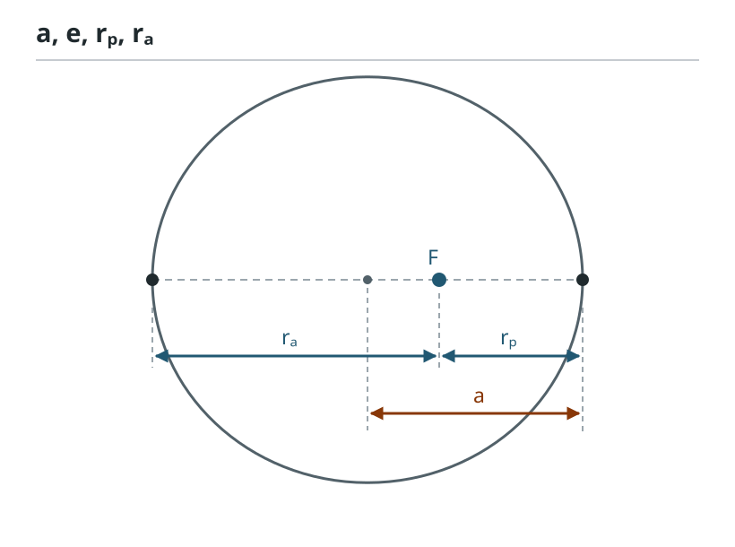

# M6-L2 – Ellipse, Zustandsvektor und Bahnenergie {#L2}

**Kursbereich:** M6 – Raumflugmechanik und Missionsanalyse

**Studienrolle** · Kern/Grundlagen

**Vorwissen** · [M6-L1 – Gravitation und Kreisbahn](M6-L1.md)

**Lernziel** · Bahnabschnitte und Energiebedeutung aus Halbachse, Exzentrizität und Zustandsvektor ableiten

## Einstieg {#S1}

Ein fiktives wissenschaftliches Raumfahrzeug meldet zu verschiedenen Zeiten unterschiedliche Abstände vom Zentralkörper. Die Messwerte können zu derselben idealen Umlaufbahn gehören. Aus der Geometrie einer Ellipse und der örtlichen Bewegung lässt sich erklären, wie das möglich ist und was auf der ganzen Bahn konstant bleibt.

## Begriffe und Modell {#S2}

In einer ebenen Keplerellipse liegt der Zentralkörper in einem Brennpunkt. Die große Halbachse $a$ ist die Hälfte der langen Ellipsenachse, die dimensionslose Exzentrizität $e$ beschreibt die Abweichung von der Kreisform. Für die Ellipse gilt $0\leq e<1$. Die beiden Apsiden sind der nächste und der fernste Punkt vom Brennpunkt. Am Perizentrum ist der Abstand $r_\mathrm{p}=a(1-e)$, am Apozentrum $r_\mathrm{a}=a(1+e)$. In einer Kreisbahn fallen beide Abstände zusammen und es gibt keine eindeutige Apsidenrichtung. Höhe und Abstand vom Brennpunkt bleiben verschiedene Größen.

Der Zustand zu einem Zeitpunkt besteht aus dem Positionsvektor $\vec r$ in Metern und dem Geschwindigkeitsvektor $\vec v$ in $\mathrm{m/s}$, jeweils in demselben inertialen Bezugssystem. Für die idealisierte Bewegung unter alleiniger Zentralgravitation beträgt die spezifische mechanische Energie, also die mechanische Energie pro Masse des Raumfahrzeugs,

$$
\mathcal E=\frac{v^2}{2}-\frac{\mu}{r}=-\frac{\mu}{2a}.
$$

Das Nullniveau der potenziellen Energie liegt im Unendlichen. $\mathcal E$ hat die Einheit $\mathrm{J/kg}$ und ist auf einer gebundenen Keplerellipse negativ. Die lokale Geschwindigkeit ändert sich so, dass die Summe aus spezifischer kinetischer und potenzieller Energie erhalten bleibt. Auch der spezifische Drehimpuls $\vec r\times\vec v$ in $\mathrm{m^2/s}$ bleibt im Zentralkraftmodell konstant.

{alt="Ellipse mit Zentralkörper im Brennpunkt, langem Abstand zum Apozentrum und kurzem Abstand zum Perizentrum."}

## Durchgerechnetes Beispiel {#S3}

Eine synthetische Ellipse hat $a=6{,}0\cdot10^6\,\mathrm{m}$, $e=1/3$ und $\mu=6{,}4\cdot10^{13}\,\mathrm{m^3/s^2}$.

1. Das Perizentrum liegt bei $r_\mathrm{p}=4{,}0\cdot10^6\,\mathrm{m}$ und das Apozentrum bei $r_\mathrm{a}=8{,}0\cdot10^6\,\mathrm{m}$.
2. Die spezifische Energie beträgt $\mathcal E=-\mu/(2a)\approx-5{,}33\cdot10^6\,\mathrm{J/kg}$.
3. An beiden Apsiden ist die Geschwindigkeit tangential, da die radiale Abstandskomponente dort ein Extremum hat. Aus der Drehimpulserhaltung folgt $r_\mathrm{p}v_\mathrm{p}=r_\mathrm{a}v_\mathrm{a}$. Im Perizentrum ist der Geschwindigkeitsbetrag deshalb doppelt so groß wie im Apozentrum.

Das Vorzeichen der spezifischen Energie ist mit einer gebundenen Bahn vereinbar. Für ihre Form ist zusätzlich die Exzentrizität oder eine gleichwertige Zustandsinformation erforderlich.

## Selbstkontrolle {#S4}

1. Welches $a$ und welches $e$ ergeben sich für Apsidenabstände von $3\,000$ und $9\,000\,\mathrm{km}$?
2. Zwei Bahnen um denselben Zentralkörper haben dasselbe $a$, einmal mit $e=0$ und einmal mit $e=1/2$. Welche Größe ist auf beiden Bahnen gleich, und auf welcher Bahn ändert sich der Geschwindigkeitsbetrag?

::: {.lc-solutions data-lc-section="S4"}

1. Addition liefert $a=6\,000\,\mathrm{km}$. Die Differenz der Apsidenabstände geteilt durch ihre Summe liefert $e=1/2$.
2. Die spezifische mechanische Energie ist gleich. Der Geschwindigkeitsbetrag ändert sich entlang der exzentrischen Bahn, weil sich dort der Abstand und damit die potenzielle Energie ändern.

:::

## Annahmen und Grenzen {#S5}

Die Gleichungen beschreiben ein geschlossenes Keplermodell ohne weitere Kräfte. Ein einzelner Abstand legt keine eindeutige Ellipse fest. Ohne den vollständigen Geschwindigkeitsvektor kann beispielsweise die Bahnebene unbestimmt bleiben. Nahe der Kreisform reagiert eine geschätzte Apsidenrichtung empfindlich auf kleine Messfehler. Die Größen $a$ und $e$ allein beschreiben die Form und Größe, während Lage der Bahnebene und Position auf der Bahn zusätzliche Angaben erfordern.

## Zusammenfassung {#S6}

Die Ellipsengeometrie bestimmt Apsidenabstände. Die spezifische Energie erfasst die Größe der gebundenen Bahn, und Drehimpulserhaltung erklärt den Unterschied der Apsidengeschwindigkeiten. Anschließend lässt sich untersuchen, weshalb eine örtliche Störung des Zustands eine andere Bahn beschreibt.

**Weiterlesen** · [M6-L3 – Bahnänderungen als energetisches Modell](M6-L3.md)

## Quellen (extern) {#S7}

- [NASA Science – Basics of Space Flight – Chapter 5](https://science.nasa.gov/learn/basics-of-space-flight/chapter5-1/) · Orbital Parameters and Elements · Fachgrundlage · Zuletzt abgerufen: 2026-11-23
- [NASA Science – Basics of Space Flight – Chapter 3](https://science.nasa.gov/learn/basics-of-space-flight/chapter3-3/) · Acceleration in Orbit; Kepler’s Laws · Fachgrundlage · Zuletzt abgerufen: 2026-11-23
- [OpenStax – University Physics Volume 1 – Satellite Orbits and Energy](https://openstax.org/books/university-physics-volume-1/pages/13-4-satellite-orbits-and-energy) · § 13.4, Circular Orbits, Gl. 13.7–13.8 · Fachgrundlage · Zuletzt abgerufen: 2026-11-23
