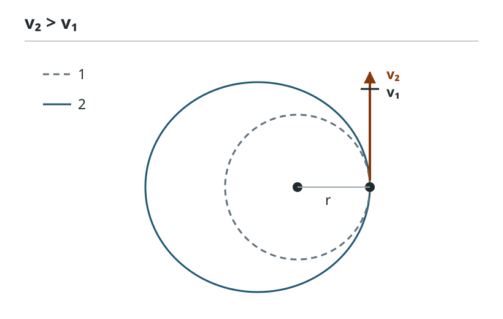

# M6-L3 – Bahnänderungen als energetisches Modell {#L3}

**Kursbereich:** M6 – Raumflugmechanik und Missionsanalyse

**Studienrolle** · Kern/Grundlagen

**Vorwissen** · [M6-L2 – Ellipse, Zustandsvektor und Bahnenergie](M6-L2.md)

**Lernziel** · Idealisierten tangentialen Impuls qualitativ mit Energie- und Bahnänderung verbinden

## Einstieg {#S1}

In einer Lernsimulation folgt ein Beobachtungsinstrument einer kreisförmigen Bahn. Zum Vergleich zweier Modellläufe wird an einem einzigen Bildpunkt der tangentiale Geschwindigkeitspfeil etwas verlängert. Warum zeigt das Instrument im ersten Bild danach dieselbe Position, obwohl die angezeigte Bahn ihre Form ändert?

## Begriffe und Modell {#S2}

Wir beschreiben denselben Punkt unmittelbar vor und nach der Störung in einem inertialen Bezugssystem mit Ursprung im Zentralkörper. Im idealen Impulsmodell ändert sich die Position während dieses einzelnen Schrittes nicht. Die Geschwindigkeitsänderung liegt tangential zur Ausgangskreisbahn und weist in Bewegungsrichtung. Der vorwärts gerichtete Geschwindigkeitsbetrag steigt daher von $v_\mathrm{alt}$ auf $v_\mathrm{neu}$. Beide Größen werden in $\mathrm{m/s}$ angegeben.

Da der Abstand $r$ im Vergleichsmoment gleich bleibt, ändert sich die spezifische potenzielle Energie $-\mu/r$ in diesem Moment nicht. Die spezifische kinetische Energie $v^2/2$ nimmt zu. Damit gilt für die spezifische mechanische Energie in $\mathrm{J/kg}$

$$
\mathcal E_\mathrm{neu}>\mathcal E_\mathrm{alt}.
$$

Bleibt $\mathcal E_\mathrm{neu}$ negativ und wirkt danach wieder ausschließlich die Zentralgravitation, ist der neue Zustand gebunden. Die Energiebeziehung $\mathcal E=-\mu/(2a)$ besagt dann, dass die große Halbachse $a$ im neuen Modell größer ist. Kreisförmig könnte die Bahn am gemeinsamen Punkt nur sein, wenn dort der zu diesem Radius gehörende Kreisbahngeschwindigkeitsbetrag vorläge.

{alt="Gestrichelter Ausgangskreis und durchgezogene Ellipse mit gemeinsamem Punkt und vergrößertem Tangentialvektor."}

## Durchgerechnetes Beispiel {#S3}

Ein Lehrprogramm zeigt einen Zentralkörper und markiert den rechten Rand der ursprünglichen Kreisbahn als Vergleichspunkt. Dort weist der ursprüngliche Geschwindigkeitsvektor senkrecht nach oben. Der Vergleichslauf verwendet am selben Punkt dieselbe Richtung, aber einen etwas größeren Betrag. In beiden Läufen endet die betrachtete Störung sofort und im Versuch bleiben beide Zustände gebunden.

1. Die beiden Positionen fallen zusammen. Der sofortige Energieunterschied steckt daher vollständig in der kinetischen Energie.
2. Der Ausgangslauf zeigt die zum gemeinsamen Radius passende Kreisgeschwindigkeit. Im Vergleichslauf überschreitet die neue Geschwindigkeit diesen Wert und der Zustand kann dort keine Kreisbahn mehr beschreiben.
3. Die neue Ellipse ist am Vergleichspunkt tangential zur Ausgangsbahn. Wegen der höheren Geschwindigkeit bei demselben Radius ist die verfügbare Zentralbeschleunigung kleiner als die für einen Kreis mit dieser Geschwindigkeit erforderliche. Der Abstand nimmt nach dem Vergleichspunkt zunächst zu. Der Punkt ist das Perizentrum der neuen gebundenen Bahn.

Der größere Geschwindigkeitsbetrag gilt für den Vergleich am gemeinsamen Punkt. Entlang der Ellipse ändert sich der Betrag mit dem Abstand. Außerdem hat eine getrennte größere Kreisbahn einen kleineren Kreisgeschwindigkeitsbetrag als die ursprüngliche Kreisbahn.

## Selbstkontrolle {#S4}

1. Welche beiden Energieterme vergleichst du direkt am gemeinsamen Punkt? Welcher bleibt gleich?
2. Eine Figur legt den neuen Kreisradius einfach oberhalb der ursprünglichen Bahn ein, ohne gemeinsamen Punkt. Welche Beobachtung aus dem Impulsmodell verletzt sie?

::: {.lc-solutions data-lc-section="S4"}

1. Spezifische potenzielle und kinetische Energie. Die potenzielle Energie bleibt bei festem $r$ gleich. Die kinetische Energie steigt mit dem größeren Geschwindigkeitsbetrag.
2. Der Impuls ändert im gewählten Vergleich nur die Geschwindigkeit. Beide Modellbahnen gehen daher durch den gemeinsamen Punkt, wo nur der zum ursprünglichen Radius passende Geschwindigkeitsbetrag eine Kreisbahn zuließe.

:::

## Annahmen und Grenzen {#S5}

Ein unmittelbarer Zustandswechsel beschreibt eine mathematische Idealisierung. Bei einer zeitlich ausgedehnten Einwirkung bewegen sich Position und Geschwindigkeit gleichzeitig weiter. Eine radiale oder aus der Bahnebene weisende Änderung hätte andere geometrische Folgen. Die Betrachtung verwendet gebundene Zustände und weder Zielbahnparameter noch ein reales Manöver.

## Zusammenfassung {#S6}

Eine tangentiale Störung ändert im Modell lokal die Geschwindigkeit und die spezifische Bahnenergie. Der Vergleich hält den Startpunkt fest und erklärt dadurch den Unterschied zwischen einer augenblicklichen Zustandsänderung und der daraus folgenden Bahnform.

**Weiterlesen** · [M6-L4 – Missionsziele, Bahnwahl und Modellabweichungen](M6-L4.md)

## Quellen (extern) {#S7}

- [OpenStax – University Physics Volume 1 – Satellite Orbits and Energy](https://openstax.org/books/university-physics-volume-1/pages/13-4-satellite-orbits-and-energy) · § 13.4, Circular Orbits, Gl. 13.7–13.8 · Fachgrundlage · Zuletzt abgerufen: 2026-11-23
- [NASA Science – Basics of Space Flight – Chapter 3](https://science.nasa.gov/learn/basics-of-space-flight/chapter3-3/) · Acceleration in Orbit; Kepler’s Laws · Fachgrundlage · Zuletzt abgerufen: 2026-11-23
- [NASA Earth Observatory – Catalog of Earth Satellite Orbits](https://science.nasa.gov/earth/earth-observatory/catalog-of-earth-satellite-orbits/) · Three Classes of Orbit; High Earth Orbit · Fachgrundlage · Zuletzt abgerufen: 2026-11-23
