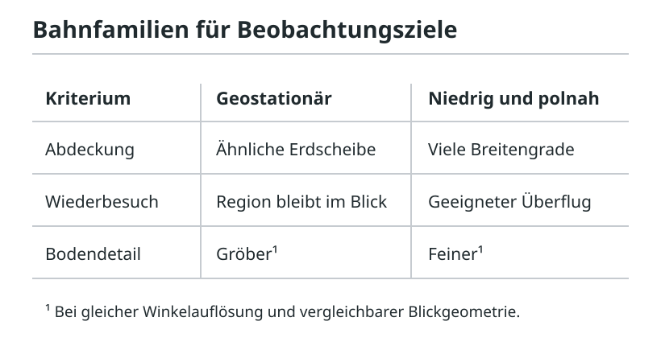

# M6-L4 – Missionsziele, Bahnwahl und Modellabweichungen {#L4}

**Kursbereich:** M6 – Raumflugmechanik und Missionsanalyse

**Studienrolle** · Kern/Grundlagen

**Vorwissen** · [M6-L1 – Gravitation und Kreisbahn](M6-L1.md); [M6-L2 – Ellipse, Zustandsvektor und Bahnenergie](M6-L2.md)

**Lernziel** · Anforderungen einer zivilen Beobachtungsmission in qualitative Bahnkonflikte übersetzen

## Einstieg {#S1}

Ein ziviler Wetterdienst braucht für eine bestimmte Wolkenregion regelmäßig neue Bilder. Ein zweites Projekt möchte an vielen Breitengraden langfristige Oberflächenänderungen erkennen. Beide wollen die Erde beobachten, stellen aber unterschiedliche Anforderungen an räumliche Abdeckung, Wiederbesuch und Bildqualität.

## Begriffe und Modell {#S2}

Ein Missionsziel beschreibt, welche Information für wen und in welcher Zeitspanne verfügbar sein soll. Das Wort *Abdeckung* bezeichnet hier die Regionen, die sich unter den angenommenen Beobachtungsbedingungen grundsätzlich erfassen lassen. *Wiederbesuchszeit* ist das Zeitintervall zwischen zwei geeigneten Beobachtungsgelegenheiten derselben Region. Sie hängt von der Bewegung relativ zur rotierenden Erde, vom beobachteten Streifen und von den Aufnahmebedingungen ab. Eine kurze Umlaufperiode liefert allein noch keine kurze Wiederbesuchszeit.

Wir vergleichen zwei Familien qualitativ. Eine ideale geostationäre Bahn ist kreisförmig und prograd über dem Äquator. Ihre Umlaufperiode entspricht der siderischen Erdrotation. Dadurch bleibt die beobachtete Erdscheibe relativ zum Raumfahrzeug annähernd gleich. Eine generische niedrige, polnahe Bahn führt an vielen Breitengraden vorbei, während sich die Erde unter ihrer Bahnebene dreht. Ihre Bodenspur kann über aufeinanderfolgende Umläufe unterschiedliche Regionen überstreichen. Der tatsächlich nutzbare Streifen hängt auch vom Instrument ab.

Zum Vergleich nehmen wir ein optisches Lehrinstrument an. Gleiches Winkelauflösungsvermögen führt bei größerer Beobachtungsentfernung und ansonsten ähnlicher Geometrie tendenziell zu gröberen Details am Boden. Wolken, Beleuchtung, Sichtwinkel und vorhandene Bildverarbeitung bestimmen zusätzlich, welche Beobachtungen wissenschaftlich brauchbar sind.

{alt="Tabelle vergleicht Abdeckung, Wiederbesuch und Bodendetail geostationärer und niedriger polnaher Bahnen."}

## Durchgerechnetes Beispiel {#S3}

Der Wetterdienst möchte die Entwicklung einer Wolkenregion in einer einzigen geeigneten Erdscheibe in dichter Folge verfolgen. Das Oberflächenprojekt braucht über die Zeit viele Breitengrade und legt größeren Wert auf kleine erkennbare Bodenstrukturen als auf dauernden Blickkontakt.

| Kriterium | Geostationäre Familie | Niedrige, polnahe Familie |
|---|---|---|
| Abdeckung | Ähnliche sichtbare Erdscheibe über längere Zeit | Viele Breitengrade im Verlauf mehrerer Umläufe |
| Wiederbesuch | Die passende Region bleibt grundsätzlich im Blick | Erneute geeignete Passage hängt von Bodenspur und Instrument ab |
| Bodenstruktur | Größere Entfernung ergibt im Vergleich gröbere Details | Geringere Entfernung erlaubt bei sonst gleichen Annahmen feinere Details |
| Umwelt | Auf die jeweilige Bahn bezogene Prüfung von Beleuchtung und Strahlung nötig | Beleuchtung, Restatmosphäre und Trümmerumgebung gesondert betrachten |

Die geostationäre Familie passt im Vergleich besser zum Wetterziel. Die niedrige, polnahe Familie passt besser zum langfristigen Oberflächenziel. Vor einer konkreten Entscheidung müssten beide Teams ihre Anforderungen an Blickgeometrie, Beobachtungszeit und Datenverfügbarkeit quantifizieren.

## Selbstkontrolle {#S4}

1. Warum verspricht ein kürzerer Umlauf keinen entsprechend kürzeren Wiederbesuch?
2. Das Wetterziel verlagert sich auf eine Region in Polnähe. Welches Ergebnis des Vergleichs muss als Erstes überprüft werden?

::: {.lc-solutions data-lc-section="S4"}

1. Während des Umlaufs dreht sich die Erde. Erst eine geeignete neue Bodenspur und ein nutzbarer Sicht- und Aufnahmebereich ermöglichen die nächste Beobachtung.
2. Die Sichtgeometrie aus der geostationären Familie muss überprüft werden. Polnahe Regionen werden aus äquatorialer Perspektive unter sehr flachen Winkeln oder gar nicht erfasst. Der vorherige Vorteil der kontinuierlichen Sicht kann dort entfallen.

:::

## Annahmen und Grenzen {#S5}

Der Vergleich verwendet generische Familien und dieselbe angenommene Winkelauflösung. Er liefert qualitative Präferenzen, keine konkrete Flugbahn, Wiederbesuchszeit oder Instrumentfreigabe. Eine niedrige polnahe Bahn ist auch nicht automatisch sonnensynchron. Ohne Angaben zu Instrument, erreichbarer Blickgeometrie, Beleuchtung und Datenlieferung bleibt die Machbarkeit offen.

## Zusammenfassung {#S6}

Die geeignete Bahnfamilie hängt von messbaren Missionszielen und den angenommenen Beobachtungsbedingungen ab. Die Orbitumgebung verbindet diese Wahl mit Wärmebedingungen, Strahlung und weiteren Systemanforderungen.

**Weiterlesen** · [M7-L1 – Raumfahrtumgebung und Wärmebilanz](M7-L1.md)

## Quellen (extern) {#S7}

- [NASA Earth Observatory – Catalog of Earth Satellite Orbits](https://science.nasa.gov/earth/earth-observatory/catalog-of-earth-satellite-orbits/) · Three Classes of Orbit; High Earth Orbit · Fachgrundlage · Zuletzt abgerufen: 2026-11-23
- [NASA Science – Basics of Space Flight – Chapter 7](https://science.nasa.gov/learn/basics-of-space-flight/chapter7-1/) · Chapter Objectives; Conceptual Study · Fachgrundlage · Zuletzt abgerufen: 2026-11-23
- [ESA – ESA Space Environment Report 2026](https://www.esa.int/articles/esa-space-environment-report-2026) · In brief; Key 2026 takeaways · Fachgrundlage · Zuletzt abgerufen: 2026-11-23
