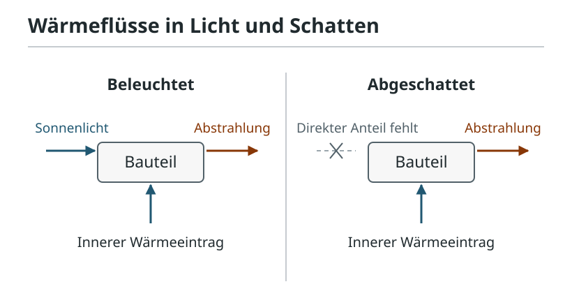

# M7-L1 – Raumfahrtumgebung und Wärmebilanz {#L1}

**Kursbereich:** M7 – Raumfahrtumgebung und Raumfahrzeugsysteme

**Studienrolle** · Kern/Grundlagen

**Vorwissen** · [M4-L1 – Energiebilanz strömender Systeme](M4-L1.md); [M6-L1 – Gravitation und Kreisbahn](M6-L1.md)

**Lernziel** · Strahlungsleistung, Vakuumgrenzen und Umweltlasten an einem Lehrmodell einordnen

## Einstieg {#S1}

Ein wissenschaftliches Raumfahrzeug wechselt im Modell zwischen beleuchtetem und abgeschattetem Bahnbereich. Ein Temperaturfühler registriert eine allmähliche Änderung. Welche Wärmeflüsse ändern sich beim Eintritt in den Schatten und welche können auch dort weiterwirken?

## Begriffe und Modell {#S2}

Wir modellieren einen Bauteilbereich als Körper mit einheitlicher Temperatur $T$ in Kelvin. Seine effektive Wärmekapazität $C_\mathrm{th}$ gibt in $\mathrm{J/K}$ an, wie viel Wärme seine Temperatur um ein Kelvin anhebt. Leistungen werden positiv in der im jeweiligen Term benannten Richtung gezählt. Eine Bilanz mit absorbierter Strahlungsleistung $P_\mathrm{abs}$, innerer Verlustwärme $P_\mathrm{int}$ und abgegebener Strahlungsleistung $P_\mathrm{emit}$ lautet

$$
C_\mathrm{th}\frac{\mathrm dT}{\mathrm dt}=P_\mathrm{abs}+P_\mathrm{int}-P_\mathrm{emit}.
$$

Im Modell sind die Leistungsgrößen in Watt angegeben. Wärmestrahlung kann sich durch Vakuum ausbreiten. Für die nach außen abstrahlende Fläche $A$ in $\mathrm{m^2}$ mit dimensionslosem thermischem Emissionsgrad $\varepsilon$ verwenden wir

$$
P_\mathrm{emit}=\varepsilon\sigma A T^4,
\qquad
\sigma\approx5{,}67\cdot10^{-8}\,\mathrm{W/(m^2\,K^4)}.
$$

$\sigma$ ist die Stefan–Boltzmann-Konstante. Die Gleichung liefert die **emittierte** Leistung. Zur Netto-Strahlungsbilanz gehört auch die vom Bauteil absorbierte Strahlung. Diese kann direkte Sonnenstrahlung, reflektiertes Sonnenlicht oder thermische Strahlung benachbarter Flächen enthalten. Auch feste Teile können weiterhin Wärme leiten. Äußere Konvektion vernachlässigen wir im angenommenen Vakuum. Stabile Temperatur im Modell erfordert eine verschwindende Nettowärmeleistung.

{alt="Ein Bauteil mit direktem Sonnenlicht, innerer Wärme und Abstrahlung. Im Schatten fehlt der direkte Anteil."}

## Durchgerechnetes Beispiel {#S3}

Zwei fiktive Oberflächen haben jeweils $A=0{,}20\,\mathrm{m^2}$ und im Vergleichsmoment $T=300\,\mathrm K$. Ihre Emissionsgrade seien $0{,}40$ und $0{,}80$.

1. Der gemeinsame Faktor $\sigma A T^4$ beträgt rund $91{,}9\,\mathrm W$.
2. Mit $\varepsilon=0{,}40$ emittiert die erste Fläche rund $36{,}7\,\mathrm W$. Für $\varepsilon=0{,}80$ ergibt sich rund $73{,}5\,\mathrm W$.
3. Die zweite Fläche emittiert bei gleicher Fläche und Temperatur doppelt so viel Wärmeleistung. Welche Fläche im Betrieb wärmer ist, hängt zusätzlich von der jeweiligen Absorption, den inneren Quellen und der Wärmeleitung ab.

Wenn der Schatten die direkte Einstrahlung reduziert, sinkt zunächst $P_\mathrm{abs}$. Bei unveränderter Anfangstemperatur ändert sich $P_\mathrm{emit}$ im ersten Moment nicht. Die Temperatur reagiert danach entsprechend dem Vorzeichen der Bilanz.

## Selbstkontrolle {#S4}

1. Um welchen Faktor ändert sich $P_\mathrm{emit}$ bei Verdopplung der absoluten Temperatur und sonst gleichen Annahmen?
2. Wie ändert sich $T$ zunächst, wenn im Schatten $P_\mathrm{abs}=10\,\mathrm W$, $P_\mathrm{int}=15\,\mathrm W$ und $P_\mathrm{emit}=35\,\mathrm W$ gelten?

::: {.lc-solutions data-lc-section="S4"}

1. Der Faktor beträgt $2^4=16$. Für diese Skalierung muss die Temperatur in Kelvin eingesetzt werden.
2. Die Bilanz beträgt $10+15-35=-10\,\mathrm W$. Bei positiver Wärmekapazität sinkt die Temperatur zunächst.

:::

## Annahmen und Grenzen {#S5}

Das Ein-Knoten-Modell setzt im Bauteilbereich kaum Temperaturunterschiede und einen hier als konstant behandelten Emissionsgrad voraus. Starke innere Temperaturgradienten, gegenseitige Abschattung, spektrale Eigenschaften und zeitlich veränderliche Oberflächeneigenschaften brauchen mehr Details. Weltraumumgebung umfasst zusätzlich etwa hochenergetische Strahlung, Startvibrationen und Einwirkungen durch Partikel. Diese werden durch die Wärmebilanz allein nicht geprüft.

## Zusammenfassung {#S6}

Im Schatten verändert sich die absorbierte Leistung, während Eigenemission und innere Wärmequellen weiterwirken können. Die Temperatur folgt der gesamten Energiebilanz. Der nächste Schritt betrachtet elektrische Leistung, die Nutzlast, Datenverarbeitung und Kommunikation gemeinsam beanspruchen.

**Weiterlesen** · [M7-L2 – Energie, Kommunikation und Systemgrenzen](M7-L2.md)

## Quellen (extern) {#S7}

- [OpenStax – University Physics Volume 2 – Mechanisms of Heat Transfer](https://openstax.org/books/university-physics-volume-2/pages/1-6-mechanisms-of-heat-transfer) · § 1.6, Radiation · Fachgrundlage · Zuletzt abgerufen: 2026-11-23
- [ESA – Mechanical Systems Laboratory](https://technology.esa.int/lab/mechanical-systems-laboratory) · Thermal testing; Mechanical testing · Fachgrundlage · Zuletzt abgerufen: 2026-11-23
- [ESA – ESA Space Environment Report 2026](https://www.esa.int/articles/esa-space-environment-report-2026) · In brief; Key 2026 takeaways · Fachgrundlage · Zuletzt abgerufen: 2026-11-23
