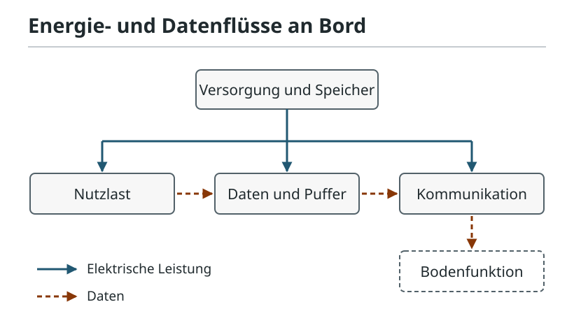

# M7-L2 – Energie, Kommunikation und Systemgrenzen {#L2}

**Kursbereich:** M7 – Raumfahrtumgebung und Raumfahrzeugsysteme

**Studienrolle** · Kern/Grundlagen

**Vorwissen** · [M4-L1 – Energiebilanz strömender Systeme](M4-L1.md); [M7-L1 – Raumfahrtumgebung und Wärmebilanz](M7-L1.md)

**Lernziel** · Interaktionen von Missionsziel, Nutzlast, Energie und Kommunikation auf Blockebene erklären

## Einstieg {#S1}

Ein ziviles Forschungsinstrument soll in einem fiktiven Kurzintervall Messwerte sammeln und danach einen Datensatz übertragen. Die Messung und die Übertragung beanspruchen gemeinsame Ressourcen. Welche Information brauchen wir neben der durchschnittlichen Leistungsbilanz, damit die beiden Funktionen im Lehrmodell stattfinden können?

## Begriffe und Modell {#S2}

Aus dem Missionsziel ergeben sich auf Blockebene drei Fragen: Welche Messdaten sollen entstehen, wann können sie genutzt werden und welche Dienste benötigen Aufnahme und Übertragung? Die Nutzlast führt die Messung aus. Eine Datenfunktion kann Messwerte verarbeiten und puffern. Die Kommunikationsfunktion stellt den Datenfluss zur Bodenfunktion her, wenn ein geeigneter Kontakt angenommen wird. Versorgung und Speicherung stellen Energie für diese Funktionsblöcke bereit. Auch der Übergang zwischen einer Messphase und einer Übertragungsphase gehört damit zum System.

Wir ziehen die Grenze um das elektrische Bordnetz und einen idealisierten Speicher. An einem elektrischen Verbraucher ist die Leistung $P$ die Energie pro Zeit in Watt, also $\mathrm{J/s}$. Bei im betrachteten Intervall konstanter Leistung gilt $E=P\,\Delta t$. Für den hier gewählten Speicherbilanzraum gilt

$$
\Delta E_\mathrm{Sp} = E_\mathrm{zu}-E_\mathrm{Grund}-E_\mathrm{Nutz}-E_\mathrm{Komm}-E_\mathrm{V}.
$$

Dabei ist $E_\mathrm{zu}$ die zugeführte Energie, $E_\mathrm{Grund}$ der kontinuierliche Grundverbrauch, $E_\mathrm{Nutz}$ der Zusatzverbrauch der Nutzlast, $E_\mathrm{Komm}$ der Zusatzverbrauch für Kommunikation und $E_\mathrm{V}$ ein separat angesetzter Verlust. Ein positives Ergebnis erhöht den idealisierten Speicherinhalt. Ein zeitweiliges Leistungsdefizit ist auch bei positiver Gesamtbilanz möglich.

{alt="Leistungsfluss zum Messblock, Datenpuffer und Kommunikationsblock. Der separate Datenpfad endet bei der Bodenfunktion."}

## Durchgerechnetes Beispiel {#S3}

Acht Minuten lang stehen im Lehrmodell $36\,\mathrm W$ Eingangsleistung zur Verfügung. Der Grundbetrieb benötigt durchgehend $18\,\mathrm W$ und der Verlust beträgt $4\,\mathrm W$. In den ersten fünf Minuten entfallen zusätzlich $12\,\mathrm W$ auf die Nutzlast. Nur in den letzten zwei Minuten beansprucht die Übertragung zusätzliche $20\,\mathrm W$. In der Minute dazwischen sind beide Zusatzfunktionen inaktiv.

1. Die Eingangsenergie beträgt $36\cdot480=17\,280\,\mathrm J$.
2. Grundbetrieb, Nutzlast, Kommunikation und Verluste benötigen $8\,640+3\,600+2\,400+1\,920=16\,560\,\mathrm J$.
3. Es verbleiben insgesamt $720\,\mathrm J=0{,}20\,\mathrm{Wh}$. In den letzten zwei Minuten beträgt der Gesamtverbrauch jedoch $42\,\mathrm W$. In diesem Abschnitt muss der Speicher $6\,\mathrm W$ beziehungsweise über das Intervall $720\,\mathrm J$ zum Ausgleich der Differenz beitragen.

Das Modell benötigt also sowohl eine ausreichende momentane Leistung als auch Energie über die erforderliche Dauer. Die Daten müssen zudem bis zum Beginn der Übertragung verfügbar bleiben.

## Selbstkontrolle {#S4}

1. Was geschieht mit der Gesamtbilanz, wenn die fiktive Übertragung um eine Minute verlängert und der Zeitraum konstant gehalten wird?
2. Welche Information fehlt, wenn der Kommunikationsblock zwar elektrisch versorgt werden kann, die Daten aber die Bodenfunktion erreichen sollen?

::: {.lc-solutions data-lc-section="S4"}

1. Die zusätzliche Übertragungsminute beansprucht $20\cdot60=1\,200\,\mathrm J$, solange die übrigen Lasten unverändert bleiben. Die Gesamtbilanz sinkt auf $-480\,\mathrm J$.
2. Ein geeignetes Zeitfenster für die Verbindung und ein Datenfluss vom Messblock über die Speicherung zur Kommunikation müssen vorgesehen sein. Die Energiebilanz allein belegt keine nutzbare Verbindung oder vollständige Datenlieferung.

:::

## Annahmen und Grenzen {#S5}

Die Zahlen sind fiktiv. Das Modell setzt stückweise konstante Leistungen und einen pauschalen Verlust an. Es kennt weder Ladegrenzen noch Signalqualität, Datenrate oder thermische Rückwirkungen. Aus der positiven Energiebilanz folgen deshalb keine Aussagen über dimensionierte Hardware, Funkabdeckung oder erfüllte Missionsanforderungen.

## Zusammenfassung {#S6}

Nutzlast, Daten, Kommunikation und Versorgung sind über zeitabhängige Schnittstellen gekoppelt. Eine vollständige Funktionsbetrachtung prüft Energie, momentane Leistung und Datenfluss.

**Weiterlesen** · [M7-L3 – Lage, Bahn und Umwelteinflüsse](M7-L3.md)

## Quellen (extern) {#S7}

- [NASA Science – Basics of Space Flight – Chapter 11: Onboard Systems](https://science.nasa.gov/learn/basics-of-space-flight/chapter11-1/) · Systems, Subsystems, and Assemblies; Data Handling Subsystems · Fachgrundlage · Zuletzt abgerufen: 2026-11-23
- [NASA Science – Basics of Space Flight – Chapter 7](https://science.nasa.gov/learn/basics-of-space-flight/chapter7-1/) · Chapter Objectives; Conceptual Study · Fachgrundlage · Zuletzt abgerufen: 2026-11-23
