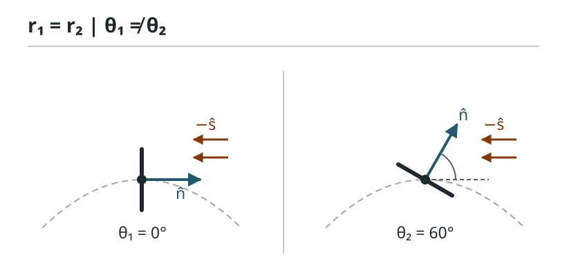

# M7-L3 – Lage, Bahn und Umwelteinflüsse {#L3}

**Kursbereich:** M7 – Raumfahrtumgebung und Raumfahrzeugsysteme

**Studienrolle** · Kern/Grundlagen

**Vorwissen** · [M3-L1 – Flugachsen, Kräfte und Momente](M3-L1.md); [M6-L2 – Ellipse, Zustandsvektor und Bahnenergie](M6-L2.md); [M7-L1 – Raumfahrtumgebung und Wärmebilanz](M7-L1.md)

**Lernziel** · Position, Orientierung und deren unterschiedliche Einflussgrößen auseinanderhalten

## Einstieg {#S1}

Zwei Modellansichten zeigen ein Raumfahrzeug zur gleichen Zeit am gleichen Punkt seiner Bahn. In einer Ansicht weist die Vorderseite eines Lichtdetektors zur Lichtquelle, in der anderen ist sie schräg dazu ausgerichtet. Warum unterscheiden sich die Messwerte, obwohl die Position gleich ist?

## Begriffe und Modell {#S2}

Die **Bahn** beschreibt die zeitliche Bewegung eines Bezugspunkts des Raumfahrzeugs, im Lehrmodell seines Schwerpunkts. Der Positionsvektor $\vec r$ wird vom Zentrum des Zentralkörpers aus gemessen. Die **Lage** beschreibt, wie körperfeste Achsen relativ zu einem angegebenen äußeren Bezugssystem orientiert sind. Die Position allein legt die Lage nicht fest. Für Anwendungen müssen das äußere Bezugssystem und die Orientierung der jeweils gemeinten Körperfläche benannt sein.

Betrachte ein Lichtbündel, dessen Strahlen für die Modellfläche parallel sind. $\hat s$ ist der Einheitsvektor von der Fläche zur Lichtquelle. $\hat n$ ist die nach außen weisende Einheitsnormale der betrachteten Vorderseite. Für den Winkel $\theta$ zwischen beiden ist die wirksame Projektionsfläche $A\max(0,\cos\theta)$. $A$ steht in $\mathrm{m^2}$. Bei eintreffender Bestrahlungsstärke $I$ in $\mathrm{W/m^2}$ folgt für die Leistung, die diese Seite geometrisch erreicht,

$$
P_\mathrm{ein}=I A\max(0,\cos\theta).
$$

Die Nullschranke schließt Beleuchtung der definierten Vorderseite von hinten aus. Absorption und elektrische oder sensorische Umwandlung wären weitere Schritte. In der Mechanik verändert eine resultierende Kraft den Translationsimpuls. Ein resultierendes Drehmoment um den Schwerpunkt verändert den Drehimpuls. Eine Umweltwechselwirkung kann beides auslösen, wenn die Wirkungslinie der Kraft den Schwerpunkt verfehlt.

{alt="Zwei Ansichten derselben Bahnposition mit unterschiedlich ausgerichteten Flächennormalen bei gleicher Lichtrichtung."}

## Durchgerechnetes Beispiel {#S3}

Für zwei unabhängige Schnappschüsse eines fiktiven Beobachtungsinstruments setzen wir denselben Ort, eine Bestrahlungsstärke von $400\,\mathrm{W/m^2}$ und eine ebene Detektorfläche von $0{,}10\,\mathrm{m^2}$ an.

1. Normale zur Quelle: $\theta=0^\circ$ und $\cos\theta=1$. Die geometrisch einfallende Leistung beträgt $40\,\mathrm W$.
2. Geneigte Normale: $\theta=60^\circ$ und $\cos\theta=0{,}50$. Die projizierte Fläche halbiert sich und die einfallende Leistung beträgt $20\,\mathrm W$.

Beide Schnappschüsse setzen dieselbe Bahnposition und dieselbe Strahlungsumgebung voraus. Allein die Lage der Fläche erklärt in diesem Vergleich die Differenz. Derselbe Gedanke gilt bei einer Wärmebilanz oder für das Sichtfeld eines gerichteten Instruments, wenn die jeweils relevante Richtung ausdrücklich benannt ist.

## Selbstkontrolle {#S4}

1. Welche Leistung erreicht die idealisierte Vorderseite bei $\theta=90^\circ$? Was begrenzt die Aussage in einem echten Aufbau?
2. Im Modell wirkt ein reines Drehmoment um den Schwerpunkt, während die Zusatz-Gesamtkraft null ist. Welche Impulsgröße ändert sich direkt?

::: {.lc-solutions data-lc-section="S4"}

1. Idealisiert sind es $0\,\mathrm W$, weil $\cos90^\circ=0$. Diffuse Strahlung, eine ausgedehnte Quelle, Streulicht oder eine nicht ebene Oberfläche können davon abweichen.
2. Der Drehimpuls ändert sich. Der Translationsimpuls erhält von dieser Wechselwirkung keinen direkten Zusatz, weil ihre Gesamtkraft null ist.

:::

## Annahmen und Grenzen {#S5}

Das Vergleichsmodell verwendet eine ebene Fläche, eine Strahlrichtung und keine Abschattung durch andere Bauteile. In realen Situationen können Restatmosphäre oder Strahlungsdruck auf mehrere Flächen wirken. Eine Orientierungsänderung kann dadurch auch die resultierende Kraft beeinflussen. Die Funktionsbetrachtung liefert keine Auslegung einer Lageregelung und keine Vorhersage eines realen Bahneffekts.

## Zusammenfassung {#S6}

Bahn und Lage benötigen getrennte Beschreibungen. Dieselbe Position lässt verschiedene Ausrichtungen und damit verschiedene Bedingungen für Licht, Wärmeeintrag und Instrumente zu. Das macht Bezugssysteme auch für die folgenden Messketten wichtig.

**Weiterlesen** · [M8-L1 – Avionik und Signalwege](M8-L1.md)

## Quellen (extern) {#S7}

- [NASA Science – Dawn – Navigation](https://science.nasa.gov/mission/dawn/technology/navigating/) · Spacecraft attitude · Fachgrundlage · Zuletzt abgerufen: 2026-11-23
- [NASA Science – Basics of Space Flight – Chapter 11: Onboard Systems](https://science.nasa.gov/learn/basics-of-space-flight/chapter11-1/) · Systems, Subsystems, and Assemblies; Data Handling Subsystems · Fachgrundlage · Zuletzt abgerufen: 2026-11-23
- [OpenStax – University Physics Volume 2 – Mechanisms of Heat Transfer](https://openstax.org/books/university-physics-volume-2/pages/1-6-mechanisms-of-heat-transfer) · § 1.6, Radiation · Fachgrundlage · Zuletzt abgerufen: 2026-11-23
