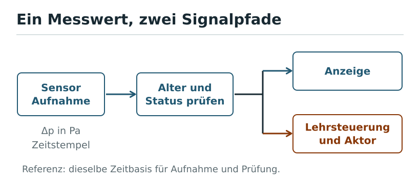

# M8-L1 – Avionik und Signalwege {#L1}

**Kursbereich:** M8 – Avionik und Systems Engineering

**Studienrolle** · Kern/Grundlagen

**Vorwissen** · [M1-L3 – Ähnlichkeit, Messfehler und Modellgrenzen](M1-L3.md); [M3-L1 – Flugachsen, Kräfte und Momente](M3-L1.md)

**Lernziel** · Messkette und Kontrollpfad einer zivilen Funktion von der Anzeige bis zur Aktuation lesen

## Vom Druckwert zur Entscheidung {#S1}

An einem digitalen Lehrprüfstand für ein ziviles Flugzeug zeigt eine Anzeige Differenzdruck an. Ein zweiter Bildschirm meldet, ob derselbe Datenstrom für ein Steuersignal freigegeben ist. Der angezeigte Wert schwankt leicht. Ein Wert kann aufgrund von Messrauschen springen oder unverändert stehen bleiben, weil eine Nachricht ausgefallen ist. Die beiden Fälle erfordern unterschiedliche Entscheidungen über den Status der Messkette.

## Messpfad und Wirkungspfad {#S2}

Eine **Messkette** verbindet Sensor, Signalaufbereitung, Digitalisierung, Datenübertragung, Verarbeitung und Anzeige. Am Pitot-Statik-Modell ist die Messgröße die Differenz $\Delta p=p_\mathrm{t}-p_\mathrm{s}$ aus Gesamt- und statischem Druck. Drücke werden in Pascal angegeben. Im stationären, annähernd inkompressiblen Lehrmodell lässt sich der gemessene Differenzdruck einer geeigneten Anordnung als dynamischer Druck $q$ interpretieren. Bei kompressibler Strömung ist diese Gleichsetzung im Allgemeinen unzulässig.

Der Anzeigepfad endet bei einer Information für Menschen. Ein Steuerpfad kann dieselbe Messung verwenden und endet am Aktor, also einem Element, das eine physische Stellwirkung erzeugt. Hier empfängt der Aktor ausschließlich ein fiktives Testsignal. Die Pfade können dieselbe Messquelle teilen, jedoch unterschiedliche Kriterien für Anzeige und Freigabe besitzen.

Jede Nachricht trägt Messwert, Einheit, Aufnahmezeit und Qualitätsstatus. Mit gemeinsamer Zeitbasis ist das Datenalter bei einer Auswertung zum Zeitpunkt $t_\mathrm{aus}$ gleich $a=t_\mathrm{aus}-t_\mathrm{auf}$. Das **Alter** schließt die Zeit seit der Aufnahme ein. Die **Transportlatenz** umfasst hier nur die Übertragung vom Sender zum Empfänger. Die Größen können sich zum Beispiel durch eine Eingangswarteschlange unterscheiden.

{alt="Das Sensorsignal läuft mit Zeitstempel durch eine Alters- und Statusprüfung und verzweigt zu Anzeige und Lehrsteuerung."}

## Ein kurzer Protokollausschnitt {#S3}

Im Lehrversuch gilt als Freigabekriterium $a\leq 150\,\mathrm{ms}$ bei gültigem Status. Beide Werte werden zur selben Zeit geprüft.

| Signal | $\Delta p$ | Aufnahme | Auswertung | Alter |
|---|---:|---:|---:|---:|
| A | $405\,\mathrm{Pa}$ | $980\,\mathrm{ms}$ | $1\,050\,\mathrm{ms}$ | $70\,\mathrm{ms}$ |
| B | $400\,\mathrm{Pa}$ | $890\,\mathrm{ms}$ | $1\,050\,\mathrm{ms}$ | $160\,\mathrm{ms}$ |

A weicht gering vom Prüfstandssoll $400\,\mathrm{Pa}$ ab und ist zeitlich frisch. B entspricht dem Soll exakt, überschreitet aber die Altersgrenze. Bei sonst gültigem Status darf nur A im fiktiven Steuerpfad verwendet werden. Seine Abweichung von $5\,\mathrm{Pa}$ allein beweist weder Rauschen noch einen Sensorfehler. Dafür braucht man weitere Messungen oder eine unabhängige Referenz. B kann als Historienwert mit Alterskennzeichnung sichtbar bleiben.

## Selbstkontrolle {#S4}

1. Eine Nachricht wurde bei $900\,\mathrm{ms}$ aufgenommen und bei $1\,050\,\mathrm{ms}$ ausgewertet. Erfüllt sie das Alterskriterium?
2. Zwei aufeinanderfolgende Werte sind numerisch gleich. Welche Zusatzinformation unterscheidet eine frische Wiederholung von einer erneut angezeigten alten Nachricht?

::: {.lc-solutions data-lc-section="S4"}
1. Das Alter beträgt $150\,\mathrm{ms}$. Der inklusive Grenzwert ist eingehalten. Die Freigabe erfordert zusätzlich einen gültigen Qualitätsstatus.
2. Aufnahmezeit und bei Bedarf Sequenznummer prüfen. Zwei getrennte Erfassungen können bei konstantem Zustand denselben Zahlenwert haben.
:::

## Annahmen und Grenzen {#S5}

Unsynchronisierte Zeitbasen verfälschen das Alter. Ein korrekt erscheinender Zeitstempel kann zudem einen mechanisch fehlerhaften Messpfad verdecken. Das Modell trennt beide Prüfungen und setzt eine bekannte Zeitreferenz voraus. Der Schwellenwert gehört ausschließlich zum Lehrprüfstand.

## Zusammenfassung {#S6}

Für einen Messwert sind physische Herkunft, zeitliche Gültigkeit und Verwendungszweck festzuhalten. Eine Anzeige und ein Steuerpfad dürfen aus demselben Signal verschiedene Entscheidungen ableiten.

**Weiterlesen** · [M8-L2 – Navigation, Schätzung und Unsicherheit](M8-L2.md)

## Quellen (extern) {#S7}

- [FAA – Pilot’s Handbook of Aeronautical Knowledge – Flight Instruments](https://www.faa.gov/sites/faa.gov/files/10_phak_ch8.pdf) · Ch. 8, p. 8–1, Pitot-Static Flight Instruments · Fachgrundlage · Zuletzt abgerufen: 2026-11-23
- [NASA Glenn – Bernoulli’s Equation](https://www1.grc.nasa.gov/beginners-guide-to-aeronautics/bernoullis-equation-1/) · Introductory equation; Derivation of General Equations · Fachgrundlage · Zuletzt abgerufen: 2026-11-23
- [FH Aachen – Flugzeug- und Flugführungssysteme](https://www.campus.fh-aachen.de/campus/all/module.asp?fmodulecode=65100) · Detailinformationen > Lernziele/Inhalt · Curricularer Bezug · Zuletzt abgerufen: 2026-11-23
