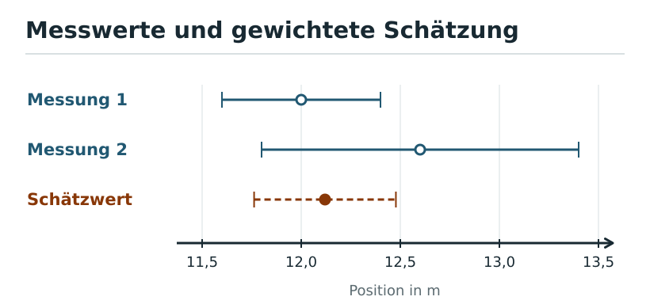

# M8-L2 – Navigation, Schätzung und Unsicherheit {#L2}

**Kursbereich:** M8 – Avionik und Systems Engineering

**Studienrolle** · Kern/Grundlagen

**Vorwissen** · [M1-L3 – Ähnlichkeit, Messfehler und Modellgrenzen](M1-L3.md); [M8-L1 – Avionik und Signalwege](M8-L1.md)

**Lernziel** · Referenz, Messgröße, Schätzwert und Unsicherheit mit unabhängigen Sensoren unterscheiden

## Zwei Positionen, ein Bezug {#S1}

Ein Messschlitten im Luftfahrtlabor fährt auf einer geraden Schiene. Zwei Messsysteme melden seine Position. Beide verwenden Meter, doch eine der Skalen könnte einen anderen Nullpunkt haben. Bevor die Software die Zahlen verbindet, muss dieselbe Positionsgröße gemeint sein. Erst danach ist die Frage nach der Unsicherheit sinnvoll.

## Referenz, Messgröße und Schätzung {#S2}

Die Referenz definiert Ursprung, positive Richtung und Zeitbezug. Im Beispiel zählt die Achse ab einer festen Markierung nach rechts. Die Messgröße ist die eindimensionale Position des Schlittens zur selben Zeit. Der gewünschte Zustand $x$ ist unbekannt. Zwei Beobachtungen erfüllen im Lehrmodell $z_i=x+\varepsilon_i$, wobei die Fehler $\varepsilon_i$ im Mittel null und unabhängig sind. Jede Standardunsicherheit $u_i$ ist positiv und wird wie $z_i$ in Metern angegeben.

Der lineare Schätzer mit minimaler Varianz unter den unverzerrten linearen Kombinationen gewichtet beide Werte mit der inversen Varianz:
$$
w_i=\frac{1}{u_i^2},\qquad
\hat x=\frac{w_1z_1+w_2z_2}{w_1+w_2},\qquad
u_{\hat x}=\sqrt{\frac{1}{w_1+w_2}}.
$$

Die Gewichte $w_i$ stehen in $\mathrm{m}^{-2}$. Ihr Verhältnis, nicht ihre absolute Einheit, bestimmt den Beitrag jeder Beobachtung. Eine Standardunsicherheit beschreibt hier eine Streuung. Wer daraus ein erweitertes Intervall berichtet, muss das verwendete Verfahren und gegebenenfalls den Deckungsfaktor nennen.

{alt="Zwei Positionswerte und der gewichtete Schätzwert auf einer gemeinsamen Achse. Die Balken reichen beiderseits über eine Standardunsicherheit."}

## Zwei fiktive Messungen zusammenführen {#S3}

Es seien $z_1=12{,}0\,\mathrm{m}$ mit $u_1=0{,}4\,\mathrm{m}$ und $z_2=12{,}6\,\mathrm{m}$ mit $u_2=0{,}8\,\mathrm{m}$. Das Verhältnis $w_1:w_2=4:1$ folgt daraus, dass eine Verdopplung der Standardunsicherheit die Varianz vervierfacht. Der gewichtete Mittelwert ist
$$
\hat x=\frac{4\cdot12{,}0+12{,}6}{5}\,\mathrm{m}=12{,}12\,\mathrm{m}.
$$
Mit $w_1+w_2=7{,}8125\,\mathrm{m}^{-2}$ erhält man $u_{\hat x}\approx0{,}36\,\mathrm{m}$. Der Wert liegt näher an der genaueren Beobachtung. Ein gemeinsamer Nullpunktfehler würde beide Zahlen gleichermaßen verschieben und auf den gewichteten Mittelwert übertragen.

## Selbstkontrolle {#S4}

1. Zwei unabhängige Beobachtungen liefern $10\,\mathrm{m}$ und $12\,\mathrm{m}$ mit derselben Standardunsicherheit $1\,\mathrm{m}$. Berechne $\hat x$ und $u_{\hat x}$.
2. Was geschieht mit dem Schätzwert im Lehrbeispiel, wenn beide Systeme wegen einer falsch gesetzten Referenz je $0{,}5\,\mathrm{m}$ zu viel anzeigen?

::: {.lc-solutions data-lc-section="S4"}
1. Gleiche Varianzen ergeben gleiche Gewichte. Daher ist $\hat x=11\,\mathrm{m}$ und $u_{\hat x}=1/\sqrt{2}\,\mathrm{m}\approx0{,}71\,\mathrm{m}$.
2. Beide Eingangswerte steigen um denselben Betrag. Der Schätzwert steigt um $0{,}5\,\mathrm{m}$ auf $12{,}62\,\mathrm{m}$. Die Gewichtsformel korrigiert den Referenzfehler nicht.
:::

## Annahmen und Grenzen {#S5}

Gemeinsame Kalibrierung, dieselbe Umwelteinwirkung oder eine gemeinsame Zeitreferenz können korrelierte Fehler erzeugen. Dann fehlt im einfachen Modell die Kovarianz. Bei Bewegung dürfen Beobachtungen verschiedener Zeiten ohne ein geeignetes Bewegungsmodell ebenfalls nicht als simultan fusioniert werden.

## Zusammenfassung {#S6}

Ein Schätzwert verbindet Beobachtungen erst nach dem Abgleich von Bezugsgröße, Zeit und Unsicherheiten. Eine rechnerisch kleinere Streuung sagt wenig über gemeinsam verzerrte Eingaben.

**Weiterlesen** · [M8-L3 – Rückkopplung, Redundanz und Fehlerbilder](M8-L3.md)

## Quellen (extern) {#S7}

- [NIST – NIST Technical Note 1297 – 7. Reporting Uncertainty](https://www.nist.gov/pml/nist-technical-note-1297/nist-tn-1297-7-reporting-uncertainty) · §§ 7.1–7.2 · Fachgrundlage · Zuletzt abgerufen: 2026-11-23
- [FH Aachen – Flugzeug- und Flugführungssysteme](https://www.campus.fh-aachen.de/campus/all/module.asp?fmodulecode=65100) · Detailinformationen > Lernziele/Inhalt · Curricularer Bezug · Zuletzt abgerufen: 2026-11-23
- [Massachusetts Institute of Technology – Aerospace Engineering (Course 16)](https://catalog.mit.edu/degree-charts/aerospace-engineering-course-16/aerospace-engineering-course-16.pdf) · Departmental Program > Departmental Core und Professional Area Subjects; S. 1 · Curricularer Bezug · Zuletzt abgerufen: 2026-11-23
