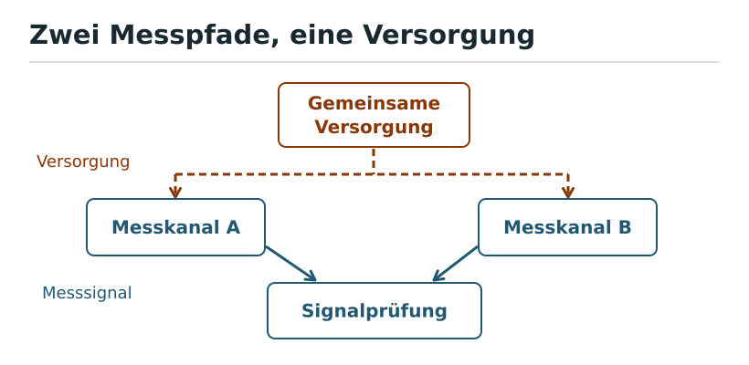

# M8-L3 – Rückkopplung, Redundanz und Fehlerbilder {#L3}

**Kursbereich:** M8 – Avionik und Systems Engineering

**Studienrolle** · Kern/Grundlagen

**Vorwissen** · [M3-L3 – Dynamische Antwort und Steuerwirkung](M3-L3.md); [M8-L1 – Avionik und Signalwege](M8-L1.md); [M8-L2 – Navigation, Schätzung und Unsicherheit](M8-L2.md)

**Lernziel** · Messredundanz und gemeinsame Ausfallursachen in einem Funktionsmodell beurteilen

## Zwei Anzeigen an einem Prüfstand {#S1}

Ein ziviler Laborprüfstand regelt die Temperatur eines Probenfachs. Zwei Anzeigen erhalten Werte von getrennten Sensoren. Beide fallen gleichzeitig aus, sobald der gemeinsame Versorgungsblock ausfällt. Wie viel Unabhängigkeit steckt in den beiden Messpfaden, und was bedeutet der Ausfall für die Rückkopplung?

## Rückführung und Verfügbarkeit {#S2}

Bei einer negativen Rückkopplung bildet der Regler aus Sollwert $r$ und Messwert $y$ die Abweichung $e=r-y$. Ist $y$ zu klein, erhöht ein positiver proportionaler Regler im hier betrachteten Modell die Heizleistung. Dadurch steigt die Temperatur und die Abweichung wird kleiner. Die Größen $r$ und $y$ können als Temperatur in Grad Celsius angegeben sein. Die Temperaturdifferenz $e$ wird in Kelvin angegeben, wobei ein Intervall von einem Grad Celsius einem Kelvin entspricht. Das Vorzeichen der Rückkopplung allein belegt keine stabile Dynamik. Verzögerung und Verstärkung beeinflussen ebenfalls den Verlauf.

**Redundanz** bedeutet hier, dass ein erkennbar ausgefallener Datenpfad durch den anderen ersetzt werden kann. Das logische Ausfallereignis lautet: gemeinsame Versorgung ausgefallen **oder** beide getrennten Kanäle bei verfügbarer Versorgung ausgefallen. Zwei getrennte Messfühler teilen in dieser Darstellung einen möglichen Ausfallgrund. Zwei Anzeigeelemente mit derselben Quelle wären sogar nur zwei Anzeigen derselben Information.

{alt="Eine Versorgung speist zwei getrennte Messkanäle, die unabhängig voneinander Daten an die Signalprüfung liefern."}

## Wahrscheinlichkeit im Lehrmodell {#S3}

Für ein fiktives Prüfintervall seien $p_\mathrm{G}=0{,}02$ für den gemeinsamen Ausfall und $p_\mathrm{K}=0{,}05$ je Kanal, unter der Bedingung verfügbarer Versorgung. Die Kanalausfälle seien unter dieser Bedingung unabhängig. Ein gültiger Kanal reicht aus. Durch Aufteilung in die beiden Versorgungssituationen folgt
$$
P(\text{beide Pfade unverfügbar})
=p_\mathrm{G}+(1-p_\mathrm{G})p_\mathrm{K}^{\,2}
=0{,}02245=2{,}245\,\%.
$$

Ohne diesen gemeinsamen Pfad und bei gleicher bedingter Kanalwahrscheinlichkeit ergäbe das Modell $0{,}0025=0{,}25\,\%$. Diese Werte illustrieren den Einfluss der gemeinsamen Versorgung. Sie beziehen sich auf das festgelegte Intervall und sind keine Betriebskennzahlen.

## Selbstkontrolle {#S4}

1. Beide Sensoren liefern dasselbe Signal an zwei Anzeigen, weil nur ein gemeinsamer Messwert übertragen wird. Welche Redundanz schützt die Messung?
2. Setze im Lehrmodell $p_\mathrm{G}=0{,}01$ und behalte $p_\mathrm{K}=0{,}05$ bei. Wie groß ist die Wahrscheinlichkeit, beide Pfade zu verlieren?

::: {.lc-solutions data-lc-section="S4"}
1. Die Anzeige ist doppelt vorhanden, die Messquelle bleibt einfach. Ein Messfehler kann beide Anzeigen gleichermaßen betreffen.
2. Es folgt $0{,}01+0{,}99\cdot0{,}05^2=0{,}012475=1{,}2475\,\%$.
:::

## Annahmen und Grenzen {#S5}

Bei widersprüchlichen Werten kann eine Anlage aus zwei Quellen allein oft nicht entscheiden, welche falsch ist. Das Beispiel rechnet nur mit erkennbarer Unverfügbarkeit. Ein inhaltlich falsches Signal, gemeinsame Kalibrierung oder Software werden gesondert untersucht. Die Rechnung setzt außerdem dieselbe Intervalllänge und die angegebene bedingte Unabhängigkeit voraus.

## Zusammenfassung {#S6}

Rückkopplung braucht eine nutzbare Messung. Ob ein zweiter Pfad die Messung absichert, hängt von der Erkennbarkeit des Fehlers und von den gemeinsam genutzten Ressourcen ab.

**Weiterlesen** · [M8-L4 – Anforderungen, Schnittstellen und Rückverfolgbarkeit](M8-L4.md)

## Quellen (extern) {#S7}

- [Technische Universität München – Fachprüfungs- und Studienordnung Aerospace](https://www.ed.tum.de/fileadmin/w00byg/ed/03_Studium/Aerospace_B._Sc/FPSO/Lesb._F._FPSO_BA_Aerospace_mit_3._AES_vom_22.10.25.PDF) · § 37 Abs. 2–3; Anlage 1, gedruckte S. 10–11 · Curricularer Bezug · Zuletzt abgerufen: 2026-11-23
- [TUM School of Engineering and Design – Modulhandbuch Aerospace [202501]](https://www.ed.tum.de/fileadmin/w00byg/ed/03_Studium/Aerospace_B._Sc/Modulhandbuch/WiSe25/Modulhandbuch_BScAerospace_SPO-202501_DE_2025-12-15.pdf) · ED110124 S. 79–81; LRG0090 S. 94–95; ED110104 S. 510–512; ED110106 S. 536–538; MW0832 S. 560–561; MW0837 S. 562–563; MW2282 S. 579–580 · Curricularer Bezug · Zuletzt abgerufen: 2026-11-23
- [FH Aachen – Prüfungsordnung Luft- und Raumfahrttechnik](https://opus.bibliothek.fh-aachen.de/opus4/files/11804/2024-30_PO_B_Luft-Raumfahrttechnik_abWS2021_lF.pdf) · Anlage 1 S. 12, 63004/64001/64002/64003/64004 sowie 65000/65001 · Curricularer Bezug · Zuletzt abgerufen: 2026-11-23
