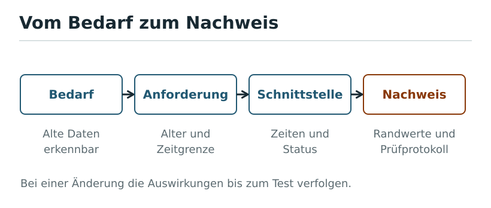

# M8-L4 – Anforderungen, Schnittstellen und Rückverfolgbarkeit {#L4}

**Kursbereich:** M8 – Avionik und Systems Engineering

**Studienrolle** · Kern/Grundlagen

**Vorwissen** · [M7-L2 – Energie, Kommunikation und Systemgrenzen](M7-L2.md); [M8-L3 – Rückkopplung, Redundanz und Fehlerbilder](M8-L3.md)

**Lernziel** · Eine zivile Anforderung in überprüfbare Kriterien und dokumentierte Schnittstellen übersetzen

## Wann ist eine Anzeige schnell genug? {#S1}

Ein Team stellt am zivilen Lehrprüfstand fest, dass die Anzeige einen alten Differenzdruck wie einen aktuellen Wert präsentiert. Ein Wunsch im Aufgabenheft lautet, dass Warnhinweise schnell erscheinen sollen. Für die Software und das anschließende Prüfprotokoll muss klar werden, was als alt gilt und an welchem Ereignis die Wartezeit gemessen wird.

## Anforderungen und Schnittstellen {#S2}

In einer **Anforderung** sind ein gefordertes Verhalten, die relevanten Bedingungen und ein überprüfbares Kriterium beschrieben. Eine **Schnittstelle** spezifiziert, was übergeben wird und wie beide Seiten die Daten verstehen. Das kann Datentypen, Einheiten, Zeitbasis, Gültigkeitsstatus und Verhalten bei fehlenden Daten einschließen. Für das Lehrsystem sind $t_\mathrm{auf}$ der Aufnahmezeitpunkt und $t_\mathrm{empf}$ der Zeitpunkt des Empfangs durch die Anzeigesoftware. Das Alter beim Empfang ist $a=t_\mathrm{empf}-t_\mathrm{auf}$. Die Reaktionszeit ist $\ell=t_\mathrm{anzeige}-t_\mathrm{empf}$ bis der zugehörige Status sichtbar wird. Beide Größen sind in Millisekunden auszuwerten und beziehen sich auf dieselbe Zeitbasis.

**Rückverfolgbarkeit** verbindet den Bedarf, die Anforderung, die betroffene Schnittstelle und den Nachweis. Eine Änderung der Grenze lässt sich so zu den erwarteten Testergebnissen zurückverfolgen. Ein Laborprotokoll ist nur für die geprüfte Revision und die festgehaltenen Randbedingungen aussagekräftig.

{alt="Vier Schritte verbinden den Bedarf nach sichtbaren Altdaten mit Altersschwelle, Schnittstellendaten und Grenzwertprüfung."}

## Von der Beobachtung zum Test {#S3}

Für eine formal gültige Nachricht mit bekannter Zeitbasis entscheidet das Lehrteam: Bei $a>150\,\mathrm{ms}$ muss die Anzeige spätestens $40\,\mathrm{ms}$ nach Empfang ihren Zustand als **veraltet** kennzeichnen. Bei $a\leq150\,\mathrm{ms}$ muss sie bis zur selben Frist **aktuell** anzeigen. Das Kriterium bezieht sich auf das Alter beim Empfang. Über fehlende und ungültige Nachrichten entscheidet eine eigene Anforderung.

| Fall | Alter beim Empfang | Erwarteter Status bis $40\,\mathrm{ms}$ |
|---|---:|---|
| knapp darunter | $149\,\mathrm{ms}$ | aktuell |
| am Grenzwert | $150\,\mathrm{ms}$ | aktuell |
| knapp darüber | $151\,\mathrm{ms}$ | veraltet |

Die nachprüfbare Schnittstelle definiert Aufnahmezeit und Empfangszeit in derselben Einheit und gibt den Statusbegriff vor. Für jeden Fall dokumentiert das Team Prüfling, Softwarestand, Eingangsdaten, gemessene Reaktionszeit, erwarteten und sichtbaren Status. So können spätere Teams nachvollziehen, welche Variante tatsächlich geprüft wurde.

## Selbstkontrolle {#S4}

1. Bei $a=151\,\mathrm{ms}$ erscheint der Status veraltet nach $42\,\mathrm{ms}$. Welcher Teil des Kriteriums wurde erfüllt?
2. Eine Nachricht enthält einen Zähler, aber weder die Einheit noch den Bezugszeitpunkt. Welche Information braucht die Schnittstelle, damit sich das Alter prüfen lässt?

::: {.lc-solutions data-lc-section="S4"}
1. Die Statusart stimmt. Die geforderte Reaktionszeit von höchstens $40\,\mathrm{ms}$ ist überschritten.
2. Sie braucht eine Umrechnung des Zählers in Zeit, seinen Bezugspunkt und einen bekannten Zusammenhang zur Empfängerzeit.
:::

## Annahmen und Grenzen {#S5}

Die Grenzwerte sind didaktisch gewählt. Angaben zur Zeitmessunsicherheit und zur Auflösung bestimmen in einem Versuch, ob Werte knapp an der Schwelle tatsächlich unterscheidbar sind. Wenn die Anzeige während eines anhaltenden Nachrichtenausfalls altern soll, muss auch dieser Fall als eigenes Verhalten spezifiziert und geprüft werden.

## Zusammenfassung {#S6}

Prüfbare Anforderungen legen Bedingungen und Entscheidungskriterien fest. Eindeutige Schnittstellen und die Zuordnung zum Nachweis halten sichtbar, was mit welchem Ergebnis überprüft wurde.

**Weiterlesen** · [M9-L1 – Verifikation, Validierung und Qualifikation](M9-L1.md)

## Quellen (extern) {#S7}

- [Technische Universität München – Fachprüfungs- und Studienordnung Aerospace](https://www.ed.tum.de/fileadmin/w00byg/ed/03_Studium/Aerospace_B._Sc/FPSO/Lesb._F._FPSO_BA_Aerospace_mit_3._AES_vom_22.10.25.PDF) · Anlage 1, gedruckte S. 11 · Curricularer Bezug · Zuletzt abgerufen: 2026-11-23
- [TUM School of Engineering and Design – Modulhandbuch Aerospace [202501]](https://www.ed.tum.de/fileadmin/w00byg/ed/03_Studium/Aerospace_B._Sc/Modulhandbuch/WiSe25/Modulhandbuch_BScAerospace_SPO-202501_DE_2025-12-15.pdf) · ED110124 S. 79–81; LRG0090 S. 94–95; ED110104 S. 510–512; ED110106 S. 536–538; MW0832 S. 560–561; MW0837 S. 562–563; MW2282 S. 579–580 · Curricularer Bezug · Zuletzt abgerufen: 2026-11-23
- [NASA – NASA Systems Engineering Handbook – 5.3 Product Verification](https://www.nasa.gov/reference/5-3-product-verification/) · § 5.3, Process Description · Fachgrundlage · Zuletzt abgerufen: 2026-11-23
