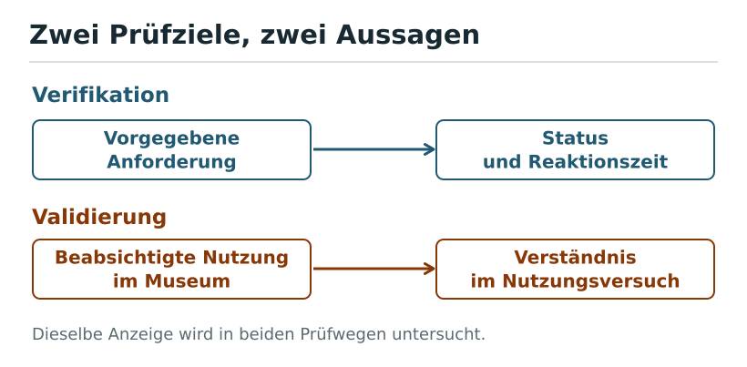

# M9-L1 – Verifikation, Validierung und Qualifikation {#L1}

**Kursbereich:** M9 – Nachweise, Sicherheit und Umweltwirkungen

**Studienrolle** · Kern/Grundlagen

**Vorwissen** · [M8-L4 – Anforderungen, Schnittstellen und Rückverfolgbarkeit](M8-L4.md)

**Lernziel** · Anforderungen, beabsichtigte Nutzung, Prüfmethoden und Evidenz sauber zuordnen

## Welchen Anspruch stützt derselbe Versuch? {#S1}

Ein Team baut für ein Luftfahrtmuseum einen zivilen Signal-Demonstrator. Die Anzeige soll alte Messwerte kennzeichnen. Am Tisch stimmt der Text mit der Spezifikation überein. Bei der Museumsführung interpretieren mehrere Besucherinnen und Besucher das Signal dennoch falsch. Welche Nachweise fehlen, obwohl die Software den vorgesehenen Status anzeigt?

## Verifikation, Validierung und Qualifikation {#S2}

**Verifikation** prüft, ob ein festgelegtes Produkt die spezifizierten Anforderungen erfüllt. **Validierung** prüft seine Eignung für die beabsichtigte Nutzung im vorgesehenen Kontext. Die Gegenstände beider Prüfungen können dieselben sein. Die Entscheidungsgrundlagen unterscheiden sich: verbindliche Anforderung im ersten Fall, Nutzung und erwarteter Nutzen im zweiten.

Ein einfacher **Komponententest** kann die Klassifikation einer Nachricht isolieren. Ein **Systemtest** kann dieselbe Situation vom Nachrichteneingang bis zur sichtbaren Anzeige auslösen. Eine **Analyse** kann einen Zeitpunkt aus einem Protokoll berechnen, und eine **Inspektion** kann die Übereinstimmung einer Schnittstellenbeschreibung mit dem Prüfling feststellen. Die Methode muss zu der konkreten Aussage passen.

**Qualifikation** betrifft in der hier verwendeten technischen Bedeutung den dokumentierten Nachweis, dass eine definierte Ausführung unter vorgegebenen Bedingungen die einschlägigen Anforderungen erfüllt. Ein Umweltprogramm für echte Hardware kann etwa Temperatur- und mechanische Belastung getrennt prüfen. Geltungsbereich, Artikelkonfiguration, Belastungsprofil, Akzeptanzkriterien und Abweichungen werden festgehalten. Eine Tischprüfung oder eine Aufzeichnung aus der Lehrsoftware ersetzt keinen solchen Nachweis.

{alt="Verifikation vergleicht Anforderung, Status und Reaktionszeit. Validierung vergleicht beabsichtigte Nutzung und Verständnis der Besucher."}

## Nachweise für den Museumskoffer {#S3}

Der Koffer soll die Altersgrenze $150\,\mathrm{ms}$ korrekt umsetzen und den Status innerhalb $40\,\mathrm{ms}$ anzeigen. Drei synthetische Nachrichten mit $149$, $150$ und $151\,\mathrm{ms}$ Alter ergeben die erwarteten Status aktuell, aktuell und veraltet. Die gemessenen Antwortzeiten betragen $34$, $32$ und $37\,\mathrm{ms}$. Alle drei getesteten Fälle erfüllen die spezifizierte Funktion und Frist. Eine nicht geprüfte Kombination, etwa eine ungültige Differenzdrucknachricht, bleibt offen.

Für die beabsichtigte Nutzung soll eine kleine Probe mit klarer Aufgabenstellung zeigen, ob mindestens $7$ von $8$ Personen den veralteten Wert ohne zusätzliche Erklärung erkennen. Es gelingt $6$ Personen. Das Nutzungskriterium ist hier verfehlt. Die Stichprobe dient als Hinweis für die nächste Überarbeitung. Sie erlaubt keine belastbare Schätzung für alle späteren Besucher.

## Selbstkontrolle {#S4}

1. In einer Wiederholung zeigt der Koffer bei $151\,\mathrm{ms}$ den richtigen Status erst nach $45\,\mathrm{ms}$. Wie fällt der Funktionsnachweis für diesen Fall aus?
2. Ein Protokoll dokumentiert, dass ein Ersatzdisplay bei Raumtemperatur funktioniert. Welche Qualifikationsaussage über einen anderen Temperaturbereich lässt sich daraus ableiten?

::: {.lc-solutions data-lc-section="S4"}
1. Die Statusart ist richtig. Die Frist ist überschritten, also ist die kombinierte Anforderung für den Fall nicht erfüllt.
2. Das Protokoll gilt für den geprüften Aufbau bei Raumtemperatur. Für einen anderen Temperaturbereich braucht es geeignete zusätzliche Belege für die definierte Ausführung und die vorgesehenen Bedingungen.
:::

## Annahmen und Grenzen {#S5}

Primäre Nachweise halten Bedingungen, Messunsicherheit und Konfiguration fest. Bei Änderungen an Softwarestand, Bedienoberfläche oder Umgebung muss der Geltungsbereich erneut entschieden werden. Zahlen und Auswertung im Beispiel beziehen sich auf ein Modell im Ausstellungskontext.

## Zusammenfassung {#S6}

Technische Erfüllung, Tauglichkeit bei der Nutzung und nachgewiesene Belastbarkeit sind verschiedene Aussagen. Jede erfordert klar begrenzte, rückverfolgbare Evidenz.

**Weiterlesen** · [M9-L2 – Sicherheitskultur und menschliche Faktoren](M9-L2.md)

## Quellen (extern) {#S7}

- [NASA – NASA Systems Engineering Handbook – 5.3 Product Verification](https://www.nasa.gov/reference/5-3-product-verification/) · § 5.3, Process Description · Fachgrundlage · Zuletzt abgerufen: 2026-11-23
- [NASA – NASA Systems Engineering Handbook – 5.4 Product Validation](https://www.nasa.gov/reference/5-4-product-validation/) · § 5.4, Process Description · Fachgrundlage · Zuletzt abgerufen: 2026-11-23
- [ESA – Mechanical Systems Laboratory](https://technology.esa.int/lab/mechanical-systems-laboratory) · Thermal testing; Mechanical testing · Fachgrundlage · Zuletzt abgerufen: 2026-11-23
