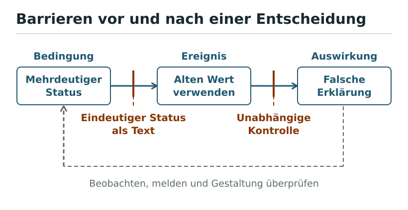

# M9-L2 – Sicherheitskultur und menschliche Faktoren {#L2}

**Kursbereich:** M9 – Nachweise, Sicherheit und Umweltwirkungen

**Studienrolle** · Kern/Grundlagen

**Vorwissen** · [M8-L3 – Rückkopplung, Redundanz und Fehlerbilder](M8-L3.md); [M9-L1 – Verifikation, Validierung und Qualifikation](M9-L1.md)

**Lernziel** · Gefahr, Ereignis, Auswirkung und Barriere an einem zivilen Beispiel unterscheiden

## Wenn die Anzeige Vertrauen ausstrahlt {#S1}

Bei einer Übung am zivilen Museumsprüfstand bleibt ein alter Messwert auf dem Bildschirm. Das Display zeigt einen grauen Punkt für den Status. Eine Person deutet Grau als neutral und bestätigt die Anweisung mit dem alten Wert. Das Team kann den Ablauf untersuchen, ohne der Person vorschnell einen alleinigen Fehler zuzuschreiben.

## Gefahr, Ereignis, Auswirkung und Barriere {#S2}

Eine **Gefahr** ist ein Zustand oder Gegenstand mit dem Potenzial, Schaden zu verursachen. Eine **auslösende Bedingung** macht ein gefährliches Ereignis wahrscheinlicher. Ein **Ereignis** beschreibt, was geschieht, und eine **Auswirkung** die mögliche Folge. In der Übung führt eine unklare Anzeige zur Entscheidung auf Basis eines veralteten Zustands. Im Museumsbetrieb ist die Folge eine falsche Erklärung. Das gefährliche Potenzial in einem anderen Kontext hängt von der konkreten Verwendung ab und ist separat zu bewerten.

**Barrieren** können vor dem Ereignis ansetzen oder die Folgen begrenzen. Eine sichtbare Textkennzeichnung bei alten Daten setzt vor der Entscheidung an. Eine unabhängige Plausibilitätskontrolle kann später verhindern, dass eine falsche Entscheidung eine Wirkung auslöst. Die Zuordnung hängt vom definierten Ereignis ab.

**Menschliche Faktoren** betrachten die Wechselwirkung zwischen Menschen, Technik, Arbeitsgestaltung und Umgebung. Sicherheitskultur zeigt sich unter anderem daran, ob Menschen Auffälligkeiten melden können, ob die Organisation den Kontext untersucht und ob die Ergebnisse zurück in Gestaltung und Schulung fließen. Just Culture bedeutet hier eine faire, lernförderliche Behandlung von Meldungen mit klaren Verantwortlichkeiten.

{alt="Ein mehrdeutiger Status kann zum Verwenden eines alten Messwerts und zu einer falschen Erklärung führen. Statusklarheit und Kontrolle wirken an zwei Stellen."}

## Eine Beobachtung in eine überprüfbare Änderung übersetzen {#S3}

Im Protokoll steht: Während der Anzeige eines alten Werts bestätigten $5$ von $8$ Teilnehmenden den Wert als aktuell. Die Sätze „Die Personen haben nicht aufgepasst“ oder „Grau ist immer missverständlich“ lassen sich daraus nicht ableiten. Festgehalten werden Anzeigefarbe, Wortlaut, Beleuchtung und die gestellte Aufgabe. Das Team ergänzt die Textanzeige **Messwert veraltet** und zeigt den Zeitpunkt der letzten Erfassung an.

In einer zweiten Lehrprobe mit einer neuen kleinen Gruppe und ansonsten möglichst ähnlichen Bedingungen deutet $1$ von $8$ Personen den Wert falsch. Die Beobachtung stützt eine Verbesserung im konkreten Lehrversuch. Sie bestimmt weder ein allgemeines Fehlerrisiko noch den alleinigen Effekt des Texts, weil gleichzeitig die Zeitangabe ergänzt wurde.

## Selbstkontrolle {#S4}

1. Ordne die unklare Statusanzeige, die Entscheidung auf alter Datengrundlage und die falsche Museumserklärung den Begriffen Bedingung, Ereignis und Auswirkung zu.
2. Warum ist eine klar lesbare Statusinformation als Text eine stärkere Barriere als eine neue Farbe allein?

::: {.lc-solutions data-lc-section="S4"}
1. Die unklare Statusanzeige ist eine auslösende Bedingung. Die Fehlentscheidung ist das Ereignis. Die falsche Erklärung ist die beobachtete Auswirkung.
2. Text verwendet einen zusätzlichen Verständniskanal und benennt den Zustand direkt. Dadurch ist die Interpretation weniger abhängig von Farbwahrnehmung, Helligkeit und der Kenntnis des Farbcodes.
:::

## Annahmen und Grenzen {#S5}

Die Gruppen sind klein, die Daten fiktiv und die Reihenfolge der Aufgaben kann das Verhalten beeinflussen. Reale Ereignismeldung und Sicherheitsbewertung folgen dem jeweiligen Organisations- und Regelungsrahmen. Die eingangs genannten Beobachtungen reichen für eine Hypothese und einen konkreten Lehrtest.

## Zusammenfassung {#S6}

Eine brauchbare Sicherheitsanalyse verbindet reproduzierbare Beobachtung, Ereignis und Folge mit einer konkreten Barriere. Die anschließende Prüfung schließt den Lernkreislauf.

**Weiterlesen** · [M9-L3 – Nachhaltigkeit und zivile Systemgrenzen](M9-L3.md)

## Quellen (extern) {#S7}

- [ICAO – Safety Management Manual (Doc 9859)](https://www.icao.int/safety-management/SMI/SMM) · § 2.5, Ch. 3 und 9 · Fachgrundlage · Zuletzt abgerufen: 2026-11-23
- [EASA – Aviation Safety Reporting – Legal Framework](https://www.easa.europa.eu/en/domains/safety-management/aviation-safety-reporting/legal-framework) · Objectives of Regulation (EU) No 376/2014 · Fachgrundlage · Zuletzt abgerufen: 2026-11-23
- [FH Aachen – Flugzeug- und Flugführungssysteme](https://www.campus.fh-aachen.de/campus/all/module.asp?fmodulecode=65100) · Detailinformationen > Lernziele/Inhalt · Curricularer Bezug · Zuletzt abgerufen: 2026-11-23
