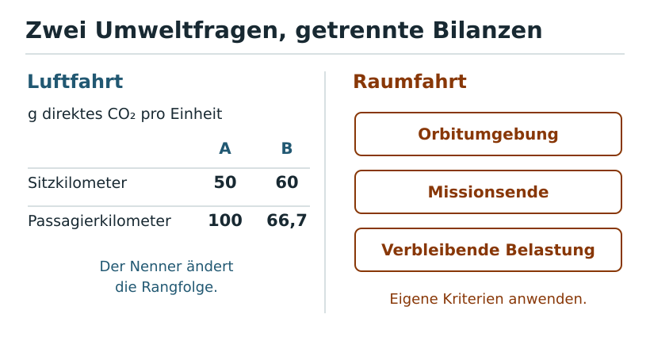

# M9-L3 – Nachhaltigkeit und zivile Systemgrenzen {#L3}

**Kursbereich:** M9 – Nachweise, Sicherheit und Umweltwirkungen

**Studienrolle** · Kern/Grundlagen

**Vorwissen** · [M4-L3 – Schub, Leistung und Antriebskonzepte](M4-L3.md); [M6-L4 – Missionsziele, Bahnwahl und Modellabweichungen](M6-L4.md); [M9-L1 – Verifikation, Validierung und Qualifikation](M9-L1.md)

**Lernziel** · Umweltwirkungen über konsistente Bezugsgrößen und Lebenszyklusgrenzen vergleichen

## Zwei Verkehrsflüge und eine offene Bezugsfrage {#S1}

Eine zivile Verkehrsplanung vergleicht zwei fiktive Flüge auf derselben Strecke. Der erste Flug bietet mehr Plätze. Der zweite befördert mehr Menschen. Welcher verursacht pro angebotener oder tatsächlich genutzter Verkehrsleistung weniger direkte Kohlendioxidemissionen? Die Antwort hängt davon ab, welche Leistung im Nenner steht.

## Funktionelle Einheit und Systemgrenze {#S2}

Die **funktionelle Einheit** bestimmt, welche Leistung verglichen wird. Ein Sitzkilometer ist ein angebotener Sitz über einen Kilometer. Ein Passagierkilometer ist eine beförderte Person über einen Kilometer. Bei $n_\mathrm{S}$ angebotenen Sitzen, $n_\mathrm{P}$ Passagieren und der Strecke $d$ in Kilometern lauten die Intensitäten für eine betrachtete Emissionsmasse $m$:
$$
I_\mathrm{S}=\frac{m}{n_\mathrm{S}d},\qquad
I_\mathrm{P}=\frac{m}{n_\mathrm{P}d}.
$$

Mit $m$ in Gramm ergibt sich Gramm je Sitzkilometer bzw. Passagierkilometer. Die **Systemgrenze** legt fest, welche Prozesse im Zähler enthalten sind. Für direkte Betriebs-Emissionen im Lehrbeispiel zählen nur die angenommenen Emissionen aus der Verbrennung während des betrachteten Flugs. Eine Lebenszyklusbetrachtung kann Herstellung und Bereitstellung des Energieträgers, Infrastruktur, Fertigung, Betrieb und Aussonderung umfassen. Klimawirkung, lokale Luftqualität und Lärm sind unterschiedliche Wirkungen. Eine Kennzahl für direktes $\mathrm{CO_2}$ erfasst die anderen Wirkungen nicht.

{alt="Links ändern Sitz- und Passagierkilometer die Rangfolge der CO₂-Intensität. Rechts werden Raumfahrtumgebung, Missionsende und verbleibende Belastung eigenständig betrachtet."}

## Ein Vergleich mit umgekehrter Reihenfolge {#S3}

Beide fiktiven Verbindungen sind $1\,000\,\mathrm{km}$ lang. Die Daten illustrieren ausschließlich die Rechnung.

| Flug | Sitzplätze | Passagiere | Direktes $\mathrm{CO_2}$ | g je Sitzkilometer | g je Passagierkilometer |
|---|---:|---:|---:|---:|---:|
| A | 180 | 90 | $9\,000\,\mathrm{kg}$ | 50 | 100 |
| B | 120 | 108 | $7\,200\,\mathrm{kg}$ | 60 | 66,7 |

Für A sind $9\,000\,\mathrm{kg}=9\,000\,000\,\mathrm{g}$. Der Sitz-Nenner ist $180\,000$ Sitzkilometer. Der Passagier-Nenner ist halb so groß. Die Intensität verdoppelt sich daher von $50$ auf $100\,\mathrm{g}$ je jeweiliger Verkehrseinheit. A liegt bei Sitzkilometern vorn, B bei Passagierkilometern.

Bei einer zivilen Erdbeobachtungsmission könnte man die erbrachte Leistung etwa als ein nutzbares Beobachtungsprodukt mit festgelegter Qualität definieren. Raumfahrtrückstände und Kollisionsrisiken im Orbit sind eigenständige Umweltaspekte. Ein Vergleich kann dafür Dokumentation des Missionsendes und Angaben zur verbleibenden Belastung zusammentragen. Solange keine gemeinsame Bewertungsmethode begründet wird, bleiben diese Angaben von der Emissionsintensität getrennt.

## Selbstkontrolle {#S4}

1. A befördert bei gleicher Strecke und Emissionsmasse $144$ Passagiere. Berechne die neuen Gramm je Passagierkilometer.
2. Eine Bilanz enthält zusätzlich die Herstellung des Energieträgers. Die andere erfasst nur die Verbrennung. Welche Vergleichsbedingung fehlt?

::: {.lc-solutions data-lc-section="S4"}
1. $9\,000\,000/(144\cdot1\,000)=62{,}5$. Die neue Intensität beträgt $62{,}5\,\mathrm{g}$ je Passagierkilometer.
2. Beide Rechnungen brauchen eine übereinstimmende Systemgrenze. Die Emissionsquellen müssen für beide Fälle einheitlich ein- oder ausgeschlossen werden.
:::

## Annahmen und Grenzen {#S5}

Das Rechenmodell hält den Emissionszähler bei veränderter Belegung konstant. Im Betrieb beeinflusst die Beladung den Energiebedarf. Änderungen von Streckenlänge, Frachtzuordnung, Auslastung und Betrieb sind mit vergleichbaren Regeln zu behandeln. Eine Ökobilanz für reale Angebote erfordert dokumentierte Datengrundlagen und Grenzen.

## Zusammenfassung {#S6}

Die Vergleichseinheit und die Systemgrenze entscheiden, welche Frage eine Umweltkennzahl beantwortet. Zivile Luftfahrt und Raumfahrt haben überlappende, aber auch eigene Umweltwirkungen, die im Vergleich kenntlich bleiben.

**Weiterlesen** · [M10-L1 – Luftfahrtprofil – Messdaten und Modellvergleich](M10-L1.md)

## Quellen (extern) {#S7}

- [EASA, EEA, EUROCONTROL – European Aviation Environmental Report 2025](https://www.easa.europa.eu/sites/default/files/eaer-downloads/EASA_EAER_2025_Book_v5.pdf) · Kap. 2, §§ 2.1, 2.3 und 2.4, S. 54, 66 und 68 · Fachgrundlage · Zuletzt abgerufen: 2026-11-23
- [ESA – ESA Space Environment Report 2026](https://www.esa.int/articles/esa-space-environment-report-2026) · In brief; Key 2026 takeaways · Fachgrundlage · Zuletzt abgerufen: 2026-11-23
